**TECHNICAL DESIGN REPORT**

**EVCC AUTOSAR Charging  
Architecture and Module Specification**

Interfaces, behavior and state machines for ISO 15118, DIN 70121 and PEV-SLAC

| **CORE RECOMMENDATION Use the Python projects as an executable reference and test oracle; implement the production EVCC as native AUTOSAR C/C++ modules behind explicit safety and communication contracts.** |
|---------------------------------------------------------------------------------------------------------------------------------------------------------------------------------------------------------------|

**Scope: EVCC side \| Target: AUTOSAR Classic \| Baseline: DIN 70121 / ISO 15118-2 \| Extension-ready: ISO 15118-20**

*Revision 4 \| Detailed AUTOSAR interfaces and requirements \| 7 September 2026*

# 1. Executive summary

The recommended design separates vehicle safety authority, charging communication, PLC link establishment, and platform services. The ISO 15118 stack negotiates and reports protocol intent; it never directly energizes the vehicle. ChargingCoordinator is the sole component that converts qualified inputs and communication outcomes into permission for high-voltage actions.

| **ARCHITECTURE DECISION One owner per state domain: ChargingCoordinator owns charge authorization; ISO15118Chrg owns the HLC session; PlcLinkManager owns SLAC and PLC link state; ChargeHardwareAdapter owns actuator execution and feedback.** |
|--------------------------------------------------------------------------------------------------------------------------------------------------------------------------------------------------------------------------------------------------|

## Design objectives

- Keep safety decisions deterministic and independent from network timing, parser behavior, or Python runtime assumptions.

- Make SDP, TLS, EXI, protocol editions, and the PLC modem replaceable behind stable interfaces.

- Preserve observable fault handling: every exchanged datum carries validity, freshness, and an explicit reason on failure.

- Support host-based reference testing against the SwitchEV code while producing an automotive C/C++ implementation for the ECU.

## Scope and assumptions

| **Topic**        | **Working assumption**                                                                                                                    |
|------------------|-------------------------------------------------------------------------------------------------------------------------------------------|
| Platform         | AUTOSAR Classic on an EV charging ECU; Ethernet/IPv6 path to a HomePlug Green PHY modem.                                                  |
| Safety           | ASIL allocation is not assumed. Final classifications and freedom-from-interference measures require the vehicle HARA and safety concept. |
| Protocol rollout | Start with DIN SPEC 70121 / ISO 15118-2 and EIM; add TLS/PnC and ISO 15118-20 through plug-in protocol modules.                           |
| Repository role  | SwitchEV iso15118 and pyslac inform behavior, tests, traces, schemas, timers, and interoperability; they are not drop-in AUTOSAR BSW.     |

# 2. Layer architecture

The RTE is the architectural seam. Safety-related SWCs exchange semantic signals with communication services; BSW supplies transport, crypto, lifecycle, persistence, diagnostics, and hardware access.

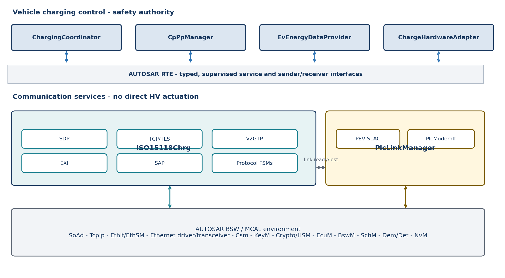

*Figure 1. Proposed EVCC layering and principal dependencies.*

## Dependency rule

Dependencies point downward to abstract services. Cross-domain communication goes through defined interfaces, never shared globals or direct calls into modem, socket, EXI, or actuator implementations. The communication path may be QM, but its outputs are treated as untrusted requests at the safety boundary.

## Environment dependencies that must stay explicit

| **Dependency**                      | **Owned by**              | **Required abstraction**                                  |
|-------------------------------------|---------------------------|-----------------------------------------------------------|
| CP/PP ADC, PWM and wake lines       | CpPpManager / MCAL        | CpPpHwIf; sampled values, edge events, diagnostics        |
| PLC modem SPI/UART/Ethernet control | PlcModemIf                | Reset, firmware status, MMEs, network key, link state     |
| IPv6 link-local and UDP/TCP sockets | TcpIp / SoAd              | Endpoint and connection services; no POSIX socket leakage |
| TLS and credentials                 | Csm / KeyM / Crypto/HSM   | Handshake, certificate validation, signing, key isolation |
| Persistent contracts/configuration  | NvM                       | Versioned records with integrity and rollback behavior    |
| Mode, startup and supervision       | EcuM / BswM / SchM / WdgM | Deterministic mode transitions and deadlines              |

# 3. Safety-related application SWCs

## 3.1 ChargingCoordinator - single charge authority

Strategy: implement a deterministic state machine that fuses qualified CP/PP status, BMS/OBC limits, isolation/interlock status, hardware feedback, PLC link state, and HLC outcomes. It emits the only ChargePermission and actuator intent used by the hardware layer.

- Reject stale, invalid, contradictory, or out-of-sequence inputs.

- Apply temporal guards and hysteresis to avoid oscillation during CP transitions or network retries.

- Latch safety-relevant faults where required; report a reason code and recovery preconditions.

- Keep policy and protocol choice separate from hard safety invariants.

## 3.2 CpPpManager

Strategy: own CP/PP acquisition, debounce, plausibility, cable current capability, CP state qualification, and PWM interpretation. Publish a QualifiedCpPp signal with value, quality, timestamp, sequence counter, and diagnostic status. A raw ADC value must never cross directly into the coordinator or HLC stack.

## 3.3 EvEnergyDataProvider

Strategy: create atomic snapshots from BMS, OBC, thermal, isolation and vehicle-state inputs. Validate units, ranges, age and cross-signal consistency. Provide protocol-neutral SI values plus explicit availability flags; let the ISO 15118 adapter perform protocol-specific scaling and encoding.

## 3.4 ChargeHardwareAdapter

Strategy: translate idempotent coordinator commands into contactor, precharge, lock, discharge and OBC/DC-path actions. Every command has an identifier, deadline, result, measured state and failure reason. On supervision loss, it moves to the independently defined safe state.

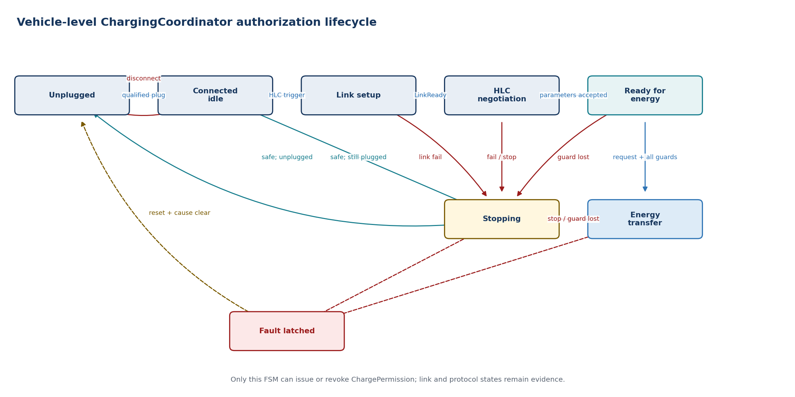

*Figure 2. Vehicle-level authorization state machine.*

# 4. Communication service strategy

## 4.1 ISO15118Chrg

Expose one stable EVCC service while keeping internal protocol mechanisms independently testable and replaceable. The public interface should be semantic: start or stop a session, supply capabilities and fresh energy data, receive negotiation results and session events.

| **Submodule**   | **Responsibility**                                                                                             | **Boundary / rule**                                                                             |
|-----------------|----------------------------------------------------------------------------------------------------------------|-------------------------------------------------------------------------------------------------|
| SDP             | Send SECC Discovery requests over IPv6 link-local UDP; validate response address, port and security selection. | Starts only after PLC and IPv6 readiness. Bounded retries and deterministic timeout outcome.    |
| TCP/TLS session | Open, supervise and close TCP; optionally establish TLS using platform crypto and credentials.                 | No private-key material in the protocol FSM. TLS policy is configuration plus session evidence. |
| V2GTP           | Frame and validate payload type and length; feed complete protocol payloads upward.                            | Enforce size limits before allocation/decoding; reject malformed or unsupported payloads.       |
| EXI             | Encode/decode schema-constrained messages and return structured errors.                                        | Treat decoder as an untrusted parser; bounded buffers, no heap growth, negative test corpus.    |
| SAP             | Negotiate the application protocol namespace and version.                                                      | Select only locally enabled protocol adapters; produce explicit no-match result.                |
| Protocol FSMs   | Implement DIN, ISO-2 and later ISO-20 message order, timers and response handling.                             | May request energy actions, but cannot authorize or execute them.                               |

## Recommended internal interfaces

- ISdpClient, ITransportSession, IV2gtpCodec and IExiCodec isolate infrastructure.

- IProtocolAdapter isolates DIN 70121, ISO 15118-2 and ISO 15118-20 state machines.

- IEvChargeContext provides immutable capability and energy snapshots.

- IHlcEventSink reports state, negotiated limits, requests, peer evidence and failures to ChargingCoordinator.

# 4.2 PlcLinkManager

PlcLinkManager owns the complete link lifecycle below IP: modem initialization, PEV-side SLAC matching, NMK/NID application, link supervision, retry limits and link teardown. ISO15118Chrg sees only LinkReady, LinkLost and link diagnostics.

## PEV-SLAC strategy

- Implement the vehicle-side ISO 15118-3 state machine with bounded timers, retries and validated MME fields.

- Keep raw Ethernet/HomePlug framing and vendor modem commands in PlcModemIf.

- Publish a session-scoped link token; reject late events belonging to an earlier plug session.

- On CP disconnect, coordinator stop, modem reset or link loss, cancel SLAC and invalidate network readiness.

| **REPOSITORY CAUTION pyslac is primarily organized around EVSE-side sessions; its repository includes a Scapy EV example, but that is not a production PEV-SLAC implementation. Reuse traces, message models and test ideas - not its runtime architecture.** |
|---------------------------------------------------------------------------------------------------------------------------------------------------------------------------------------------------------------------------------------------------------------|

## 4.3 Main startup and stop sequence

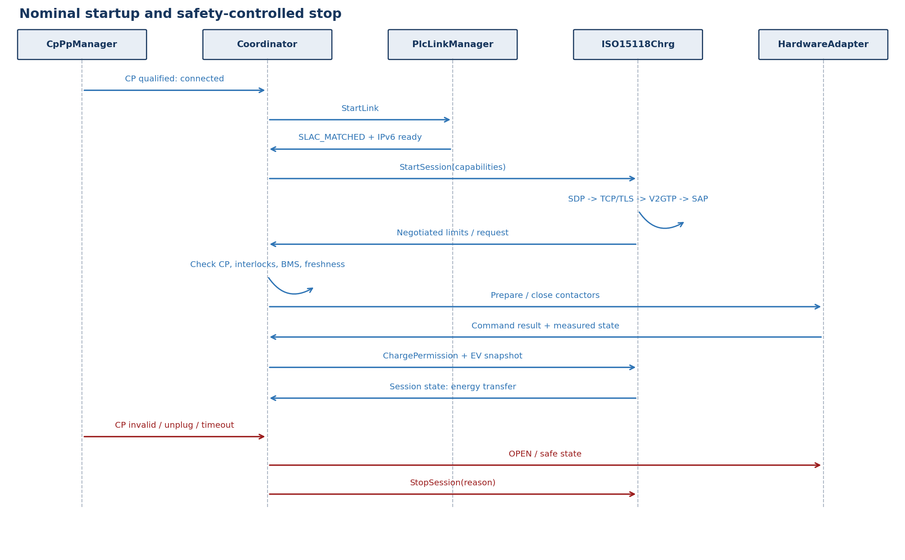

*Figure 3. Nominal startup plus the safety-controlled stop path.*

# 5. Interface contracts

All service boundaries use versioned types with explicit validity. Avoid APIs that expose Python objects, XML/EXI model classes, socket handles, modem frames or hardware registers outside their owning module.

| **Contract**       | **Producer -\> consumer**                          | **Minimum fields**                                                                               |
|--------------------|----------------------------------------------------|--------------------------------------------------------------------------------------------------|
| QualifiedCpPp      | CpPpManager -\> Coordinator                        | plug state, CP state, PP capacity, PWM mode/duty, quality, timestamp, counter, fault             |
| EnergySnapshot     | EvEnergyDataProvider -\> Coordinator / HLC adapter | SOC, voltage/current, limits, target, temperatures, isolation/interlock, availability, age       |
| LinkStatus         | PlcLinkManager -\> Coordinator / ISO15118Chrg      | state, session token, peer/modem evidence, IPv6 readiness, reason, timestamp                     |
| HlcEvent           | ISO15118Chrg -\> Coordinator                       | session/protocol state, peer request, negotiated limits, auth result, timeout/error, evidence id |
| ChargePermission   | Coordinator -\> HLC / HardwareAdapter              | allow/deny, allowed mode, bounded limits, validity window, reason, generation counter            |
| HwCommand / Result | Coordinator \<-\> HardwareAdapter                  | command id, desired state, deadline; result, measured state, diagnostic reason                   |

## Timing and concurrency rules

- Each plug event creates a new session generation; every asynchronous callback carries that generation.

- Use monotonic time for age and deadlines. Wall-clock time is only metadata.

- Queue depth, EXI payload size, certificate chain size and supported schedule points are compile-time/configuration limits.

- Cancellation is explicit and idempotent; late responses cannot reopen a stopped session.

- RTE data consistency or exclusive areas protect multi-signal snapshots; avoid cross-core shared mutable state.

## Fault reaction matrix

| **Fault**           | **Immediate owner action**                            | **Coordinator reaction**                                                 |
|---------------------|-------------------------------------------------------|--------------------------------------------------------------------------|
| CP invalid / unplug | CpPpManager publishes invalid/disconnected            | Remove permission; open energy path; stop HLC and PLC                    |
| PLC link lost       | PlcLinkManager invalidates link token                 | Controlled stop; do not trust active TCP state                           |
| SDP/TCP/TLS timeout | ISO15118Chrg closes transport and reports reason      | Apply configured fallback only if safety concept permits; otherwise stop |
| Malformed V2GTP/EXI | Reject before FSM; increment diagnostics              | Deny new action; terminate or safely stop active session                 |
| Stale BMS snapshot  | Provider marks invalid/stale                          | Remove charge permission and command safe state                          |
| Actuator mismatch   | HardwareAdapter reports failed command/measured state | Immediate safe-state path; latch/report as required                      |

# 6. Repository mapping and language strategy

## What the repositories already cover

| **Required block**      | **SwitchEV iso15118**                                         | **SwitchEV pyslac**                        | **AUTOSAR production decision**                               |
|-------------------------|---------------------------------------------------------------|--------------------------------------------|---------------------------------------------------------------|
| SDP                     | Yes - EVCC UDP transport and SDP messages                     | No                                         | Port behavior to SoAd/TcpIp IPv6 service                      |
| TCP/TLS                 | Yes - asyncio transport and security helpers                  | No                                         | Use SoAd/TcpIp plus Csm/KeyM/Crypto/HSM                       |
| V2GTP                   | Yes - message framing                                         | No                                         | Reimplement as bounded C/C++ codec                            |
| EXI                     | Yes - codec interface; community path may use Java EXIficient | No                                         | Select qualified/native embedded EXI codec; keep IExiCodec    |
| SAP and protocol FSMs   | Yes - EVCC DIN, ISO-2 and ISO-20 state modules                | No                                         | Translate behavior into deterministic C/C++ protocol adapters |
| PEV-SLAC                | EV example is outside this repository                         | Partial - EVSE focus plus EV Scapy example | Implement/adopt a production PEV-SLAC FSM                     |
| AUTOSAR/RTE/safety SWCs | No                                                            | No                                         | New vehicle-specific implementation                           |

## Is Python the implementation language?

For the referenced projects, yes: both require Python 3.9 or newer. For a production AUTOSAR Classic EVCC, the recommended implementation language is C or C++. Python remains valuable on the host side for golden traces, differential tests, certificate generation, schema/test-vector work, simulation, and interoperability automation.

## Reuse classification

| **Reuse directly**                                                               | **Translate / regenerate**                                   | **Do not couple**                                                                            |
|----------------------------------------------------------------------------------|--------------------------------------------------------------|----------------------------------------------------------------------------------------------|
| Schemas, examples, captured messages, negative tests, expected state transitions | Protocol FSM logic, timers, SDP/V2GTP rules, EXI data models | asyncio, POSIX/raw sockets, environment variables, Docker topology, Java process assumptions |

# 7. Delivery roadmap

1.  **Safety and interface contracts -** Complete HARA-derived safety requirements; define state ownership, freshness, safe states, RTE types, timeout budgets and diagnostics.

2.  **Vehicle foundation -** Implement CpPpManager, ChargingCoordinator skeleton, EnergySnapshot and simulated ChargeHardwareAdapter; prove stop paths first.

3.  **PLC link -** Integrate modem boot/control, production PEV-SLAC and link supervision; validate against multiple EVSE chipsets.

4.  **Network foundation -** Configure Eth/EthIf/EthSM, IPv6 link-local, SoAd/TcpIp and SDP; prove interface and lifecycle behavior without HLC.

5.  **HLC minimum viable stack -** Add bounded V2GTP, native EXI, SAP and DIN/ISO-2 EIM FSMs; use Python as the differential oracle.

6.  **Security and feature growth -** Integrate TLS, KeyM/Csm/HSM and PnC; then add ISO 15118-20 adapters and bidirectional services where required.

7.  **Qualification and release -** Static analysis, unit/MC/DC as applicable, fuzzing, SIL/HIL, conformance suites, fault injection and multi-vendor interoperability.

## Release gates

- No direct HLC-to-actuator path exists in code, configuration, or RTE wiring.

- Every transition to energy transfer has traceable evidence from CP/PP, interlocks, energy snapshot, link/session and hardware readiness.

- All asynchronous paths pass generation-token, timeout, cancellation and late-event tests.

- EXI/V2GTP parsers pass bounds, malformed-input and fuzz campaigns.

- Reference traces from the Python EVCC agree at semantic message and state-transition level.

- Safe-stop latency is measured under link loss, ECU load, modem reset and diagnostic fault injection.

## Key decisions still required

| **Decision**                             | **Why it matters**                                                                              |
|------------------------------------------|-------------------------------------------------------------------------------------------------|
| AUTOSAR Classic release and vendor stack | Determines available ISO15118Chrg maturity, TcpIp/SoAd APIs and integration constraints.        |
| ASIL decomposition and ECU partitioning  | Determines freedom-from-interference, memory/time protection and safety mechanism depth.        |
| EXI product and generation flow          | Dominates interoperability, memory footprint, qualification evidence and protocol upgrade cost. |
| PLC modem and host interface             | Determines raw MME access, network-key handling, diagnostics and boot timing.                   |
| Initial protocol/authentication scope    | Controls schedule: ISO-2 EIM is materially smaller than PnC plus ISO-20/BPT.                    |

# 8. Verification strategy

| **Level**         | **Primary objective**                         | **Representative evidence**                                                   |
|-------------------|-----------------------------------------------|-------------------------------------------------------------------------------|
| Module unit       | Correct states, timers, codecs and validation | Boundary tests, transition coverage, generated vectors, static analysis       |
| Differential      | Match reference semantics                     | Python EVCC/SECC traces compared with C/C++ encode/decode and FSM results     |
| SIL               | RTE contracts and cancellation behavior       | Virtual modem/socket faults, stale data, reordered and late callbacks         |
| HIL               | Electrical and timing behavior                | CP/PP transitions, PLC attenuation, modem reset, contactor/precharge feedback |
| Conformance       | Standard protocol correctness                 | ISO/DIN conformance tests, TLS/PKI cases, negative EXI/V2GTP corpus           |
| Interoperability  | Real ecosystem behavior                       | Multiple EVSE vendors, PLC chipsets, certificates and backend conditions      |
| Safety validation | Fault control and safe-state timing           | Fault injection, watchdog loss, resource exhaustion, independent measurements |

## Recommended test-oracle arrangement

Run the SwitchEV Python EVCC/SECC in a Linux integration environment with IPv6 link-local networking. Capture semantic messages, V2GTP frames, EXI payloads, state transitions and timeout results. Replay the same vectors into the native modules and compare normalized outcomes. Keep this bench tooling outside the production ECU build and safety case.

| **DEFINITION OF DONE The vehicle remains safe when any communication component is absent, delayed, reset, malformed, compromised, or internally inconsistent; the charging session can only progress when all required evidence is fresh and mutually consistent.** |
|---------------------------------------------------------------------------------------------------------------------------------------------------------------------------------------------------------------------------------------------------------------------|

# 9. Detailed component specifications

This catalogue applies a common specification pattern to every major component: interface contract, behavior, state machine, timing and failure handling. Port names are proposed AUTOSAR design names. Exact runnable periods and timeout values remain project configuration constrained by the selected standards release, HARA and ECU timing analysis.

| **Specification rule** | **Application**                                                                                                 |
|------------------------|-----------------------------------------------------------------------------------------------------------------|
| State ownership        | Each state is written by one component only; other components receive events or qualified snapshots.            |
| Validity               | Every asynchronous event carries sessionGeneration, timestamp, sequenceCounter and result/reason.               |
| Safety boundary        | Communication outputs are requests or evidence. Only ChargingCoordinator issues ChargePermission.               |
| Cancellation           | Stop operations are idempotent. Late events from older generations are rejected.                                |
| Configuration          | Protocol selection, timers, retries, payload limits and feature flags are versioned configuration.              |
| Diagnostics            | Failures map to stable reason codes and Dem events without exposing parser/modem internals to application SWCs. |

| **READING CONVENTION Direction is stated from the named module perspective. “Provided” means the module publishes or implements the port; “Required” means it consumes or calls it.** |
|---------------------------------------------------------------------------------------------------------------------------------------------------------------------------------------|

# 9.1 ChargingCoordinator

| **RESPONSIBILITY Sole vehicle-level authority for charging progression, energy permission and safe-stop coordination. It consumes qualified evidence; it never parses protocol frames or drives hardware registers.** |
|-----------------------------------------------------------------------------------------------------------------------------------------------------------------------------------------------------------------------|

## Interface specification

| **Port / operation** | **Direction** | **Type or payload**           | **Trigger / contract**                             |
|----------------------|---------------|-------------------------------|----------------------------------------------------|
| Rp_CpPpStatus        | Required      | QualifiedCpPp                 | Cyclic/event; reject invalid or stale generation   |
| Rp_EnergySnapshot    | Required      | EvEnergySnapshot              | Atomic snapshot with availability and age          |
| Rp_PlcLinkStatus     | Required      | PlcLinkStatus                 | Event/cyclic; LinkReady is prerequisite only       |
| Rp_HlcEvent          | Required      | HlcEvent                      | Session, peer request, limits and failure evidence |
| Pp_ChargePermission  | Provided      | ChargePermission              | Cyclic or on change; bounded validity window       |
| Pp_HwControl         | Provided      | Prepare/Enable/Stop/SafeState | Async idempotent command with commandId            |
| Pp_PlcControl        | Provided      | StartLink/StopLink            | Carries current sessionGeneration                  |
| Pp_HlcControl        | Provided      | StartSession/StopSession      | Protocol-neutral start/stop service                |

## Behavior

- Create one new sessionGeneration for each qualified plug session.

- Evaluate hard safety invariants before policy, protocol preference or fallback behavior.

- Authorize energy only when CP/PP, BMS/OBC, isolation, interlocks, HLC, PLC and hardware evidence are mutually consistent.

- Revoke permission before requesting HLC or PLC teardown.

- Latch faults and define recovery conditions according to the vehicle safety concept.

**Timing note.** Recommended runnable: deterministic safety-cycle selected by the program. Every permission includes validUntil; expiry is interpreted as deny.

## State machine

**State basis.** *Proposed AUTOSAR architectural FSM derived from this module responsibility; it is not claimed as a state machine supplied by the Python repositories.*

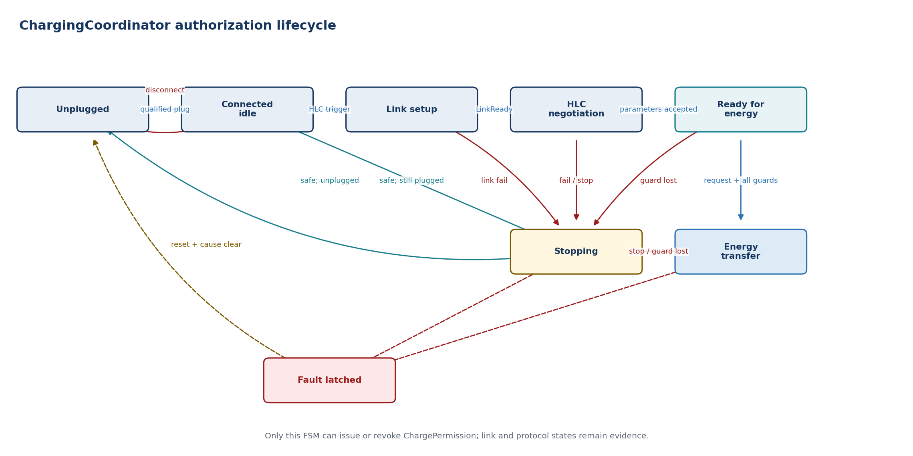

| **State**        | **Entry / activity**                                       | **Exit or failure transition**                             |
|------------------|------------------------------------------------------------|------------------------------------------------------------|
| Unplugged        | Invalidate session; command open/safe state                | Qualified connected status -\> Connected idle              |
| Connected idle   | Create session; validate vehicle availability              | HLC trigger -\> Link setup                                 |
| Link setup       | Request PLC link and supervise deadline                    | LinkReady -\> HLC negotiation; failure -\> Stopping        |
| HLC negotiation  | Start HLC and evaluate negotiated service                  | Accepted parameters -\> Ready for energy                   |
| Ready for energy | Coordinate isolation, cable check, precharge and readiness | Valid PowerDelivery request and guards -\> Energy transfer |
| Energy transfer  | Publish bounded permission; supervise all evidence         | Stop/fault/stale/link loss -\> Stopping or Fault           |
| Stopping         | Deny permission; stop energy path, HLC and PLC             | Safe confirmation -\> Connected or Unplugged               |
| Fault latched    | Maintain safe state and diagnostic evidence                | Configured reset/unplug and cleared cause -\> Unplugged    |

| **FAULT HANDLING CP disconnect, isolation failure, stale safety data or actuator mismatch removes permission immediately. Communication loss uses a controlled stop only where the safety concept allows it.** |
|----------------------------------------------------------------------------------------------------------------------------------------------------------------------------------------------------------------|

## Dependencies

RTE, OS/SchM timing, BswM/EcuM vehicle mode, Dem diagnostics, WdgM supervision and NvM policy/configuration. It has no direct SoAd, EXI, modem or actuator-register dependency.

# 9.2 CpPpManager

| **RESPONSIBILITY Qualifies Control Pilot and Proximity Pilot electrical measurements into stable, time-aware charging connection evidence.** |
|----------------------------------------------------------------------------------------------------------------------------------------------|

## Interface specification

| **Port / operation** | **Direction** | **Type or payload**           | **Trigger / contract**                            |
|----------------------|---------------|-------------------------------|---------------------------------------------------|
| Rp_CpPpHw            | Required      | ADC/PWM/DIO samples           | Hardware abstraction; no raw sample leaves module |
| Rp_OperatingMode     | Required      | Ecu/vehicle mode              | Enable, sleep, wake and diagnostic modes          |
| Pp_QualifiedCpPp     | Provided      | QualifiedCpPp                 | Cyclic plus event on qualified transition         |
| Pp_CpPpEvent         | Provided      | Connect/Disconnect/HlcTrigger | Debounced event with session candidate            |
| Pp_CpPpDiag          | Provided      | CpPpDiagnostic                | Short/open/range/frequency/plausibility reason    |

## Behavior

- Sample CP positive/negative levels, frequency/duty and PP resistance through a hardware abstraction.

- Debounce and apply hysteresis independently to electrical detection and published logical state.

- Calculate cable current capability and validate it against connector/vehicle configuration.

- Detect HLC trigger conditions while keeping PWM interpretation separate from ISO 15118 processing.

- Publish quality, timestamp and sequence counter with every qualified state.

**Timing note.** Proposed acquisition and qualification periods are project values; debounce must be shorter than applicable protocol/safety deadlines and supported by worst-case timing analysis.

## State machine

**State basis.** *Proposed AUTOSAR architectural FSM derived from this module responsibility; it is not claimed as a state machine supplied by the Python repositories.*

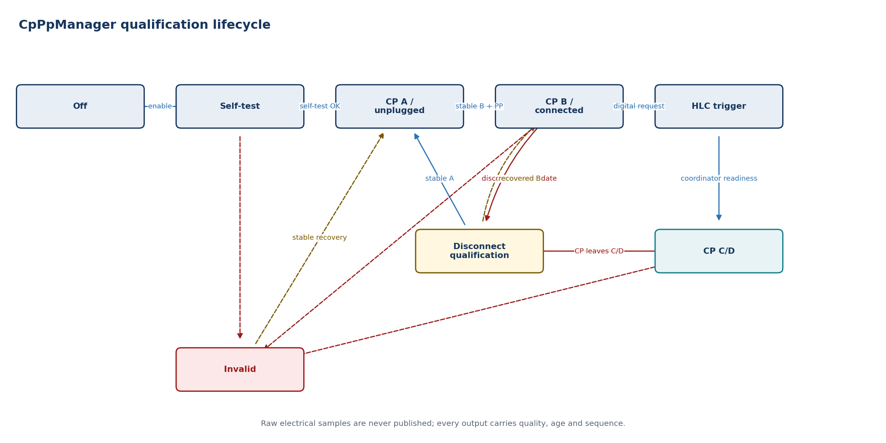

| **State**                | **Entry / activity**                             | **Exit or failure transition**                                                     |
|--------------------------|--------------------------------------------------|------------------------------------------------------------------------------------|
| Off                      | Outputs invalid; hardware low power              | Mode enable or wake -\> Self-test                                                  |
| Self-test                | Check acquisition path and configuration         | Valid -\> CP A; failure -\> Invalid                                                |
| CP A / unplugged         | Monitor for qualified connection                 | Stable CP B and PP -\> Connected                                                   |
| CP B / connected         | Publish connection and cable capability          | Digital request -\> HLC trigger; disconnect candidate -\> Disconnect qualification |
| HLC trigger              | Publish high-level communication request         | Coordinator progression or CP change                                               |
| CP C/D                   | Publish charge-capable state with quality        | CP change -\> Disconnect qualification; implausibility -\> Invalid                 |
| Disconnect qualification | Debounce loss of connection/charge-capable state | Stable A -\> CP A; recovered state -\> CP B or CP C/D                              |
| Invalid                  | Publish invalid quality and diagnostic reason    | Stable recovery -\> corresponding qualified state                                  |

| **FAULT HANDLING Invalid or implausible CP/PP is never converted into the last-known-good state. The published quality changes to invalid and the coordinator decides the safe reaction.** |
|--------------------------------------------------------------------------------------------------------------------------------------------------------------------------------------------|

## Dependencies

ADC/ICU/PWM/DIO MCAL or a dedicated CP transceiver driver, EcuM wakeup, Dem/Det, SchM timing and RTE. Hardware filtering and diagnostics remain platform-specific.

# 9.3 EvEnergyDataProvider

| **RESPONSIBILITY Builds protocol-neutral, atomic and validated snapshots of EV energy capability and status from BMS, OBC, thermal, isolation and vehicle data.** |
|-------------------------------------------------------------------------------------------------------------------------------------------------------------------|

## Interface specification

| **Port / operation**  | **Direction** | **Type or payload**                | **Trigger / contract**                                |
|-----------------------|---------------|------------------------------------|-------------------------------------------------------|
| Rp_BmsData            | Required      | SOC, voltage, current and limits   | Multiple sources captured into one consistency window |
| Rp_ChargingDeviceData | Required      | OBC/DC path state and limits       | Availability and measured values                      |
| Rp_SafetyData         | Required      | Isolation/interlock/thermal status | Safety freshness is independently supervised          |
| Pp_EnergySnapshot     | Provided      | EvEnergySnapshot                   | Immutable snapshot with snapshotId and timestamp      |
| Pp_GetCapabilities    | Provided      | EvChargeCapabilities               | Read service for static/session capabilities          |
| Pp_EnergyDiag         | Provided      | EnergyDataDiagnostic               | Range, unit, missing-source and consistency reason    |

## Behavior

- Capture related values atomically or within a defined consistency window.

- Normalize internal signals to SI units and explicit sign conventions.

- Validate range, availability, age and cross-signal plausibility before publication.

- Separate static capabilities from fast-changing measurements and requested targets.

- Do not perform DIN/ISO scaling or EXI encoding; protocol adapters own that mapping.

**Timing note.** Each field has a maximum age; the snapshot has an overall validity deadline equal to the strictest required constituent.

## State machine

**State basis.** *Proposed AUTOSAR architectural FSM derived from this module responsibility; it is not claimed as a state machine supplied by the Python repositories.*

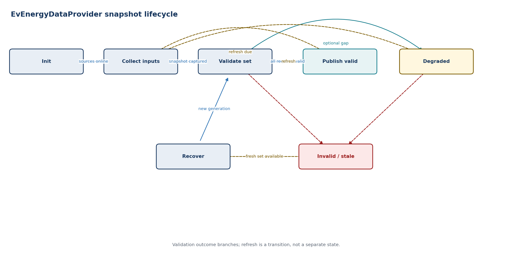

| **State**      | **Entry / activity**                          | **Exit or failure transition**                                                         |
|----------------|-----------------------------------------------|----------------------------------------------------------------------------------------|
| Init           | Load configuration; mark unavailable          | Required sources online -\> Collect                                                    |
| Collect inputs | Capture source generation/timestamps          | Complete set -\> Validate                                                              |
| Validate set   | Run range, age and consistency checks         | Valid -\> Publish valid; optional gap -\> Degraded; required invalid -\> Invalid/stale |
| Publish valid  | Publish immutable snapshot                    | Refresh deadline -\> Collect                                                           |
| Degraded       | Publish allowed optional omissions and reason | Refresh -\> Collect; required input lost -\> Invalid/stale                             |
| Invalid/stale  | Explicitly invalidate safety-relevant fields  | Fresh consistent set -\> Recover                                                       |
| Recover        | Create new snapshot generation                | Captured set -\> Validate set                                                          |

| **FAULT HANDLING A missing or stale safety-relevant field invalidates the snapshot. Optional protocol fields may be marked unavailable only when the selected protocol permits omission.** |
|--------------------------------------------------------------------------------------------------------------------------------------------------------------------------------------------|

## Dependencies

RTE data from BMS/OBC/thermal/isolation SWCs, SchM/OS timebase, Dem diagnostics and NvM configuration. No dependency on protocol message classes or EXI types.

# 9.4 ChargeHardwareAdapter

| **RESPONSIBILITY Executes coordinator-owned charging hardware commands and returns independently measured results. It owns sequencing details, but not the decision to allow energy transfer.** |
|-------------------------------------------------------------------------------------------------------------------------------------------------------------------------------------------------|

## Interface specification

| **Port / operation** | **Direction** | **Type or payload**               | **Trigger / contract**                                |
|----------------------|---------------|-----------------------------------|-------------------------------------------------------|
| Rp_HwCommand         | Required      | HwCommand                         | Idempotent async command with commandId/deadline      |
| Pp_HwResult          | Provided      | HwCommandResult                   | Accepted/completed/failed plus measured state         |
| Pp_HwStatus          | Provided      | ChargeHardwareStatus              | Cyclic contactor, lock, precharge and discharge state |
| Rp_SafeStateRequest  | Required      | Immediate safe-state request      | Highest-priority path; independent of HLC             |
| Rp_ActuatorHw        | Required      | Contactor/lock/OBC/DC-path driver | Platform hardware abstraction                         |
| Pp_HwDiag            | Provided      | HardwareDiagnostic                | Mismatch, timeout, welded contactor and driver fault  |

## Behavior

- Accept commands only from ChargingCoordinator and reject obsolete session generations.

- Make Prepare, Enable, Stop and SafeState operations idempotent and observable.

- Sequence lock, precharge, contactors and discharge according to selected AC/DC hardware topology.

- Confirm results from measured feedback rather than command echo.

- Enter the defined safe state on supervision loss or command deadline expiry.

**Timing note.** Command-specific deadlines are configuration. Deadline expiry generates a failed result and invokes safe-state handling.

## State machine

**State basis.** *Proposed AUTOSAR architectural FSM derived from this module responsibility; it is not claimed as a state machine supplied by the Python repositories.*

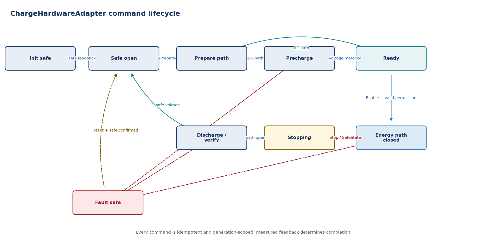

| **State**          | **Entry / activity**                                         | **Exit or failure transition**                     |
|--------------------|--------------------------------------------------------------|----------------------------------------------------|
| Init safe          | Drive de-energized outputs; validate feedback                | Safe feedback -\> Safe open                        |
| Safe open          | Monitor and accept Prepare                                   | Prepare -\> Prepare path                           |
| Prepare path       | Lock/check path and prerequisites                            | DC precharge -\> Precharge; AC readiness -\> Ready |
| Precharge          | Control voltage equalization and timeout                     | Target reached -\> Ready                           |
| Ready              | Report readiness; wait for Enable                            | Valid enable -\> Energy path closed                |
| Energy path closed | Supervise contactors and measured state                      | Stop/safe request -\> Stopping                     |
| Stopping           | Open energy path and disable converter                       | Open confirmed -\> Discharge/verify                |
| Discharge/verify   | Discharge and verify safe voltage/state                      | Safe -\> Safe open; mismatch -\> Fault safe        |
| Fault safe         | Drive independent safe-state path; invalidate command result | Reset/cause clear and safe feedback -\> Safe open  |

| **FAULT HANDLING Measured-state disagreement, welded contactor evidence, failed discharge or control supervision loss takes the independent safe-state path and may latch until service/reset.** |
|--------------------------------------------------------------------------------------------------------------------------------------------------------------------------------------------------|

## Dependencies

RTE, IO/HW abstraction, PWM/DIO/ADC/SPI drivers, ICU, Dem, WdgM and platform power-mode services. The independent safe-state mechanism is defined by the safety concept.

# 10.1 ISO15118Chrg session supervisor

| **RESPONSIBILITY Owns the high-level communication session lifecycle and dispatches common transport services to the selected DIN or ISO protocol adapter. When implemented as the AUTOSAR BSW module, its ASW boundary preserves the R25-11 ChargeControl and ChargeParameters service interfaces. It reports semantic outcomes, never hardware commands.** |
|--------------------------------------------------------------------------------------------------------------------------------------------------------------------------------------------------------------------------------------------------------------------------------------------------------------------------------------------------------------|

## Interface specification

| **Port / operation** | **Direction**      | **Type or payload**                               | **Trigger / contract**                                                                     |
|----------------------|--------------------|---------------------------------------------------|--------------------------------------------------------------------------------------------|
| ChargeControlPort    | Provided C/S       | AUTOSAR ChargeControl                             | SetChargeState and SetCpLineStatus from ASW                                                |
| ChargeParametersPort | Required C/S       | AUTOSAR ChargeParameters                          | Message parameters, state, SLAC, connection and error exchange with ASW                    |
| DataLinkIndication   | BSW callback       | EthTrcv_LinkStateType                             | Physical/data-link evidence; invalidates communication immediately on loss                 |
| Rp_SoAd_PduR_TcpIp   | Required BSW APIs  | Socket, PDU and IPv6 services                     | SDP via UDP; V2GTP transport via TP; no POSIX socket leakage                               |
| Rp_CryptoServices    | Required BSW APIs  | TLS, Csm, KeyM, Crypto/HSM                        | Credential and crypto operations remain platform-owned                                     |
| Pp_HlcSessionAdapter | Project ASW facade | HlcSessionStatus / HlcEvent                       | Adds session generation, freshness and stable semantic events without changing AUTOSAR ABI |
| Internal services    | Local C interfaces | SDP, transport, V2GTP, EXI, SAP, protocol adapter | Replaceable, bounded implementation seams; not public RTE ports                            |

## Behavior

- Create a session context keyed by sessionGeneration and reject callbacks from older contexts.

- Perform SDP, transport establishment, SAP and protocol-adapter creation in order.

- Translate internal protocol states into stable HlcEvent categories.

- Check ChargePermission before sending any message that represents vehicle readiness for energy.

- Close transport and erase transient security/session state during every stop path.

**Timing note.** Timers are owned at the lowest layer that can decide expiry: transport deadlines in transport; message deadlines in the protocol adapter; overall session supervision in the supervisor.

## State machine

**State basis.** *Proposed AUTOSAR architectural FSM derived from this module responsibility; it is not claimed as a state machine supplied by the Python repositories.*

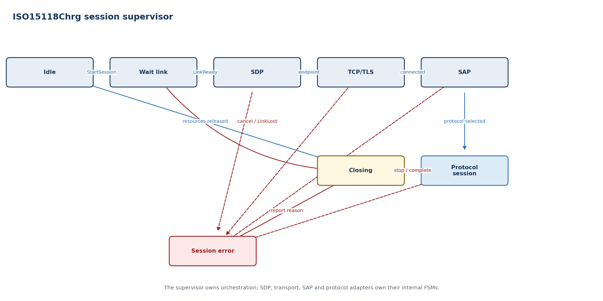

| **State**        | **Entry / activity**                          | **Exit or failure transition**       |
|------------------|-----------------------------------------------|--------------------------------------|
| Idle             | No endpoint, transport or protocol context    | StartSession -\> Wait link           |
| Wait link        | Hold request while link becomes ready         | LinkReady -\> SDP; timeout -\> Error |
| SDP              | Discover and validate SECC endpoint           | Endpoint -\> TCP/TLS                 |
| TCP/TLS          | Establish configured transport                | Connected -\> SAP                    |
| SAP              | Negotiate enabled application protocol        | Selection -\> Protocol session       |
| Protocol session | Run selected adapter and message timers       | Stop/complete -\> Closing            |
| Closing          | Cancel timers, close transport, report result | Resources released -\> Idle          |
| Session error    | Report stable reason and force closing        | Reason published -\> Closing         |

| **FAULT HANDLING Malformed messages, timer expiry, link loss, permission loss or cancellation close the session and report a semantic reason to ChargingCoordinator.** |
|------------------------------------------------------------------------------------------------------------------------------------------------------------------------|

## Dependencies

RTE, PlcLinkManager, SoAd/TcpIp, Csm/KeyM/Crypto/HSM, Dem, NvM and protocol/codec modules. POSIX socket, filesystem and environment-variable assumptions are not allowed in the ECU API.

# 10.2 SDP client

| **RESPONSIBILITY Discovers the SECC IPv6 endpoint and advertised transport security using UDP over the PLC IPv6 link-local interface.** |
|-----------------------------------------------------------------------------------------------------------------------------------------|

## Interface specification

| **Port / operation** | **Direction** | **Type or payload**                | **Trigger / contract**                                  |
|----------------------|---------------|------------------------------------|---------------------------------------------------------|
| Pp_DiscoverEndpoint  | Provided      | SdpRequest/SdpResult               | Async operation scoped to sessionGeneration             |
| Rp_LinkContext       | Required      | Interface index and IPv6 readiness | Must be ready before request                            |
| Rp_UdpSocket         | Required      | SoAd/TcpIp UDP service             | Link-local multicast/unicast communication              |
| Pp_SdpDiag           | Provided      | SdpDiagnostic                      | Timeout, invalid version/type, endpoint/security reason |

## Behavior

- Build the SDP request from requested transport and security policy.

- Bind to the correct PLC network interface and IPv6 scope.

- Validate V2GTP header, SDP payload, address, port, transport and security fields.

- Apply bounded retry count and backoff; cancel immediately on LinkLost or StopSession.

- For DIN SPEC 70121, accept only TCP with no transport-layer security.

**Timing note.** Retry count and timers are configured per supported protocol set and verified against applicable ISO/DIN requirements.

## State machine

**State basis.** *Proposed AUTOSAR architectural FSM derived from this module responsibility; it is not claimed as a state machine supplied by the Python repositories.*

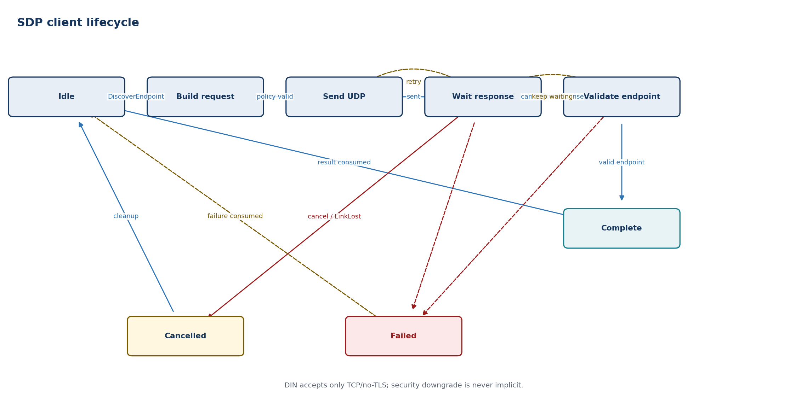

| **State**         | **Entry / activity**                                 | **Exit or failure transition**            |
|-------------------|------------------------------------------------------|-------------------------------------------|
| Idle              | No UDP operation                                     | DiscoverEndpoint -\> Build request        |
| Build request     | Encode and validate local policy                     | Valid -\> Send                            |
| Send UDP          | Transmit on current PLC interface                    | Sent -\> Wait response                    |
| Wait response     | Filter by generation and expected payload            | Frame -\> Validate; timer -\> Retry/fail  |
| Validate endpoint | Validate address, port, transport and security       | Valid -\> Complete; invalid -\> wait/fail |
| Complete          | Return immutable endpoint result                     | Acknowledged/cancelled -\> Idle           |
| Failed            | Return bounded timeout or policy reason              | Failure consumed -\> Idle                 |
| Cancelled         | Stop timer/socket activity and invalidate candidates | Cleanup complete -\> Idle                 |

| **FAULT HANDLING Reject responses from the wrong interface, generation or payload type. Do not silently downgrade security unless explicit vehicle policy permits it.** |
|-------------------------------------------------------------------------------------------------------------------------------------------------------------------------|

## Dependencies

SoAd/TcpIp, EthIf/EthSM interface status, V2GTP framing and SchM/OS timers. It has no EXI or charge-hardware dependency.

# 10.3 TCP/TLS session

| **RESPONSIBILITY Provides bounded, cancellable stream transport and optional TLS while isolating SoAd/TcpIp and cryptographic implementation details from protocol FSMs.** |
|----------------------------------------------------------------------------------------------------------------------------------------------------------------------------|

## Interface specification

| **Port / operation** | **Direction** | **Type or payload**                   | **Trigger / contract**                     |
|----------------------|---------------|---------------------------------------|--------------------------------------------|
| Pp_Connect           | Provided      | Endpoint + security policy            | Async; returns connectionHandle            |
| Pp_Send              | Provided      | Buffer view + deadline                | All-or-error semantic result               |
| Pp_Receive           | Provided      | Bounded receive indication            | Stream bytes tagged with handle/generation |
| Pp_Close             | Provided      | Close reason                          | Idempotent and cancellable                 |
| Rp_SoAdTcpIp         | Required      | Socket/connection services            | AUTOSAR network stack                      |
| Rp_CryptoKey         | Required      | TLS, certificate and signing services | Csm/KeyM/HSM; no key export                |

## Behavior

- Open TCP only to the endpoint returned by the current SDP result.

- Perform TLS according to selected protocol and policy; expose peer/security evidence, not private keys.

- Maintain bounded transmit/receive queues with explicit backpressure.

- Convert stream fragments into ordered byte indications without assuming V2GTP message boundaries.

- Cancel connect, handshake and I/O on session stop or link loss.

**Timing note.** Connection, handshake and I/O deadlines are separate. Queue and buffer budgets are fixed by configuration.

## State machine

**State basis.** *Proposed AUTOSAR architectural FSM derived from this module responsibility; it is not claimed as a state machine supplied by the Python repositories.*

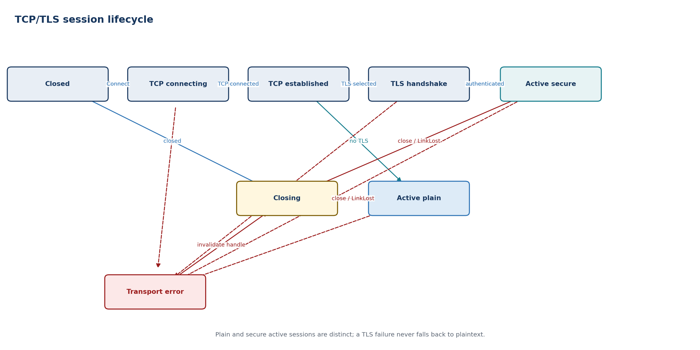

| **State**       | **Entry / activity**                       | **Exit or failure transition**                                        |
|-----------------|--------------------------------------------|-----------------------------------------------------------------------|
| Closed          | No socket or crypto context                | Connect -\> TCP connecting                                            |
| TCP connecting  | Request active SoAd/TcpIp connection       | Connected -\> TCP established                                         |
| TCP established | Apply endpoint security policy             | No TLS -\> Active plain; TLS -\> TLS handshake                        |
| TLS handshake   | Validate peer/cipher/certificates          | Success -\> Active secure; failure -\> Transport error                |
| Active plain    | Send/receive supervised plaintext stream   | Close/link loss -\> Closing; I/O failure -\> Transport error          |
| Active secure   | Send/receive supervised TLS stream         | Close/link loss -\> Closing; I/O/security failure -\> Transport error |
| Closing         | Cancel I/O and release crypto/socket state | Closed indication -\> Closed                                          |
| Transport error | Invalidate handle and queued callbacks     | Error reported -\> Closing                                            |

| **FAULT HANDLING A transport error invalidates the connection handle and all queued callbacks. Security failure is never retried as plaintext unless a separately authorized policy path exists.** |
|----------------------------------------------------------------------------------------------------------------------------------------------------------------------------------------------------|

## Dependencies

SoAd, TcpIp, EthSM, Csm, KeyM, Crypto/HSM, SchM timers and Dem. The TLS feature set depends on the selected AUTOSAR/vendor stack.

# 10.4 V2GTP codec

| **RESPONSIBILITY Frames and validates V2G Transport Protocol messages while protecting upper layers from malformed payload type, version and length fields.** |
|---------------------------------------------------------------------------------------------------------------------------------------------------------------|

## Interface specification

| **Port / operation** | **Direction** | **Type or payload**            | **Trigger / contract**                            |
|----------------------|---------------|--------------------------------|---------------------------------------------------|
| Pp_EncodeFrame       | Provided      | Payload type + bounded payload | Returns complete V2GTP frame or size error        |
| Pp_ConsumeBytes      | Provided      | Stream byte span               | Returns zero or more complete frames              |
| Pp_V2gtpFrame        | Provided      | Validated payload view         | Immutable, bounded lifetime                       |
| Pp_V2gtpDiag         | Provided      | Codec error                    | Version, inverse, type, length or overflow reason |

## Behavior

- Validate protocol version and inverse-version relationship before accepting length.

- Validate payload type against current phase and enabled protocol family.

- Reject lengths above the compile-time/configured maximum before allocation.

- Support partial headers, fragmented payloads and multiple frames in one receive indication.

- Return structured errors without logging sensitive payloads by default.

**Timing note.** Parsing is incremental and bounded. No declared peer length may cause dynamic unbounded allocation.

## State machine

**State basis.** *Proposed AUTOSAR architectural FSM derived from this module responsibility; it is not claimed as a state machine supplied by the Python repositories.*

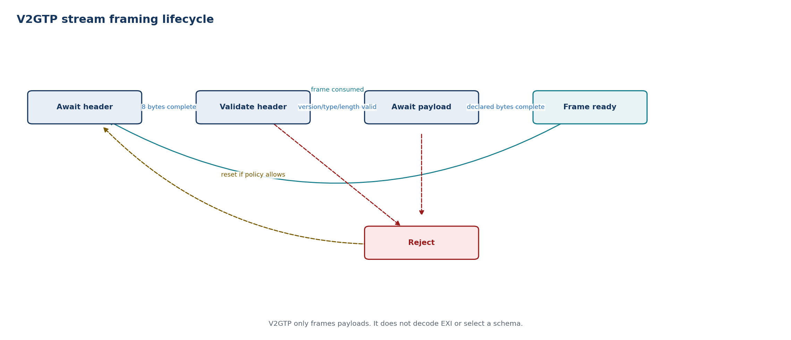

| **State**       | **Entry / activity**                       | **Exit or failure transition**                      |
|-----------------|--------------------------------------------|-----------------------------------------------------|
| Await header    | Accumulate fixed header bytes              | Complete header -\> Validate                        |
| Validate header | Check version, type and length bounds      | Valid -\> Assemble payload; invalid -\> Reject      |
| Await payload   | Accumulate exactly declared bounded length | Complete -\> Frame ready; overflow/abort -\> Reject |
| Frame ready     | Return validated payload view              | Consumed -\> Await header                           |
| Reject          | Discard defined scope; report reason       | Connection policy -\> Await header or close         |

| **FAULT HANDLING Header inconsistency, unsupported payload type or oversize length produces a deterministic rejection and normally closes the HLC session.** |
|--------------------------------------------------------------------------------------------------------------------------------------------------------------|

## Dependencies

TCP/TLS byte stream, configured payload limits, Dem/Det and protocol/SAP consumers. It does not depend on EXI schemas or application data.

# 10.5 EXI codec

| **RESPONSIBILITY Encodes and decodes schema-informed DIN/ISO messages behind a stable codec interface with bounded resources and protocol-specific schema selection.** |
|------------------------------------------------------------------------------------------------------------------------------------------------------------------------|

## Interface specification

| **Port / operation** | **Direction** | **Type or payload**        | **Trigger / contract**                            |
|----------------------|---------------|----------------------------|---------------------------------------------------|
| Pp_ExiEncode         | Provided      | ProtocolId + typed message | Bounded EXI byte result                           |
| Pp_ExiDecode         | Provided      | ProtocolId + EXI byte view | Typed message or structured decode error          |
| Rp_SchemaRegistry    | Required      | SchemaId/version tables    | Immutable generated schema metadata               |
| Pp_ExiDiag           | Provided      | Codec diagnostic           | Schema, range, grammar, size and signature reason |

## Behavior

- Select schemas explicitly from the negotiated protocol; never infer them from untrusted content.

- Use fixed/bounded workspaces and generated types suitable for automotive C/C++.

- Validate occurrence counts, string lengths, numeric ranges and optional-field presence.

- Separate XML signature processing from generic EXI grammar where platform crypto is required.

- Maintain golden-vector compatibility against the Python reference implementation.

**Timing note.** Worst-case encode/decode time and workspace size are measured for maximum supported messages and schedule points.

## State machine

**State basis.** *Proposed AUTOSAR architectural FSM derived from this module responsibility; it is not claimed as a state machine supplied by the Python repositories.*

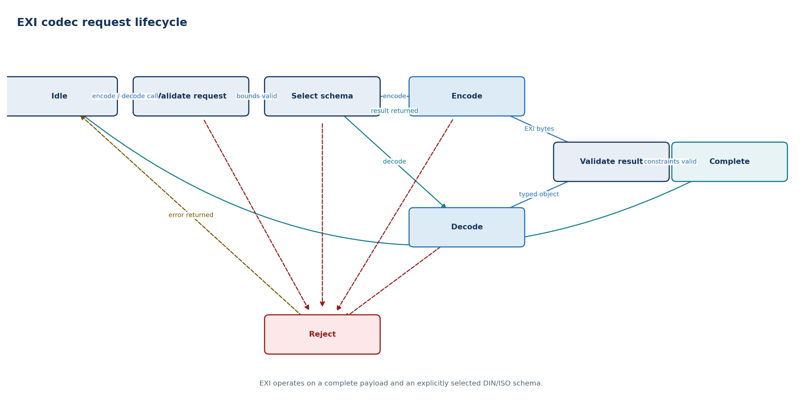

| **State**        | **Entry / activity**                               | **Exit or failure transition**                              |
|------------------|----------------------------------------------------|-------------------------------------------------------------|
| Idle             | Codec workspace reset                              | Encode/decode request -\> Validate request                  |
| Validate request | Check protocol and buffer/workspace bounds         | Valid -\> Select schema; invalid -\> Reject                 |
| Select schema    | Resolve the explicitly negotiated grammar          | Encode request -\> Encode; decode request -\> Decode        |
| Encode           | Execute bounded schema-informed encoding           | Bytes produced -\> Validate result; error -\> Reject        |
| Decode           | Execute bounded schema-informed decoding           | Typed object produced -\> Validate result; error -\> Reject |
| Validate result  | Check generated-type constraints and output bounds | Valid -\> Complete; invalid -\> Reject                      |
| Complete         | Return bytes or typed object                       | Return -\> Idle                                             |
| Reject           | Zero transient state and return reason             | Return -\> Idle                                             |

| **FAULT HANDLING Any grammar, constraint, buffer or signature error rejects the message. Partially decoded data is never delivered to a protocol FSM.** |
|---------------------------------------------------------------------------------------------------------------------------------------------------------|

## Dependencies

Generated DIN/ISO schema code, fixed memory pools, Csm for signature-related operations, Dem/Det and the selected production EXI product. Java/JRE is restricted to host tooling, not the ECU runtime.

# 10.6 SupportedAppProtocol negotiator

| **RESPONSIBILITY Advertises enabled application protocols and constructs exactly one protocol adapter from a valid SECC selection.** |
|--------------------------------------------------------------------------------------------------------------------------------------|

## Interface specification

| **Port / operation** | **Direction** | **Type or payload**           | **Trigger / contract**                   |
|----------------------|---------------|-------------------------------|------------------------------------------|
| Pp_Negotiate         | Provided      | Ordered ProtocolOffer list    | Async SAP exchange over active transport |
| Rp_EnabledProtocols  | Required      | DIN/ISO versions and priority | Versioned vehicle configuration          |
| Rp_ExiCodec          | Required      | SAP grammar encode/decode     | Dedicated SAP namespace                  |
| Pp_ProtocolSelection | Provided      | ProtocolId + schemaId         | Validated immutable selection            |

## Behavior

- Build a deterministic priority-ordered offer list from configured and session-compatible protocols.

- Forbid DIN offers on a TLS connection and other invalid protocol/transport combinations.

- Validate response code and schemaId against the exact offered list.

- Create the selected adapter through a factory; do not branch protocol logic throughout common services.

- Report no-match distinctly from malformed response or transport failure.

**Timing note.** SAP uses its protocol-defined request/response timeout; the supervisor owns overall session cancellation.

## State machine

**State basis.** *Repository-aligned SAP selection semantics, decomposed into bounded AUTOSAR service substates.*

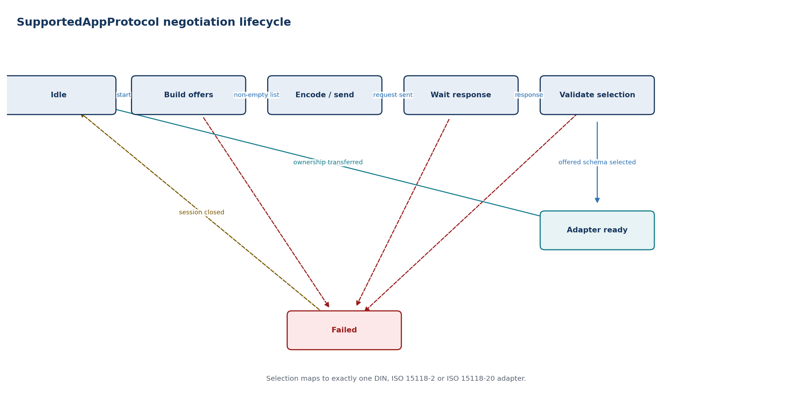

| **State**          | **Entry / activity**                          | **Exit or failure transition**                                |
|--------------------|-----------------------------------------------|---------------------------------------------------------------|
| Idle               | No negotiation context                        | Start negotiation -\> Build offers                            |
| Build offers       | Filter configuration by transport/energy mode | Nonempty -\> Encode/send; empty -\> Failed                    |
| Encode/send        | Create and transmit SupportedAppProtocolReq   | Sent -\> Wait response                                        |
| Wait response      | Await and decode SupportedAppProtocolRes      | Response -\> Validate selection; timeout/malformed -\> Failed |
| Validate selection | Check response and offered schemaId           | Valid -\> Adapter ready; invalid -\> Failed                   |
| Adapter ready      | Bind protocol context and EXI schema          | Ownership transferred -\> Idle                                |
| Failed             | Report no-match, malformed or timeout reason  | Session close/cleanup -\> Idle                                |

| **FAULT HANDLING An unoffered schemaId, unsupported namespace or invalid transport combination terminates negotiation without fallback outside the configured offer list.** |
|-----------------------------------------------------------------------------------------------------------------------------------------------------------------------------|

## Dependencies

EXI SAP grammar, V2GTP, transport session, versioned protocol configuration and protocol-adapter factory.

# 11.1 DIN SPEC 70121 EVCC adapter

| **RESPONSIBILITY Implements the legacy DC charging message sequence using the DIN schema while presenting the same protocol-neutral context and event interfaces as later ISO adapters.** |
|-------------------------------------------------------------------------------------------------------------------------------------------------------------------------------------------|

## Interface specification

| **Port / operation** | **Direction** | **Type or payload**                   | **Trigger / contract**             |
|----------------------|---------------|---------------------------------------|------------------------------------|
| Rp_ProtocolControl   | Required      | Start/Stop + session context          | Created only after SAP selects DIN |
| Rp_EvContext         | Required      | Capabilities, snapshot and permission | Protocol-neutral source data       |
| Rp_MessageChannel    | Required      | Typed DIN message send/receive        | V2GTP and DIN EXI beneath adapter  |
| Pp_HlcEvent          | Provided      | Negotiation/request/session event     | Normalized for ChargingCoordinator |
| Pp_ProtocolDiag      | Provided      | DIN state/response/timer reason       | Stable error classification        |

## Behavior

- Support DC charging only and require a non-TLS TCP session.

- Map SI-unit EV context into DIN-specific physical values, optional fields and response codes.

- Execute the message order and response timers without allowing out-of-sequence acceptance.

- Request cable-check, precharge, power-delivery and stop actions through semantic HlcEvent outputs.

- Send readiness or energy-flow indications only while ChargePermission is valid.

**Timing note.** Use the applicable DIN response timers and message-loop limits. Exact values belong in generated/configured protocol data, not application code.

## State machine

**State basis.** *Repository-aligned EVCC state classes and main transitions; loops and AC/DC or EIM/PnC branches are shown explicitly.*

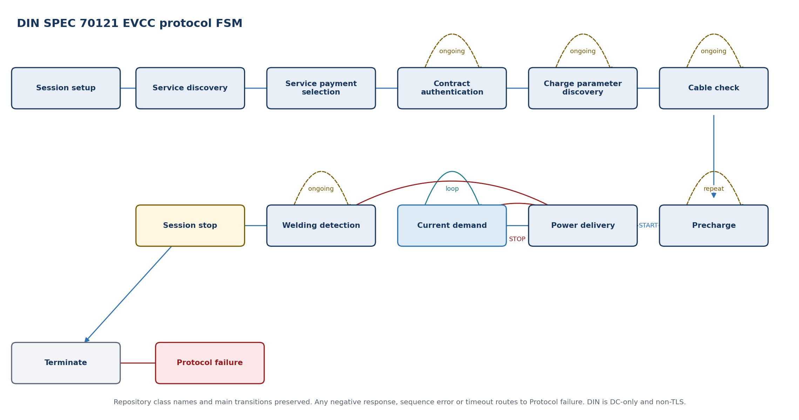

| **State**                  | **Entry / activity**                                   | **Exit or failure transition**                            |
|----------------------------|--------------------------------------------------------|-----------------------------------------------------------|
| Session setup              | Establish EVCC/SECC session identity                   | Response -\> Service discovery                            |
| Service discovery          | Discover charging/payment services                     | Valid DC service -\> Service payment selection            |
| Service payment selection  | Select the DIN external-payment service                | Response -\> Contract authentication                      |
| Contract authentication    | Poll EVSE authorization processing                     | Ongoing -\> self; accepted -\> Charge parameter discovery |
| Charge parameter discovery | Exchange DC limits and capabilities                    | Ongoing -\> self; accepted -\> Cable check                |
| Cable check                | Coordinate isolation test                              | Ongoing -\> self; finished -\> Precharge                  |
| Precharge                  | Coordinate target/present voltage                      | Not reached -\> self; reached -\> Power delivery START    |
| Power delivery             | Process START or STOP response                         | START -\> Current demand; STOP -\> Welding detection      |
| Current demand             | Exchange target and present values                     | Continue -\> self; stop -\> Power delivery STOP           |
| Welding detection          | Coordinate post-charge contactor check                 | Ongoing -\> self; finished -\> Session stop               |
| Session stop               | Request protocol termination                           | Response -\> Terminate                                    |
| Terminate                  | Release DIN adapter session state                      | Terminal                                                  |
| Protocol failure           | Normalize negative response, sequence error or timeout | Terminate via common session error handling               |

| **FAULT HANDLING Unexpected response, negative response, permission loss or timeout produces a protocol failure event and enters the controlled session stop/close path.** |
|----------------------------------------------------------------------------------------------------------------------------------------------------------------------------|

## Dependencies

DIN EXI schema (\`urn:din:70121:2012:MsgDef\`), common message channel, ChargingCoordinator context and protocol timers. No TLS dependency is permitted for DIN operation.

# 11.2 ISO 15118-2 EVCC adapter

| **RESPONSIBILITY Implements ISO 15118-2 AC/DC charging, EIM and optional Plug & Charge while keeping transport, EXI, crypto and vehicle-control concerns separated.** |
|-----------------------------------------------------------------------------------------------------------------------------------------------------------------------|

## Interface specification

| **Port / operation** | **Direction** | **Type or payload**                   | **Trigger / contract**                   |
|----------------------|---------------|---------------------------------------|------------------------------------------|
| Rp_ProtocolControl   | Required      | Start/Stop + negotiated context       | Created after SAP selects ISO 15118-2    |
| Rp_EvContext         | Required      | Capabilities, snapshot and permission | Read-only protocol-neutral values        |
| Rp_MessageChannel    | Required      | Typed ISO-2 messages                  | V2GTP + ISO-2 EXI                        |
| Rp_PkiCrypto         | Required      | Certificate/signature services        | Only for enabled PnC/security operations |
| Pp_HlcEvent          | Provided      | Normalized service/auth/energy events | Consumed by ChargingCoordinator          |

## Behavior

- Select AC or DC behavior from the negotiated energy-transfer mode.

- Support EIM first; isolate PnC certificate and signature flows behind security services.

- Keep protocol schedule/profile data bounded by configured maximum entries.

- Normalize charge-parameter and power-delivery requests before reporting them upward.

- Share common DC action vocabulary with DIN without sharing protocol state ownership.

**Timing note.** Protocol message and sequence timers follow the selected standard profile; schedule-point and certificate-chain limits are explicit configuration.

## State machine

**State basis.** *Repository-aligned EVCC state classes and main transitions; loops and AC/DC or EIM/PnC branches are shown explicitly.*

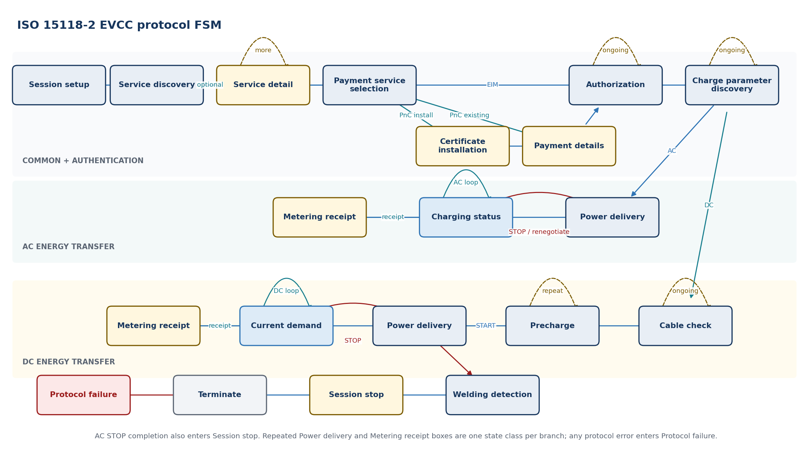

| **State**                  | **Entry / activity**                                               | **Exit or failure transition**                                                       |
|----------------------------|--------------------------------------------------------------------|--------------------------------------------------------------------------------------|
| Session setup              | Create/resume session identity                                     | Response -\> Service discovery                                                       |
| Service discovery          | Discover services, payment options and energy modes                | Detail requested -\> Service detail; otherwise -\> Payment service selection         |
| Service detail             | Collect optional value-added-service parameters                    | More detail -\> self; complete -\> Payment service selection                         |
| Payment service selection  | Select services and EIM/PnC                                        | EIM -\> Authorization; PnC -\> Certificate installation or Payment details           |
| Certificate installation   | Install/validate contract certificate material                     | Success -\> Payment details                                                          |
| Payment details            | Exchange eMAID, certificate chain and challenge                    | Signed challenge -\> Authorization                                                   |
| Authorization              | Process EIM or signed PnC authorization                            | Ongoing -\> self; accepted -\> Charge parameter discovery                            |
| Charge parameter discovery | Exchange limits and schedules                                      | Ongoing -\> self; AC -\> Power delivery; DC -\> Cable check                          |
| Power delivery             | Start, stop or renegotiate energy transfer                         | AC START -\> Charging status; DC START -\> Current demand                            |
| Charging status            | Run AC charging-status loop                                        | Continue -\> self; receipt -\> Metering receipt; stop/renegotiate -\> Power delivery |
| Metering receipt           | Provide signed receipt when requested                              | Continue -\> Charging status or Current demand                                       |
| Cable check                | Run DC isolation/cable check                                       | Ongoing -\> self; finished -\> Precharge                                             |
| Precharge                  | Coordinate DC voltage matching                                     | Not reached -\> self; reached -\> Power delivery START                               |
| Current demand             | Run DC target/present-value loop                                   | Continue -\> self; receipt -\> Metering receipt; stop -\> Power delivery STOP        |
| Welding detection          | Run DC post-charge check                                           | Finished -\> Session stop                                                            |
| Session stop               | Close or pause protocol session                                    | Response -\> Terminate                                                               |
| Terminate                  | Release ISO 15118-2 adapter state                                  | Terminal                                                                             |
| Protocol failure           | Normalize negative response, security, sequence or timeout failure | Terminate via common session error handling                                          |

| **FAULT HANDLING Authorization, certificate, signature, sequence, timeout and permission failures are mapped to stable HlcEvent reasons before closing.** |
|-----------------------------------------------------------------------------------------------------------------------------------------------------------|

## Dependencies

ISO 15118-2 EXI model, common message channel, Csm/KeyM/HSM for PnC, NvM contract records and ChargingCoordinator context.

# 11.3 ISO 15118-20 EVCC adapter

| **RESPONSIBILITY Implements the ISO 15118-20 common-session structure and selected energy service through service-specific sub-adapters, without changing the application safety boundary.** |
|----------------------------------------------------------------------------------------------------------------------------------------------------------------------------------------------|

## Interface specification

| **Port / operation** | **Direction** | **Type or payload**                        | **Trigger / contract**                           |
|----------------------|---------------|--------------------------------------------|--------------------------------------------------|
| Rp_ProtocolControl   | Required      | Start/Stop + service configuration         | Created after SAP selects ISO 15118-20           |
| Rp_EvContext         | Required      | Capabilities/snapshot/permission           | Includes bidirectional capability when supported |
| Rp_MessageChannel    | Required      | Common and service-specific messages       | ProtocolId selects Common/AC/DC/BPT schema       |
| Rp_PkiCrypto         | Required      | TLS 1.3 and signature/certificate services | Platform-owned credentials and crypto            |
| Pp_HlcEvent          | Provided      | Service/schedule/control-loop events       | Normalized upward interface                      |

## Behavior

- Separate common session messages from AC, DC and bidirectional service sub-adapters.

- Negotiate only vehicle-supported services and control modes.

- Treat CertificateInstallation as a production gap in the referenced EVCC code until implemented and verified.

- Bound schedule-exchange and service-parameter collections.

- Normalize dynamic control-loop requests into the same coordinator permission model.

- Treat bidirectional power as a distinct vehicle capability and safety concept extension.

**Timing note.** Message timers and schedule/control-loop periods are service-specific. Resource budgets are fixed for each enabled service.

## State machine

**State basis.** *Repository-aligned EVCC state classes and main transitions; loops and AC/DC or EIM/PnC branches are shown explicitly.*

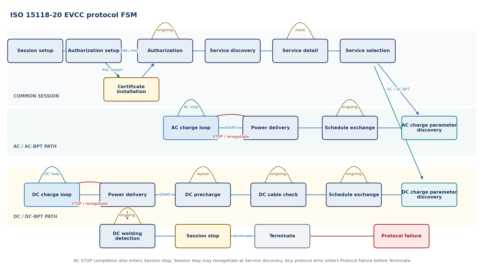

| **State**                     | **Entry / activity**                                               | **Exit or failure transition**                                                           |
|-------------------------------|--------------------------------------------------------------------|------------------------------------------------------------------------------------------|
| Session setup                 | Establish session and common context                               | Response -\> Authorization setup                                                         |
| Authorization setup           | Select EIM/PnC method                                              | EIM/PnC ready -\> Authorization; certificate needed -\> Certificate installation         |
| Certificate installation      | Execute PnC certificate-installation path                          | Success -\> Authorization; reference implementation currently raises NotImplementedError |
| Authorization                 | Complete selected authorization                                    | Ongoing -\> self; accepted -\> Service discovery                                         |
| Service discovery             | Discover energy and value-added services                           | Services available -\> Service detail; none -\> Session stop                             |
| Service detail                | Collect parameter sets for offered services                        | More details -\> self; complete -\> Service selection                                    |
| Service selection             | Select energy service and control mode                             | AC/AC-BPT -\> AC charge parameter discovery; DC/DC-BPT -\> DC charge parameter discovery |
| AC charge parameter discovery | Exchange AC or AC-BPT service parameters                           | Complete -\> Schedule exchange                                                           |
| DC charge parameter discovery | Exchange DC or DC-BPT service parameters                           | Complete -\> Schedule exchange                                                           |
| Schedule exchange             | Exchange constraints and schedules                                 | Ongoing -\> self; AC ready -\> Power delivery; DC ready -\> DC cable check               |
| DC cable check                | Run DC isolation/cable check                                       | Ongoing -\> self; finished -\> DC precharge                                              |
| DC precharge                  | Coordinate DC voltage matching                                     | Not reached -\> self; reached -\> Power delivery START                                   |
| Power delivery                | Start, stop or renegotiate selected service                        | START -\> AC charge loop or DC charge loop                                               |
| AC charge loop                | Run scheduled/dynamic AC or AC-BPT loop                            | Continue -\> self; stop/renegotiate -\> Power delivery                                   |
| DC charge loop                | Run scheduled/dynamic DC or DC-BPT loop                            | Continue -\> self; stop/renegotiate -\> Power delivery                                   |
| DC welding detection          | Run DC post-charge contactor check                                 | Ongoing -\> self; finished -\> Session stop                                              |
| Session stop                  | Close/pause or request service renegotiation                       | Renegotiation -\> Service discovery; terminate -\> Terminate                             |
| Terminate                     | Release ISO 15118-20 adapter state                                 | Terminal                                                                                 |
| Protocol failure              | Normalize security, service, schedule, sequence or timeout failure | Terminate via common session error handling                                              |

| **FAULT HANDLING Unsupported service, schedule overflow, security failure, stale permission or protocol error terminates the affected service/session without bypassing coordinator guards.** |
|-----------------------------------------------------------------------------------------------------------------------------------------------------------------------------------------------|

## Dependencies

ISO 15118-20 common and service schemas, TLS/crypto services, common message channel, NvM credential/contract storage and ChargingCoordinator context.

# 12.1 PlcLinkManager

| **RESPONSIBILITY Owns the link lifecycle below IP: modem availability, PEV-SLAC, network-key installation, association, IPv6 readiness, supervision, retry and teardown.** |
|----------------------------------------------------------------------------------------------------------------------------------------------------------------------------|

## Interface specification

| **Port / operation** | **Direction**       | **Type or payload**      | **Trigger / contract**                                                |
|----------------------|---------------------|--------------------------|-----------------------------------------------------------------------|
| Pp_PlcLinkControl    | Provided C/S        | Plm_LinkControl          | StartLink, StopLink and ResetFault from coordinator                   |
| Rp_QualifiedCpPp     | Required S/R        | QualifiedCpPp            | Nonqueued authoritative CP/PP evidence with age and quality           |
| Pp_PlcLinkStatus     | Provided S/R        | Plm_LinkStatusType       | Nonqueued authoritative state, readiness evidence and failure reason  |
| Pp_PlcLinkEvent      | Provided queued S/R | Plm_LinkEventType        | Transition notifications; status remains authoritative after overflow |
| Rp_PevSlacControl    | Required C/S        | Plm_SlacControl          | StartAttempt and CancelAttempt; completion correlated by attemptId    |
| Rp_PlcModemControl   | Required C/S        | Plm_ModemControl         | Init, Configure, SetNetwork, LeaveNetwork, Reset and Shutdown         |
| Rp_PlatformStatus    | Required S/R        | ModemStatus + IPv6Status | Association and TcpIp local-address readiness evidence                |

## Behavior

- Bind every operation and callback to the active sessionGeneration.

- Initialize and supervise the modem independently from the ISO 15118 session.

- Run one PEV-SLAC attempt at a time with bounded retries and backoff.

- Publish LinkReady only after matching, NMK/NID installation, PLC association and IPv6 link-local readiness.

- Invalidate LinkReady immediately on association loss, modem reset, CP disconnect or stop.

**Timing note.** Overall link deadline belongs to PlcLinkManager; detailed ISO 15118-3 timers belong to PevSlac; modem command deadlines belong to PlcModemIf.

## State machine

**State basis.** *Proposed AUTOSAR architectural FSM derived from this module responsibility; it is not claimed as a state machine supplied by the Python repositories.*

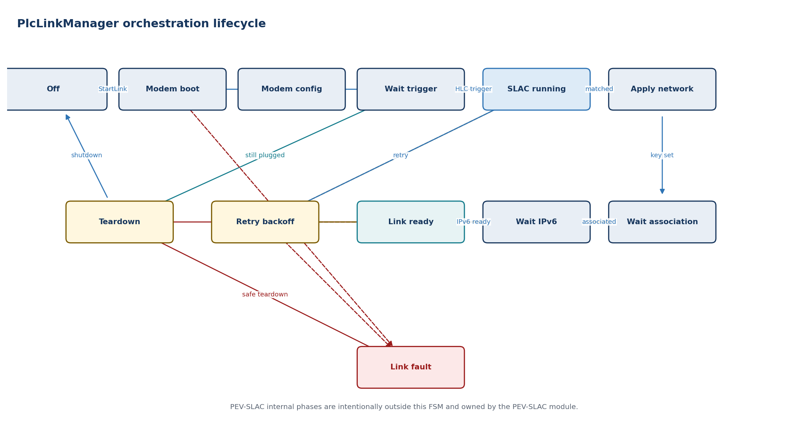

| **State**        | **Entry / activity**                              | **Exit or failure transition**                                            |
|------------------|---------------------------------------------------|---------------------------------------------------------------------------|
| Off              | Modem off/low power; link invalid                 | StartLink -\> Modem boot                                                  |
| Modem boot       | Reset and wait for modem readiness                | Ready -\> Modem config                                                    |
| Modem config     | Configure MAC/MME/network baseline                | Configured -\> Wait trigger                                               |
| Wait trigger     | Validate CP and session generation                | Qualified HLC trigger -\> SLAC running                                    |
| SLAC running     | Start and supervise one PEV-SLAC attempt          | Matched result -\> Apply network; failure -\> Retry backoff or Link fault |
| Apply network    | Program matched NMK/NID through PlcModemIf        | Confirmed -\> Wait association                                            |
| Wait association | Wait for modem PLC association                    | Associated -\> Wait IPv6; timeout -\> Retry backoff                       |
| Wait IPv6        | Wait for AUTOSAR IPv6 link-local readiness        | Ready -\> Link ready; timeout/loss -\> Retry backoff                      |
| Link ready       | Publish and supervise valid link evidence         | Stop/disconnect -\> Teardown; loss -\> Retry backoff                      |
| Retry backoff    | Clear candidate/network state and delay retry     | Retry allowed -\> SLAC running; exhausted -\> Link fault                  |
| Teardown         | Cancel timers, leave link and invalidate result   | Complete -\> Wait trigger/Off                                             |
| Link fault       | Publish stable failure and keep LinkReady invalid | Coordinator stop/reset -\> Teardown                                       |

| **FAULT HANDLING LinkLost is published immediately and causes the coordinator to revoke permission. PlcLinkManager cannot authorize energy or directly restart an invalid vehicle session.** |
|----------------------------------------------------------------------------------------------------------------------------------------------------------------------------------------------|

## Dependencies

RTE, CpPpManager evidence, PevSlac, PlcModemIf, EthIf/EthSM/TcpIp network status, OS timers, Dem and optional NvM modem configuration.

# 12.2 PEV-SLAC

| **RESPONSIBILITY Implements vehicle-side signal-level attenuation characterization and logical network matching as a bounded ISO 15118-3 state machine.** |
|-----------------------------------------------------------------------------------------------------------------------------------------------------------|

## Interface specification

| **Port / operation** | **Direction** | **Type or payload**            | **Trigger / contract**                                      |
|----------------------|---------------|--------------------------------|-------------------------------------------------------------|
| Pp_StartSlac         | Provided      | SlacStartRequest               | RunId/sessionGeneration/configuration                       |
| Pp_CancelSlac        | Provided      | Cancel reason                  | Idempotent cancellation                                     |
| Pp_SlacResult        | Provided      | Selected peer + NMK/NID handle | Sensitive material passed only to PlcLinkManager/modem path |
| Rp_MmeChannel        | Required      | Send/receive HomePlug MME      | Raw framing isolated in PlcModemIf                          |
| Pp_SlacDiag          | Provided      | SlacDiagnostic                 | Message, timer, attenuation, match and retry reason         |

## Behavior

- Generate a unique RunID and filter every received MME by expected type, peer and current attempt.

- Exchange SLAC parameters, start attenuation characterization and send the required M-Sounds.

- Receive/evaluate attenuation characterization and select a valid EVSE candidate.

- Send match request; validate match confirmation and network parameters.

- Zero transient network credentials on cancel, failure and teardown.

**Timing note.** Each phase has its own timer plus an overall attempt deadline. Retry policy remains with PlcLinkManager.

## State machine

**State basis.** *Proposed production PEV-side ISO 15118-3 FSM. The pyslac EV script supplies message examples only.*

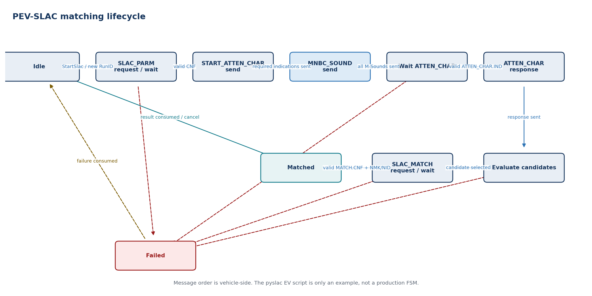

| **State**               | **Entry / activity**                           | **Exit or failure transition**                        |
|-------------------------|------------------------------------------------|-------------------------------------------------------|
| Idle                    | No attempt; transient data cleared             | StartSlac -\> SLAC_PARM request/wait                  |
| SLAC_PARM request/wait  | Send CM_SLAC_PARM.REQ and filter confirmations | Valid CM_SLAC_PARM.CNF -\> START_ATTEN_CHAR send      |
| START_ATTEN_CHAR send   | Send required CM_START_ATTEN_CHAR.IND messages | Required indications sent -\> MNBC_SOUND send         |
| MNBC_SOUND send         | Send configured CM_MNBC_SOUND.IND sequence     | Complete -\> Wait ATTEN_CHAR                          |
| Wait ATTEN_CHAR         | Receive and validate CM_ATTEN_CHAR.IND/profile | Valid result -\> ATTEN_CHAR response                  |
| ATTEN_CHAR response     | Send CM_ATTEN_CHAR.RSP to candidate EVSE       | Sent -\> Evaluate candidates                          |
| Evaluate candidates     | Apply peer, RunID and attenuation criteria     | Selected -\> SLAC_MATCH request/wait; none -\> Failed |
| SLAC_MATCH request/wait | Send CM_SLAC_MATCH.REQ and wait confirmation   | Valid CNF with NMK/NID -\> Matched                    |
| Matched                 | Return peer and network result                 | Consumed/cancelled -\> Idle                           |
| Failed                  | Return stable reason and clear sensitive state | Retry/new start -\> Idle                              |

| **FAULT HANDLING Wrong RunID/peer/type is ignored or diagnosed according to policy; timeout, unacceptable attenuation or invalid match confirmation fails the attempt without exposing a ready link.** |
|--------------------------------------------------------------------------------------------------------------------------------------------------------------------------------------------------------|

## Dependencies

PlcModemIf MME transport, ISO 15118-3 timer/configuration data, secure handling of NMK/NID and OS/SchM timers. The referenced pyslac EV path is an example, not production PEV-SLAC architecture.

# 12.3 PlcModemIf

| **RESPONSIBILITY Abstracts vendor-specific HomePlug Green PHY modem control, raw MME transport, network-key programming and link indications.** |
|-------------------------------------------------------------------------------------------------------------------------------------------------|

## Interface specification

| **Port / operation** | **Direction** | **Type or payload**                   | **Trigger / contract**                 |
|----------------------|---------------|---------------------------------------|----------------------------------------|
| Pp_ModemInit         | Provided      | Init/Shutdown/Reset                   | Async command with deadline            |
| Pp_MmeSend           | Provided      | Ethernet/HomePlug frame view          | Bounded frame; completion indication   |
| Pp_MmeReceive        | Provided      | Validated raw MME indication          | MAC/MMType/length plus bounded payload |
| Pp_SetNetwork        | Provided      | NMK/NID secure reference              | No application-layer key exposure      |
| Pp_ModemStatus       | Provided      | Boot/firmware/association/link status | Cyclic and event indication            |
| Rp_VendorDriver      | Required      | SPI/UART/Ethernet/GPIO service        | Vendor/platform implementation         |

## Behavior

- Sequence power, reset, firmware readiness and configuration with explicit deadlines.

- Validate raw frame size and basic HomePlug header before delivering an MME upward.

- Program NMK/NID through the narrowest possible privileged interface and clear them on teardown.

- Translate vendor link/association events into stable modem status.

- Keep firmware download, diagnostic register and manufacturing functions outside the runtime link API.

**Timing note.** Boot, command, key-update and shutdown deadlines are vendor-specific configuration verified on target hardware.

## State machine

**State basis.** *Proposed AUTOSAR architectural FSM derived from this module responsibility; it is not claimed as a state machine supplied by the Python repositories.*

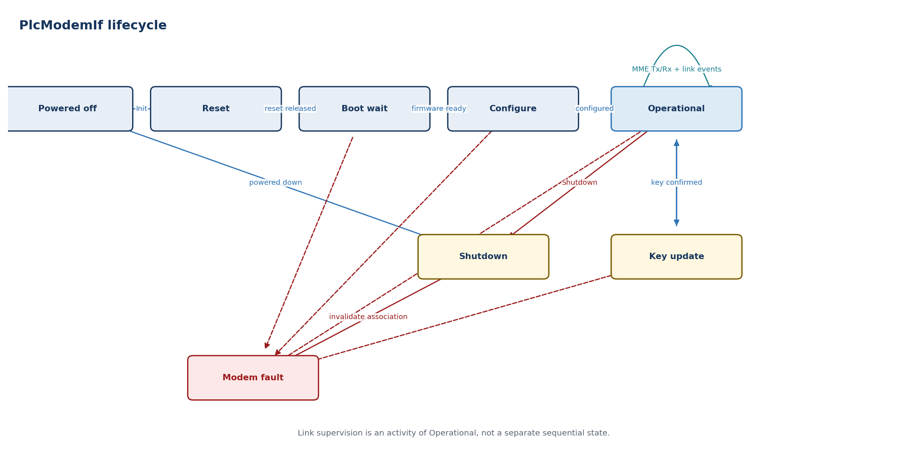

| **State**   | **Entry / activity**                                | **Exit or failure transition**                                                   |
|-------------|-----------------------------------------------------|----------------------------------------------------------------------------------|
| Powered off | Outputs/link invalid                                | Init -\> Reset                                                                   |
| Reset       | Assert/deassert hardware reset                      | Released -\> Boot wait                                                           |
| Boot wait   | Wait firmware/device readiness                      | Ready -\> Configure; timeout -\> Fault                                           |
| Configure   | Apply MAC, filters and baseline settings            | Success -\> Operational                                                          |
| Operational | Serve MME Tx/Rx and publish association/link events | SetNetwork -\> Key update; stop -\> Shutdown; driver/reset fault -\> Modem fault |
| Key update  | Program and confirm network parameters              | Success -\> Operational; failure -\> Modem fault                                 |
| Shutdown    | Clear network state and power down                  | Complete -\> Powered off                                                         |
| Modem fault | Invalidate association and report stable reason     | Safe shutdown/reset policy -\> Shutdown                                          |

| **FAULT HANDLING Firmware fault, command timeout, malformed receive frame or unexpected reset invalidates association immediately and reports ModemFault/LinkLost upward.** |
|-----------------------------------------------------------------------------------------------------------------------------------------------------------------------------|

## Dependencies

Vendor modem driver, SPI/UART/Ethernet/DIO MCAL, EthIf/EthTrcv where applicable, Csm/secure storage policy, Dem/Det, EcuM and OS timers.

# 13. Detailed AUTOSAR interface and software requirements

| **BASELINE DECISION Use the AUTOSAR R25-11 ISO15118Chrg BSW service interface unchanged at the ASW boundary. Add session generation, quality, freshness and stable events in an HlcSessionAdapter SWC. Implement PlcLinkManager as a project-defined AUTOSAR SWC with typed C/S commands and S/R status.** |
|------------------------------------------------------------------------------------------------------------------------------------------------------------------------------------------------------------------------------------------------------------------------------------------------------------|

This chapter is an implementable interface baseline, not generated ARXML. Short names must be reconciled with the selected AUTOSAR authoring tool and supplier package. Every array maximum, timeout, runnable period, queue depth and diagnostic mapping is a configuration item that must be frozen before code generation.

## 13.1 Common AUTOSAR contract rules

| **Concern**           | **Required AUTOSAR treatment**                                                | **Design rule**                                                                                                         |
|-----------------------|-------------------------------------------------------------------------------|-------------------------------------------------------------------------------------------------------------------------|
| Lifecycle commands    | ClientServerInterface; asynchronous invocation when the toolchain supports it | Return acceptance immediately; publish completion through status/event data. Stop is idempotent.                        |
| Authoritative state   | Nonqueued SenderReceiverInterface                                             | Latest state contains generation, sequenceCounter, timestamp, validity and reason. Never reconstruct state from events. |
| Transition events     | Queued SenderReceiverInterface                                                | Events aid reaction and logging. Queue overflow is diagnosed; consumers resynchronize from authoritative state.         |
| Fresh input snapshots | Nonqueued S/R or synchronous C/S read                                         | Consumer checks RTE status, validity, source timestamp and maximum age before use.                                      |
| Lower BSW interaction | Standard BSW APIs and callbacks, or a dedicated adapter SWC/CDD               | Do not disguise SoAd, TcpIp, Crypto or modem-driver APIs as portable application ports.                                 |
| Cross-ECU protection  | E2E transformer/profile selected by safety and network design                 | Apply only where data crosses a communication path; same-ECU RTE data still requires age and generation checks.         |
| Concurrency           | RTE exclusive areas or serialized event queue                                 | Callbacks copy bounded data and signal the owner runnable; only the owner runnable advances an FSM.                     |
| Configuration         | ECUC/ARXML, NvM or calibrated constants under change control                  | No environment variables, command-line options, files, reflection or runtime schema discovery.                          |

## 13.2 ISO15118Chrg AUTOSAR boundary

AUTOSAR R25-11 specifies ISO15118Chrg as a communication BSW module. Its public ASW contract consists of a provided ChargeControlPort and a required ChargeParametersPort. The AUTOSAR document marks many of these items as draft; the program shall therefore freeze the exact release, supplier ARXML and generated header as an interface baseline.

### Normative service ports and operations

| Port / interface | Operation | Semantic producer -> consumer | Contract |
| --- | --- | --- | --- |
| Pp_ChargeControlPort / ChargeControl | SetChargeState (StateMachineControl) | HlcSessionAdapter -> ISO15118Chrg | C/S; START, RENEGOTIATE, NORMAL_STOP or EMERGENCY_STOP; E_OK/E_NOT_OK. |
| Pp_ChargeControlPort / ChargeControl | SetCpLineStatus (CpLineStatus) | HlcSessionAdapter -> ISO15118Chrg | C/S; qualified active/inactive only; raw CP voltage never crosses this port. |
| Rp_ChargeParametersPort / ChargeParameters | SupportedAppProtocolParams | ISO15118Chrg <-> HlcSessionAdapter | Adapter returns bounded, configured application-protocol entries. |
| Rp_ChargeParametersPort / ChargeParameters | SessionSetupParams / SessionStopParams | ISO15118Chrg <-> HlcSessionAdapter | Exchange session setup/stop response data; adapter binds the call to its active generation. |
| Rp_ChargeParametersPort / ChargeParameters | ServiceDiscoveryParams / ServiceDetailParams | ISO15118Chrg <-> HlcSessionAdapter | Offered services enter ASW; selected scope/category/service ID return to the module. |
| Rp_ChargeParametersPort / ChargeParameters | PaymentServiceSelectionParams | ISO15118Chrg <-> HlcSessionAdapter | Adapter returns selected payment option and bounded service list. |
| Rp_ChargeParametersPort / ChargeParameters | PaymentDetailsParams / AuthorizationParams | ISO15118Chrg <-> HlcSessionAdapter | PnC identity/certificate reference or EIM identity; permission remains coordinator-owned. |
| Rp_ChargeParametersPort / ChargeParameters | ChargeParameterDiscoveryParams | ISO15118Chrg <-> HlcSessionAdapter | Map atomic EV capability snapshot and received EVSE parameters; preserve units and availability. |
| Rp_ChargeParametersPort / ChargeParameters | CableCheckParams / PreChargeParams | ISO15118Chrg <-> HlcSessionAdapter | DC status and targets are exchanged; readiness output is gated by current ChargePermission. |
| Rp_ChargeParametersPort / ChargeParameters | PowerDeliveryParams | ISO15118Chrg <-> HlcSessionAdapter | ASW returns charge progress/profile; module supplies peer status. No direct actuator call. |
| Rp_ChargeParametersPort / ChargeParameters | ChargingStatusParams / CurrentDemandParams | ISO15118Chrg <-> HlcSessionAdapter | Cyclic AC/DC loop data from immutable snapshot; reject stale or inconsistent input. |
| Rp_ChargeParametersPort / ChargeParameters | WeldingDetectionParams | ISO15118Chrg <-> HlcSessionAdapter | DC post-charge values; hardware decision remains outside ISO15118Chrg. |
| Rp_ChargeParametersPort / ChargeParameters | SeccConnectionParams | ISO15118Chrg -> HlcSessionAdapter | Publish endpoint, IP-assignment and TLS outcome; endpoint is diagnostic, not an authorization. |
| Rp_ChargeParametersPort / ChargeParameters | SlacStateParams | PlcLinkManager via adapter -> ISO15118Chrg | Publish EVSE/link-found evidence derived from valid PlcLinkStatus. |
| Rp_ChargeParametersPort / ChargeParameters | StateParams / ErrorNotification | ISO15118Chrg -> HlcSessionAdapter | Publish state/substate and protocol error; adapter maps to stable HlcSessionStatus/HlcEvent. |

Direction note. Parameter IN/OUT directions in generated RTE APIs shall follow the selected R25-11/supplier ARXML. The table above identifies the semantic producer so that similarly named EV and EVSE parameters are not wired backwards.

## 13.3 HlcSessionAdapter: project ASW facade

The adapter is a small, deterministic SWC. It provides the coordinator with a stable interface while implementing ChargeParameters and requiring ChargeControl. It is the only place allowed to add project metadata around the standard ISO15118Chrg ABI.

| **ASW port**              | **Element / operation** | **Key fields**                                                                             | **Mapping rule**                                                                                         |
|---------------------------|-------------------------|--------------------------------------------------------------------------------------------|----------------------------------------------------------------------------------------------------------|
| Pp_HlcLifecycle / C/S     | StartHlc(request)       | sessionGeneration, commandId, protocolPolicyId, linkGeneration                             | Validate LinkReady and CP evidence; call SetCpLineStatus(active), then SetChargeState(START).            |
| Pp_HlcLifecycle / C/S     | StopHlc(request)        | sessionGeneration, commandId, normalOrEmergency, reason                                    | Idempotently map to NORMAL_STOP or EMERGENCY_STOP; never wait synchronously for network close.           |
| Pp_HlcLifecycle / C/S     | Renegotiate(request)    | sessionGeneration, commandId, reason                                                       | Allowed only in an active protocol state and when policy permits; map to RENEGOTIATE.                    |
| Pp_HlcSessionStatus / S/R | HlcSessionStatusType    | generation, state, protocol, security, permissionUsed, quality, reason, timestamp, counter | Authoritative nonqueued status derived from StateParams, connection information and local command state. |
| Pp_HlcEvent / queued S/R  | HlcEventType            | generation, eventId, category, protocolStep, reason, evidenceId, timestamp                 | Normalize parameters accepted, peer request, session complete, warning and failure transitions.          |
| Rp_EvChargeContext / S/R  | EvChargeSnapshotType    | snapshotId, generation, SI values, availability, validity, timestamp                       | Read once per callback; reject generation mismatch or constituent age beyond configured maximum.         |
| Rp_ChargePermission / S/R | ChargePermissionType    | generation, permissionId, allowedAction, limits, expiry                                    | Required before returning READY/START/progress that can lead to energy transfer.                         |
| Rp_PlcLinkStatus / S/R    | Plm_LinkStatusType      | generation, linkGeneration, LinkReady evidence, validity, timestamp                        | Map valid current-generation readiness to SlacStateParams; loss triggers emergency stop sequence.        |

## 13.4 ISO15118Chrg lower BSW and internal seams

| **Boundary**      | **AUTOSAR integration**                                                                | **Ownership and constraints**                                                                                              |
|-------------------|----------------------------------------------------------------------------------------|----------------------------------------------------------------------------------------------------------------------------|
| Initialization    | EcuM initializes ISO15118Chrg_Init; BswM controls allowed communication mode           | Initialize static pools, configuration pointers, DET state and status before accepting RTE calls.                          |
| Link indication   | EthSM/EthIf/EthTrcv invokes ISO15118Chrg_DataLinkIndication                            | Treat inactive as immediate loss evidence. The project PlcLinkManager remains the qualified application link owner.        |
| IP assignment     | SoAd_RequestIpAddrAssignment plus local-address assignment callback                    | Use configured socket and local-address references; link-local IPv6 state is explicit.                                     |
| SDP               | SoAd IF/PduR UDP PDU, socket-mode callback and configured V2GTP payload                | One request per UDP packet; validate V2GTP, endpoint, transport and TLS selection before use.                              |
| TCP/V2GTP         | SoAd TP/PduR StartOfReception, CopyRxData, RxIndication, CopyTxData and TxConfirmation | Static/bounded buffers; handle BUSY/OVFL/NOT_OK; no unbounded payload assembly.                                            |
| TLS/crypto        | Supplier TLS adapter using TcpIp plus Csm/Crypto/KeyM/HSM                              | Private keys are handles only; certificate and handshake results are explicit and time-bounded.                            |
| EXI               | Local IExiCodec C interface or qualified supplier library                              | Schema/profile selected explicitly; encode/decode into caller-provided bounded buffers; no Java process.                   |
| Protocol adapters | Local IProtocolAdapter interface for DIN, ISO-2 and ISO-20                             | The standard R25-11 data model shall not be silently extended; DIN/ISO-20 use separately versioned supplier/project ARXML. |
| Diagnostics       | DET for development misuse; Dem for configured production events                       | No secrets or raw certificate/key material in logs, freeze frames or trace buffers.                                        |

## 13.5 ISO15118Chrg data and error model

| **Type / category**              | **Mandatory content**                                                                                                      | **Constraint**                                                                                             |
|----------------------------------|----------------------------------------------------------------------------------------------------------------------------|------------------------------------------------------------------------------------------------------------|
| ISO15118Chrg\_\* normative types | R25-11 generated implementation data types for ChargeControl and ChargeParameters                                          | Do not hand-copy layouts. Include generated Rte_ISO15118Chrg.h and verify data-type mapping in ARXML.      |
| HlcSessionIdType                 | sessionGeneration:uint32, commandId:uint32, linkGeneration:uint32                                                          | Zero is invalid; equality comparison is wrap-safe; generation changes on every new plug session.           |
| HlcSessionStatusType             | IDs, HlcState, ProtocolId, SecurityState, quality, reason, timestamp:uint64, sequenceCounter:uint32                        | Single nonqueued record; update timestamp and counter atomically with content.                             |
| HlcEventType                     | IDs, EventCategory, ProtocolStep, ReasonCode, evidenceId, timestamp                                                        | Bounded queue; no pointer; unknown enum values rejected at receiver boundary.                              |
| Physical values                  | value, exponent/multiplier, unit, availability, rangeStatus                                                                | Convert once at adapter; saturate/reject overflow; no implicit unit defaults.                              |
| Collections                      | length plus fixed-capacity array                                                                                           | Length is validated before iteration; unused elements initialized; capacities derive from schema and ECUC. |
| Normative return                 | E_OK, E_NOT_OK and published ISO15118CHRG\_\* application errors                                                           | Preserve exact numeric values from generated artifacts.                                                    |
| Project reason taxonomy          | NONE, PRECONDITION, STALE_DATA, LINK_LOSS, TIMEOUT, SEQUENCE, FORMAT, SECURITY, RESOURCE, PEER_REJECT, CANCELLED, INTERNAL | Map every lower error deterministically; retain detailed Dem event separately.                             |

## 13.6 ISO15118Chrg software requirements

| **Requirement ID** | **Class**    | **Shall statement**                                                                                                                                                                           | **Verification**          |
|--------------------|--------------|-----------------------------------------------------------------------------------------------------------------------------------------------------------------------------------------------|---------------------------|
| HLC-ASR-001        | Architecture | The implementation shall preserve the selected AUTOSAR release and supplier definitions of ChargeControlPort, ChargeParametersPort and ISO15118Chrg\_\* data types without local ABI changes. | ARXML/header diff         |
| HLC-ASR-002        | Architecture | DIN 70121 and ISO 15118-20 extensions shall use separately versioned interfaces or supplier extensions and shall not overload ISO 15118-2 enumeration values.                                 | Design + ARXML review     |
| HLC-ASR-003        | Architecture | Only HlcSessionAdapter shall translate coordinator lifecycle, link, snapshot and permission contracts to the ISO15118Chrg service ports.                                                      | Static architecture check |
| HLC-ASR-004        | Architecture | ISO15118Chrg shall access UDP/TCP through configured SoAd/PduR/TcpIp interfaces and shall not call POSIX socket APIs.                                                                         | Static analysis           |
| HLC-ASR-005        | Architecture | Runtime configuration shall come from ECUC/generated constants or controlled NvM data and not from files, environment variables or command-line arguments.                                    | Static + integration test |
| HLC-IF-001         | Interface    | SetChargeState shall reject unsupported values, invalid module state and a start request without qualified CP/link preconditions.                                                             | Unit boundary tests       |
| HLC-IF-002         | Interface    | SetCpLineStatus shall consume only qualified active/inactive CP status and shall never receive raw voltage or PWM samples.                                                                    | Interface review          |
| HLC-IF-003         | Interface    | Each ChargeParameters operation shall validate pointer, length, enum range, physical-value unit/multiplier and active-session context before use.                                             | Robustness tests          |
| HLC-IF-004         | Interface    | HlcSessionStatus publication shall be atomic and shall include generation, freshness, quality and stable reason.                                                                              | RTE integration test      |
| HLC-IF-005         | Interface    | A queued HlcEvent shall never be the sole source of current state; a consumer shall be able to recover using HlcSessionStatus after queue overflow.                                           | Overflow test             |
| HLC-FUN-001        | Behavior     | START shall progress only after active data-link evidence, assigned link-local IPv6 address and an accepted current-generation link context exist.                                            | State-transition tests    |
| HLC-FUN-002        | Behavior     | SDP shall send one request per UDP packet and shall accept only a structurally valid response for the configured interface, transport and security policy.                                    | Packet/SIL tests          |
| HLC-FUN-003        | Behavior     | The SDP retry interval shall be at least 250 ms; retry count and overall communication-setup timeout shall be ECUC-controlled and bounded.                                                    | Timer test                |
| HLC-FUN-004        | Behavior     | SAP shall select only a configured protocol/version/schema combination and shall report NO_PROTOCOL_MATCH when none is common.                                                                | Protocol matrix test      |
| HLC-FUN-005        | Behavior     | V2GTP shall validate protocol version, inverse version, payload type and payload length before reserving or decoding a payload buffer.                                                        | Fuzz + unit tests         |
| HLC-FUN-006        | Behavior     | EXI decode shall use the schema associated with the selected protocol and shall reject trailing, malformed, oversized or out-of-range content.                                                | Negative corpus test      |
| HLC-FUN-007        | Behavior     | Every protocol adapter shall enforce request/response sequence and message timeout before advancing its state.                                                                                | Model/state tests         |
| HLC-FUN-008        | Behavior     | The module shall not issue contactor, converter, lock or other charging-hardware commands.                                                                                                    | Call-graph analysis       |
| HLC-SAF-001        | Safety       | The adapter shall check a fresh current-generation ChargePermission before returning a value that represents vehicle readiness or START energy progress.                                      | Fault-injection test      |
| HLC-SAF-002        | Safety       | Permission expiry, invalid CP, LinkLost, emergency stop or coordinator cancellation shall initiate the controlled close path and invalidate HLC readiness.                                    | HIL fault test            |
| HLC-SAF-003        | Safety       | Late callbacks, PDU indications or protocol results from an obsolete session generation shall be discarded and diagnosed.                                                                     | Race/restart test         |
| HLC-SAF-004        | Safety       | A last-known-good snapshot, permission, link state or connection result shall not be reused after invalidation or age expiry.                                                                 | Age-boundary test         |
| HLC-TIM-001        | Timing       | Each protocol timer shall have one owner; expiry shall be evaluated from a monotonic timebase in the owning runnable.                                                                         | Timing design review      |
| HLC-TIM-002        | Timing       | The main-function period and timer resolution shall satisfy the shortest configured protocol deadline with documented jitter and WCET margin.                                                 | Target timing analysis    |
| HLC-TIM-003        | Timing       | No RTE server runnable or BSW callback shall block on SDP, TCP, TLS, EXI, protocol response or NvM completion.                                                                                | WCET + code review        |
| HLC-ERR-001        | Fault        | Every stop path shall cancel owned timers, close active sockets, release IP assignment when configured, clear transient security/session state and publish one terminal reason.               | Path-coverage test        |
| HLC-ERR-002        | Fault        | Data-link loss and CP inactive shall pre-empt discovery, transport establishment and protocol session processing.                                                                             | Event-priority test       |
| HLC-ERR-003        | Fault        | Buffer exhaustion, malformed PDU, unexpected callback, sequence error and timeout shall map to stable project reason codes and configured Dem events.                                         | Error-injection test      |
| HLC-SEC-001        | Security     | TLS policy shall be evaluated from configured allowed/required modes and the SDP result before opening the V2G session.                                                                       | Security matrix test      |
| HLC-SEC-002        | Security     | Private keys shall remain inside KeyM/Crypto/HSM services; protocol data structures shall contain only references or public material.                                                         | Security review           |
| HLC-SEC-003        | Security     | Certificate chains, signatures, identities and EXI payloads shall be length-bounded and validated before cryptographic processing.                                                            | Fuzz + penetration test   |
| HLC-RES-001        | Resource     | After initialization, the communication path shall use bounded pools and shall not depend on unbounded heap growth.                                                                           | Memory instrumentation    |
| HLC-RES-002        | Resource     | The configured maximum V2GTP payload, EXI workspace, protocol collection sizes and concurrent sessions shall be documented and enforced.                                                      | Boundary/load test        |
| HLC-RES-003        | Resource     | Callbacks shall copy or lease payload memory according to an explicit ownership contract and shall not retain caller buffers after their validity window.                                     | Static + stress test      |

## 13.7 PlcLinkManager AUTOSAR boundary

PlcLinkManager is not a standardized AUTOSAR Classic BSW module. Model it as an AtomicSwComponentType, or as a service SWC plus a CDD-backed modem adapter when direct hardware/MME access is required. Its public API remains ordinary AUTOSAR ClientServerInterface and SenderReceiverInterface definitions.

### Provided public ports

| **Port / interface**                | **Operation or data element** | **Signature / fields**                                                                   | **Contract**                                                                            |
|-------------------------------------|-------------------------------|------------------------------------------------------------------------------------------|-----------------------------------------------------------------------------------------|
| Pp_PlcLinkControl / Plm_LinkControl | StartLink                     | IN Plm_LinkStartRequestType; OUT requestId:uint32; Plm_ReturnType                        | Asynchronous acceptance; one active request per session; no blocking for modem or SLAC. |
| Pp_PlcLinkControl / Plm_LinkControl | StopLink                      | IN sessionGeneration:uint32, commandId:uint32, reason:Plm_StopReasonType; Plm_ReturnType | Idempotent. Accepted in every state. Completion is visible in Plm_LinkStatusType.       |
| Pp_PlcLinkControl / Plm_LinkControl | ResetFault                    | IN sessionGeneration:uint32, authorization:Plm_ResetAuthorizationType; Plm_ReturnType    | Allowed only with safe CP state, cleared cause and coordinator authorization.           |
| Pp_PlcLinkStatus / S/R              | LinkStatus                    | Plm_LinkStatusType                                                                       | Nonqueued authoritative level state; invalidate immediately before teardown or retry.   |
| Pp_PlcLinkEvent / queued S/R        | LinkEvent                     | Plm_LinkEventType                                                                        | Transition notification. Queue depth and overflow Dem event are configured.             |
| Pp_PlcLinkDiag / S/R                | LinkDiagnostic                | Plm_LinkDiagnosticType                                                                   | Debounced counters and last failure detail; no raw NMK or secret material.              |

### Required ports and platform services

| **Required port**             | **Provider**         | **Data / operations**                                                       | **Supervision rule**                                                                            |
|-------------------------------|----------------------|-----------------------------------------------------------------------------|-------------------------------------------------------------------------------------------------|
| Rp_QualifiedCpPp / S/R        | CpPpManager          | QualifiedCpPp with plugSessionId, CP state, HLC trigger, quality, timestamp | Invalid, stale, disconnected or non-HLC CP evidence cancels matching and invalidates LinkReady. |
| Rp_PevSlacControl / C/S       | PevSlac              | StartAttempt(request), CancelAttempt(attemptId, reason)                     | Completion is correlated by sessionGeneration + attemptId + RunID.                              |
| Rp_PevSlacResult / S/R queued | PevSlac              | Plm_SlacResultType                                                          | Unexpected type, peer, RunID, generation or duplicate completion is ignored and diagnosed.      |
| Rp_PlcModemControl / C/S      | PlcModemIf/CDD       | Init, Configure, SetNetwork, LeaveNetwork, Reset, Shutdown                  | Every command has commandId, deadline and completion indication.                                |
| Rp_PlcModemStatus / S/R       | PlcModemIf/CDD       | Plm_ModemStatusType                                                         | Reset, firmware fault or association loss immediately removes modem/association evidence.       |
| Rp_Ipv6Status / S/R           | TcpIp/EthSM adapter  | Plm_Ipv6StatusType                                                          | LinkReady requires assigned link-local IPv6 address on the intended controller/interface.       |
| Rp_TimeBase                   | OS/SchM time service | monotonic ticks and deadline comparison                                     | Clock discontinuity is diagnosed; wall-clock time is never used for timers.                     |
| Rp_Dem / Rp_NvM               | Dem and NvM adapters | event status; versioned modem/profile configuration                         | No blocking NvM access in link FSM; configuration is validated during initialization.           |

## 13.8 PlcLinkManager data types and validity

| **Type**                 | **Required fields**                                                                                                                                                      | **Invariant**                                                                                            |
|--------------------------|--------------------------------------------------------------------------------------------------------------------------------------------------------------------------|----------------------------------------------------------------------------------------------------------|
| Plm_LinkStartRequestType | sessionGeneration, commandId, plugEvidenceId, policyProfileId, requestedInterfaceId                                                                                      | All IDs nonzero; CP evidence must be current; unknown flags rejected.                                    |
| Plm_LinkStatusType       | sessionGeneration, linkGeneration, state, quality, modemReady, slacMatched, credentialInstalled, associated, ipv6Ready, attemptCount, reason, timestamp, sequenceCounter | LinkReady is true only when every readiness flag is true and fresh for the same session/link generation. |
| Plm_LinkEventType        | sessionGeneration, linkGeneration, eventId, previousState, newState, reason, detailCode, timestamp                                                                       | No pointer or variable-length text; eventId monotonic per boot.                                          |
| Plm_SlacAttemptType      | sessionGeneration, attemptId, RunID\[8\], pevMac\[6\], timerProfileId, selectionPolicyId                                                                                 | New random RunID for every attempt; all inbound MMEs filtered by attempt context.                        |
| Plm_SlacResultType       | IDs, result, selectedEvseMac\[6\], attenuationQuality, credentialRef, NID metadata, reason                                                                               | NMK is never carried as raw bytes over an RTE port; credentialRef is opaque and single-session.          |
| Plm_ModemStatusType      | state, firmwareId, configuredInterface, associated, peerMac, resetCounter, quality, reason, timestamp                                                                    | Association alone is insufficient for LinkReady.                                                         |
| Plm_Ipv6StatusType       | controller/interface ID, localAddrId, assignmentState, isLinkLocal, quality, timestamp                                                                                   | Address must belong to the configured PLC interface and current network generation.                      |
| Plm_ReturnType           | ACCEPTED, ALREADY_DONE, BUSY, STALE, PRECONDITION, CONFIG_ERROR, NOT_OK                                                                                                  | Application errors have fixed ARXML values; status explains asynchronous completion.                     |

## 13.9 PlcLinkManager runnable and concurrency model

| **Runnable / event**             | **Activation**                     | **Permitted work**                                                                                                    |
|----------------------------------|------------------------------------|-----------------------------------------------------------------------------------------------------------------------|
| Plm_Init                         | EcuM/RTE initialization event      | Validate configuration; clear generations and credentials; publish OFF/invalid.                                       |
| Plm_StartLink                    | C/S operation invoked event        | Validate request, enqueue lifecycle command, return acceptance; no modem I/O wait.                                    |
| Plm_StopLink / Plm_ResetFault    | C/S operation invoked event        | Enqueue priority command; Stop is accepted in all states and coalesces duplicates.                                    |
| Plm_OnCpPp                       | DataReceivedEvent or periodic read | Copy qualified evidence; enqueue disconnect/HLC-trigger change.                                                       |
| Plm_OnSlacResult                 | DataReceivedEvent                  | Validate IDs/RunID and enqueue bounded result; never advance the owner FSM concurrently.                              |
| Plm_OnModemStatus / OnIpv6Status | DataReceivedEvent                  | Copy current status and enqueue evidence change.                                                                      |
| Plm_MainFunction                 | TimingEvent, period T_PLM_MAIN     | Drain priority events, evaluate deadlines, advance at most a bounded number of transitions and publish atomic status. |
| Plm_DiagMainFunction             | Slower TimingEvent                 | Debounce/report Dem counters; must not hold the FSM exclusive area during Dem/NvM service.                            |

| **PRIORITY ORDER CP disconnect or StopLink \> modem reset/link loss \> timer expiry \> command completion \> retry/start. Only Plm_MainFunction owns state transitions; callbacks never call one another recursively.** |
|-------------------------------------------------------------------------------------------------------------------------------------------------------------------------------------------------------------------------|

## 13.10 PlcLinkManager software requirements

| **Requirement ID** | **Class**    | **Shall statement**                                                                                                                                                           | **Verification**            |
|--------------------|--------------|-------------------------------------------------------------------------------------------------------------------------------------------------------------------------------|-----------------------------|
| PLM-ASR-001        | Architecture | PlcLinkManager shall be modeled as an AUTOSAR SWC with explicit RTE ports; direct modem hardware access shall be isolated in PlcModemIf/CDD.                                  | Architecture + ARXML review |
| PLM-ASR-002        | Architecture | The SWC shall use EcuM/BswM/RTE/OS/SchM/Dem/NvM services according to the selected Classic release and shall not depend on POSIX, Python, files or environment variables.     | Static analysis             |
| PLM-ASR-003        | Architecture | Only PlcLinkManager shall publish project LinkReady/LinkLost status; PevSlac, PlcModemIf and TcpIp evidence shall remain subordinate inputs.                                  | Port ownership review       |
| PLM-IF-001         | Interface    | StartLink shall reject zero/obsolete generation, stale CP evidence, unsupported interface/profile and a conflicting active session.                                           | C/S boundary tests          |
| PLM-IF-002         | Interface    | StopLink shall be idempotent and accepted in every state; duplicate commandId shall return the existing outcome without repeating unsafe side effects.                        | Idempotence test            |
| PLM-IF-003         | Interface    | ResetFault shall require coordinator authorization, cleared root cause and a configured safe CP condition.                                                                    | Negative/reset tests        |
| PLM-IF-004         | Interface    | Every asynchronous modem and SLAC command/result shall carry sessionGeneration plus commandId or attemptId.                                                                   | Trace/static check          |
| PLM-IF-005         | Interface    | LinkStatus publication shall be atomic, nonqueued and include state, readiness evidence, validity, reason, timestamp and sequenceCounter.                                     | RTE integration test        |
| PLM-IF-006         | Interface    | Queue overflow or dropped LinkEvent shall be diagnosed, and consumers shall recover from the authoritative LinkStatus.                                                        | Overflow test               |
| PLM-FUN-001        | Behavior     | The manager shall initialize and configure the selected modem interface before starting a PEV-SLAC attempt.                                                                   | State test                  |
| PLM-FUN-002        | Behavior     | Only one PEV-SLAC attempt shall execute at a time for a session; every retry shall allocate a new attemptId and RunID.                                                        | Concurrency/retry test      |
| PLM-FUN-003        | Behavior     | A SLAC result shall be accepted only when sessionGeneration, attemptId, RunID, expected peer fields and result structure match the active attempt.                            | Malformed/stale result test |
| PLM-FUN-004        | Behavior     | After a valid match, the manager shall install the network credential through an opaque credentialRef and wait for explicit modem confirmation.                               | Modem integration test      |
| PLM-FUN-005        | Behavior     | The manager shall wait for association to the selected logical network and shall reject association to an unexpected peer/network generation.                                 | Association fault test      |
| PLM-FUN-006        | Behavior     | The manager shall require an assigned link-local IPv6 address on the configured PLC interface before publishing LinkReady.                                                    | TcpIp integration test      |
| PLM-FUN-007        | Behavior     | LinkReady shall assert only when modemReady, slacMatched, credentialInstalled, associated and ipv6Ready are all valid and current for one generation.                         | Truth-table test            |
| PLM-FUN-008        | Behavior     | Retry count, retryable reasons, backoff sequence and overall link deadline shall be bounded configuration owned by PlcLinkManager.                                            | Configuration/state test    |
| PLM-FUN-009        | Behavior     | On retry, the manager shall invalidate LinkReady before clearing candidate, association and credential evidence.                                                              | Transition ordering test    |
| PLM-SAF-001        | Safety       | CP disconnect, invalid/stale CP evidence, StopLink, modem reset or association loss shall synchronously invalidate the next published LinkStatus before any reconnect action. | Fault-injection test        |
| PLM-SAF-002        | Safety       | PlcLinkManager shall not issue charge permission, contactor, lock, converter or power-delivery commands.                                                                      | Call-graph analysis         |
| PLM-SAF-003        | Safety       | A stale LinkReady or a link event from an obsolete generation shall never authorize HLC start or continued charging.                                                          | System race test            |
| PLM-SAF-004        | Safety       | Teardown shall cancel SLAC and deadlines, leave the logical network, invalidate IPv6/link evidence and clear transient credential references.                                 | Path-coverage test          |
| PLM-TIM-001        | Timing       | Detailed ISO 15118-3 message timers shall be owned by PevSlac; modem command timers by PlcModemIf; retry/backoff and overall link deadline by PlcLinkManager.                 | Timer ownership review      |
| PLM-TIM-002        | Timing       | The delay from receipt of qualified loss evidence to publication of invalid LinkStatus shall not exceed configured T_PLM_REACT, including runnable jitter.                    | Target timing measurement   |
| PLM-TIM-003        | Timing       | Input age shall be checked against T_CPPP_MAX_AGE, T_MODEM_MAX_AGE and T_IPV6_MAX_AGE before evaluating LinkReady.                                                            | Age-boundary test           |
| PLM-TIM-004        | Timing       | No C/S runnable or RTE callback shall block on modem boot, key programming, SLAC, association, IP assignment, Dem or NvM completion.                                          | WCET + code review          |
| PLM-ERR-001        | Fault        | Timeout, modem fault, invalid MME/result, credential rejection, association loss, IPv6 failure and retry exhaustion shall map to stable Plm_LinkReasonType values.            | Error-mapping test          |
| PLM-ERR-002        | Fault        | Non-retryable configuration, security and hardware faults shall enter LinkFault without automatic retry.                                                                      | Fault-policy test           |
| PLM-ERR-003        | Fault        | Retry exhaustion shall publish one terminal failure for the session and wait for StopLink, disconnect or authorized reset.                                                    | Exhaustion test             |
| PLM-SEC-001        | Security     | Raw NMK material shall not cross a general RTE port or appear in logs, Dem freeze frames, crash dumps or application traces.                                                  | Security/static review      |
| PLM-SEC-002        | Security     | Credential handles shall be scoped to one link generation and invalidated on failure, retry, stop, reset and ECU shutdown.                                                    | Credential lifecycle test   |
| PLM-RES-001        | Resource     | The manager shall use fixed-capacity command/event queues and shall define deterministic behavior for every queue-full condition.                                             | Stress/overflow test        |
| PLM-RES-002        | Resource     | The maximum simultaneous sessions shall be one per physical PLC interface unless independent resources and isolation are explicitly configured.                               | Configuration test          |
| PLM-RES-003        | Resource     | FSM processing per activation shall be bounded; transition loops shall have an explicit iteration limit and watchdog-compatible WCET.                                         | WCET + stress test          |
| PLM-DIAG-001       | Diagnostic   | Dem events shall debounce persistent modem/link faults while immediate LinkStatus quality remains independent of diagnostic debounce.                                         | Dem/HIL test                |

## 13.11 Environment dependency and test substitution matrix

| **Production dependency**    | **ISO15118Chrg seam**                                  | **PlcLinkManager seam**                                | **Host/SIL substitute**                              |
|------------------------------|--------------------------------------------------------|--------------------------------------------------------|------------------------------------------------------|
| RTE + generated types        | ChargeControl/ChargeParameters and Hlc adapter ports   | Plm_LinkControl, LinkStatus/Event and input ports      | Generated stubs with signature/enum ABI checks       |
| EcuM/BswM/SchM/OS            | Init, communication mode, main functions and timers    | Init, mode, main function and monotonic deadlines      | Deterministic virtual scheduler and monotonic clock  |
| SoAd/PduR/TcpIp/EthSM        | UDP SDP, TP V2GTP, IPv6 and link callbacks             | IPv6 readiness input only                              | Packet trace replay and fault-injecting socket model |
| Csm/Crypto/KeyM/HSM          | TLS, signature, certificate and key-handle services    | Opaque PLC credential lifecycle where applicable       | Known-answer crypto stub; never production secrets   |
| PlcModemIf/CDD + MCAL        | No direct dependency; HLC consumes qualified link only | Boot/config/MME/key/association control and indication | Scripted modem/MME simulator and latency/fault model |
| Dem/Det/NvM/WdgM             | Errors, misuse, configuration and supervision          | Link faults, configuration, counters and supervision   | In-memory deterministic service stubs                |
| SwitchEV Python repositories | Reference traces, EXI/messages, EVCC protocol oracle   | EVSE-side pyslac traces/messages plus EV script only   | Differential tests; not linked into ECU executable   |

# 14. Cross-module interface and event rules

| **Rule**                  | **Required implementation**                                                                                      |
|---------------------------|------------------------------------------------------------------------------------------------------------------|
| Session generation        | Created by ChargingCoordinator; copied through PLC, HLC, transport and hardware async operations.                |
| Monotonic time            | All age/deadline checks use a common monotonic timebase; wall clock is metadata only.                            |
| Command identity          | Hardware and lifecycle commands carry commandId; retries return the same outcome or explicit in-progress status. |
| Quality model             | Signals distinguish valid, degraded, invalid, stale and unavailable; “last value” is never implicitly valid.     |
| Reason taxonomy           | Domain-specific causes map to stable coordinator-visible reason categories plus detailed Dem events.             |
| Memory ownership          | Payload/snapshot lifetimes are explicit; no callback retains a caller-owned buffer without a defined lease.      |
| Freedom from interference | Memory/time protection and communication safeguards follow the HARA and ECU safety partitioning.                 |

## Primary event coupling

| **Producer event**                | **Consumer reaction**                                               | **Forbidden shortcut**                  |
|-----------------------------------|---------------------------------------------------------------------|-----------------------------------------|
| CpPpManager: Connected/HlcTrigger | Coordinator creates session and requests link                       | Starting SDP directly from CP runnable  |
| PlcLinkManager: LinkReady         | Coordinator starts HLC; HLC accepts link context                    | Closing contactors because PLC is ready |
| ISO15118Chrg: ParametersAccepted  | Coordinator evaluates safety/readiness guards                       | Protocol FSM enabling hardware directly |
| HardwareAdapter: Ready            | Coordinator may issue bounded permission when all other guards pass | Hardware declaring charge authorization |
| Any module: invalid/stale/fault   | Coordinator revokes or withholds permission and coordinates stop    | Reusing last-known-good evidence        |
| PlcLinkManager: LinkLost          | Coordinator stops energy/HLC and invalidates link evidence          | Waiting indefinitely for TCP timeout    |

# 15. References and implementation notes

- [<u>SwitchEV iso15118 repository</u>](https://github.com/SwitchEV/iso15118)

- [<u>SwitchEV pyslac repository</u>](https://github.com/SwitchEV/pyslac)

- [<u>AUTOSAR Classic Platform - ISO 15118 Charging, R25-11</u>](https://www.autosar.org/fileadmin/standards/R25-11/CP/AUTOSAR_CP_SWS_ISO15118Charging.pdf)

- [<u>AUTOSAR Classic Platform - Requirements on RTE, R25-11</u>](https://www.autosar.org/fileadmin/standards/R25-11/CP/AUTOSAR_CP_RS_RTE.pdf)

- [<u>AUTOSAR Classic Platform - Socket Adaptor, R25-11</u>](https://www.autosar.org/fileadmin/standards/R25-11/CP/AUTOSAR_CP_SWS_SocketAdaptor.pdf)

- [<u>AUTOSAR Classic Platform - Safety Use Case, R22-11</u>](https://www.autosar.org/fileadmin/standards/R22-11/CP/AUTOSAR_EXP_SafetyUseCase.pdf)

Repository observations reflect the referenced public projects. The inspected workspace baselines were SwitchEV iso15118 commit 76bf85be572d16adbcd009a985d605622c3b7227 and SwitchEV pyslac commit 134cb15dfca6381892ef8e30d15e615dc9c61c50. The Python code is treated as an executable reference and test oracle. It is not evidence of AUTOSAR conformity, functional-safety qualification or production readiness.

The state diagrams are architectural state machines, not substitutes for the normative protocol requirements. Exact message fields, timers, response codes, certificate rules and conformance behavior must be generated or implemented against the licensed DIN/ISO standards and the selected AUTOSAR/vendor documentation.

| **PROGRAM ACTION Baseline these interface contracts in ARXML and assign owners for every TBD timing, payload limit, diagnostic event, safety mechanism and protocol feature before detailed implementation.** |
|---------------------------------------------------------------------------------------------------------------------------------------------------------------------------------------------------------------|
