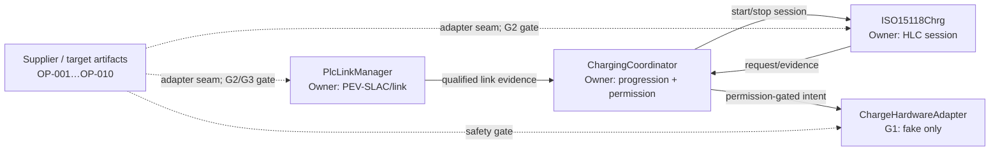

# Đề xuất nháp — Provisional Baseline để khởi động dự án

**Mã tài liệu:** `EVCC-PROVISIONAL-BASELINE`

**Revision:** Draft 0.1

**Ngày:** 09/09/2026

**Trạng thái:** `PROPOSED` — chưa phê duyệt, chưa `FROZEN`

**Phạm vi áp dụng đề xuất:** chuẩn bị R0 và các hoạt động host/SIL không phụ thuộc target

## 1. Mục đích

Tài liệu này đề xuất một baseline tạm thời để nhóm có thể bắt đầu các phần việc độc lập trong khi các điểm `OP-001`…`OP-011` vẫn đang mở. Baseline tạm thời không thay thế supplier ARXML, HARA, tiêu chuẩn có bản quyền, cấu hình target, phê duyệt kiến trúc hoặc bằng chứng kiểm thử.

Mục tiêu của cách làm này là:

- cho phép tiến hành phân rã công việc, mô hình hành vi, host skeleton, test harness và traceability;
- cô lập các phụ thuộc supplier/platform/safety sau interface adapter hoặc configuration seam;
- bảo đảm mọi giả định tạm thời được nhận diện và có điều kiện thay thế rõ ràng;
- ngăn code tạm, mock hoặc giá trị cấu hình provisional bị hiểu là production baseline.

Thành công của giai đoạn provisional là tạo được đầu vào có thể review và thay thế có kiểm soát, không phải tuyên bố đã đạt R0 hay đạt chuẩn DIN/ISO/AUTOSAR.

## 2. Phạm vi và giới hạn

### 2.1 Được phép thực hiện

- Hoàn thiện requirement decomposition và ma trận traceability.
- Chuẩn hóa ownership, semantic producer/consumer và state-machine model.
- Tạo host-only interfaces, fake adapters, deterministic state machines và test harness.
- Viết test cho generation, freshness, correlation, permission expiry, cancel race, late callback, queue overflow và schema mismatch.
- Tạo configuration symbols thay cho timer, queue, capacity hoặc target mapping chưa chốt.
- Chuẩn bị adapter seams cho AUTOSAR ABI, EXI, PLC modem, TcpIp/SoAd, Crypto/KeyM/NvM và hardware.

### 2.2 Chưa được phép tuyên bố hoặc thực hiện như production

- Sinh hoặc freeze RTE/ARXML từ các hàng P/R còn mơ hồ.
- Kết nối HLC mock hoặc host model tới actuator thật.
- Chốt safe state, ASIL, reaction deadline hoặc diagnostic recovery khi chưa có safety work products.
- Tuyên bố conformance/interoperability dựa trên reference Python, mock, host test hoặc timer provisional.
- Tự dựng lại standardized AUTOSAR/supplier types hay licensed protocol-generated layouts.
- Kích hoạt PnC/BPT production hoặc điều khiển công suất hai chiều khi chưa có capability/safety evidence.

### 2.3 Active feature scope tạm thời

Để loại bỏ mơ hồ giữa mô tả release R2 và phạm vi WP6, active G1 scope được đề xuất là nền tảng chung cộng `DIN SPEC 70121 DC EIM` và `ISO 15118-2 DC EIM`. ISO 15118-2 AC chỉ được giữ ở mức requirement/architecture analysis cho tới khi release owner xác nhận đưa vào active MVP. PnC, ISO 15118-20 và BPT mặc định fail-disabled và nằm ngoài đường găng của R2.

## 3. Quy ước trạng thái

| Trạng thái | Ý nghĩa |
|---|---|
| `DOCUMENTED` | Ý định thiết kế có trong tài liệu nguồn; chưa mặc nhiên được phê duyệt hoặc kiểm chứng. |
| `PROPOSED_TEMPORARY` | Quy ước làm việc tạm trong tài liệu này; chỉ dùng trong phạm vi cho phép. |
| `BLOCKED_FOR_TARGET` | Có thể thiết kế seam hoặc mock, nhưng không được generate/tích hợp trên target. |
| `FROZEN` | Chỉ dùng khi thỏa điều kiện freeze trong `DECISIONS.md` và có evidence tương ứng. |
| `SUPERSEDED` | Giả định tạm đã được thay bởi quyết định/artifact có thẩm quyền. |

Không có mục nào trong tài liệu này tự mang trạng thái `FROZEN`.

## 4. Các ràng buộc không được tạm bỏ qua

1. Hai composition chính là `ChargingCoordinator` và `ISO15118Chrg`.
2. `ChargeStateMachine` sở hữu charging progression; `PermissionManager` sở hữu `ChargePermission`.
3. HLC chỉ phát request/evidence; không có đường trực tiếp tới contactor, lock, precharge, converter hoặc discharge.
4. `PlcLinkManager` sở hữu PEV-SLAC/link readiness; `ISO15118Chrg::SdpClient` sở hữu SDP.
5. Mỗi state domain và timer chỉ có một owner.
6. Async data phải được kiểm tra generation, freshness, quality, correlation và buffer lifetime.
7. Thiếu hoặc invalid required evidence dẫn tới `DENY`; permission hết hạn không được tái sử dụng.
8. Stop flow ở mức responsibility là revoke permission → safe-state request → HLC/PLC teardown idempotent. Trình tự điện và deadline cuối cùng vẫn phụ thuộc safety concept.
9. BPT reversal cần measured-zero confirmation và permission mới.
10. SAP/DIN/ISO-2/ISO-20 Common/AC/DC dùng explicit schema selection và generated types riêng.

Vi phạm một trong các mục trên là điểm dừng bắt buộc, không phải open point có thể waiver bằng baseline tạm.

## 5. Mô hình gate cho công việc

| Gate | Phạm vi | Điều kiện vào | Kết quả cho phép |
|---|---|---|---|
| G0 — Documentation | Requirement, ownership, interface semantics, state model | Nguồn và khác biệt được ghi rõ | Specification draft, issue/traceability matrix |
| G1 — Host model | Logic độc lập target, mock/fake boundary | Không dùng imported ABI giả làm thật; hard invariants có test | Host skeleton và deterministic unit/component tests |
| G2 — Supplier/platform integration | RTE, BSW, EXI generator, modem, target compiler | Artifact/version/checksum và mapping được review | Generated/configured integration build |
| G3 — Safety/protocol validation | HARA, timing, conformance, HIL/interoperability | Safety concept và exact protocol edition khả dụng | Verification evidence theo release |
| G4 — Freeze/release | R0 hoặc release tiếp theo | Exit criteria, reviewer, evidence index và decision log đầy đủ | Baseline có kiểm soát thay đổi |

Trong thời gian các điểm mở chưa chốt, công việc chỉ tự động được phép ở G0–G1. Chuyển sang G2 trở lên cần evidence tương ứng, không chỉ cần tài liệu này.

## 6. Xử lý tạm thời cho các open point

| Open point | Quy ước `PROPOSED_TEMPORARY` | Công việc có thể tiếp tục | Phần vẫn bị chặn | Evidence để thay thế giả định |
|---|---|---|---|---|
| `OP-001` AUTOSAR release/supplier ABI | Xem R25-11 là reference candidate; đặt toàn bộ ABI sau `HlcSessionAdapter` | Thiết kế facade, host mock, compatibility checklist | RTE generation, production signature/type mapping | Versioned supplier ARXML, generated headers, checksum |
| `OP-002` P/R và C/S signature | Dùng semantic `caller → server` và producer/consumer làm nguồn sự thật tạm; giữ nhãn P/R ở trạng thái unresolved | Lập operation-by-operation reconciliation table, mock call direction | Chuyển bảng hiện tại trực tiếp thành RTE port | ARXML/header diff và server/client ownership review |
| `OP-003` project datatypes | Dùng tên/type trong Atomic Rev.3 làm logical host model; gắn version `0.x-provisional` | Static type model, validation, serialization-free host tests | Freeze layout, CompuMethod, init value và ARXML mapping | Project datatype/port ARXML và nested-type closure check |
| `OP-004` runnable/timing/queue | Dùng symbolic configuration; single writer; bounded queue; overflow chuyển thành explicit fault/resync | Scheduler-independent logic, race/overflow tests | Task priority, WCET claim, E2E selection, target queue sizing | Reviewed timing/concurrency budget và ECUC/RTE config |
| `OP-005` HARA/safe state | Fail-closed: default `DENY`, revoke-before-stop; hardware chỉ là fake ở G1 | Safety-boundary tests và fault-injection model | Actuator integration, ASIL/safe-state/deadline claim | Approved safety concept và traced reaction requirements |
| `OP-006` protocol edition/timers | Timer/response mapping là configuration; giá trị 250 ms chỉ là simulation default đã ghi trong nguồn, không phải normative claim | Protocol FSM harness và configurable timeout tests | Compliance claim và production timeout freeze | Exact edition/corrigenda compliance matrix và timer evidence |
| `OP-007` EXI product/schema | Dùng `IExiCodec`/`SchemaRegistry` seam; schema luôn explicit; mock chỉ nhận typed test objects | Bounds/error-path tests, codec contract, golden-test harness structure | Licensed schema generation, WCET/workspace qualification | Generator/schema version, checksums, golden vectors, target measurements |
| `OP-008` PLC/network capability | Dùng `PlcModemIf` fake và `PlcLinkManager` state model; tách PEV-SLAC khỏi SDP | Lifecycle, retry/cancel/late-event tests | Raw MME driver, target TcpIp/SoAd/TLS và interoperability claim | Supplier capability matrix và target PoC |
| `OP-009` PnC/PKI | R2 active scope chỉ dùng EIM; giữ security APIs theo handle/reference, không mô phỏng security success | Negative-path seam và interface lifecycle design | PnC enablement, credential provisioning và security claim | OEM PKI/HSM/KeyM/NvM lifecycle design và tests |
| `OP-010` BPT scope | Để BPT ngoài active MVP; chỉ giữ architectural extension points và fail-disabled default | Interface placeholders, zero-crossing/new-permission model tests | Export power, bidirectional hardware control, BPT release claim | Approved use-case/topology/capability/safety matrix |
| `OP-011` repository/toolchain/evidence | Chuẩn bị cấu trúc trung lập; mọi build command/mocks ghi rõ host-only/provisional | Repo skeleton proposal, coding rules, evidence index template | Tuyên bố target build hoặc CI qualification | Selected repository/toolchain, reproducible build và evidence location |

## 7. Quy ước tạm cho các khác biệt đã phát hiện

| Finding | Quy ước làm việc tạm | Điều kiện đóng |
|---|---|---|
| `HF-001` P/R ambiguity | Không dùng nhãn P/R để suy ra call direction; dùng server ownership và semantic caller trong reconciliation matrix | `OP-002` có ARXML/header diff |
| `HF-002` SDP/SLAC bị lẫn trong scope cũ | Áp dụng phân tách trong Atomic/Overview: SLAC ở `PlcLinkManager`, SDP ở `ISO15118Chrg` | Cập nhật traceability và review kiến trúc |
| `HF-003` protocol claims chưa xác minh | Xem là feature hypothesis; test case có thể được chuẩn bị nhưng không đánh dấu normative | `OP-006` có exact edition matrix |
| `HF-004` datatype checklist overclaim | Hạ trạng thái thực tế xuống `PARTIAL`; imported signatures/timing/queue vẫn mở | `OP-001`…`OP-004` có evidence |
| `HF-005` staffing 10–12 so với 12–14 FTE | Dùng role capacity, không dùng headcount làm cam kết; lập resource plan sau khi xác nhận overlap | PM/resource owner phê duyệt loading plan |
| State name và enum không khớp | Xem state chi tiết là internal substate; public status dùng enum coarse. Mapping phải được ghi riêng và test | State/enum mapping review hoàn tất |
| `EvChargeSnapshot` khác `EvEnergySnapshotType` | Dùng semantic alias host-only tới `EvEnergySnapshotType`; không tạo alias ARXML production | Datatype catalogue được sửa và review |
| Fault taxonomy khác nhau | Host model dùng superset `ReasonCodeType` ở Atomic §30; chưa map sang Dem/vendor codes | Fault taxonomy và Dem mapping được duyệt |
| Sign convention chưa chốt | Host algorithm truyền `PowerDirectionType` cộng magnitude không âm; conversion sang signed protocol/vendor value chỉ nằm ở adapter và bị chặn tại G2 | Vehicle/BPT sign convention được phê duyệt |

## 8. Kiến trúc làm việc tạm thời

Quy tắc triển khai ở G1:

- core logic không include supplier-generated headers;
- mọi boundary target đi qua adapter interface;
- mock không được tự trả về permission hợp lệ hoặc security success nếu test không cấu hình rõ;
- late callback mang generation cũ luôn bị loại;
- incomplete interface/type trả explicit `NOT_IMPLEMENTED`, `REJECTED` hoặc `DENY`, không dùng dữ liệu mặc định như dữ liệu hợp lệ.

## 9. Kế hoạch thực hiện đề xuất

### M0 — Chấp nhận provisional baseline

Deliverables:

- tài liệu này được review;
- phạm vi G0–G1 và danh sách hard invariants được đồng thuận;
- vai trò phụ trách từng `OP-*` được chỉ định ngoài tài liệu nguồn.

Exit criteria: không có ý kiến hiểu baseline tạm là production approval hoặc R0 freeze.

### M1 — Consistency và traceability baseline

Deliverables:

- requirement → module → interface → state → test matrix;
- P/R reconciliation matrix;
- state/internal-substate/public-enum mapping;
- datatype gap list và fault taxonomy thống nhất ở mức draft.

Exit criteria: mọi interface trong active R2 MVP có owner, direction semantic và verification intent.

### M2 — Host/SIL architecture skeleton

Deliverables:

- two-composition core skeleton;
- fake PLC, HLC, energy, CP/PP và hardware boundaries;
- deterministic test harness;
- configuration symbols và evidence index.

Exit criteria: các hard invariant có automated tests; không có imported ABI giả hoặc actuator path.

### M3 — External-decision closure

Deliverables:

- evidence cho `OP-001`…`OP-008` cần cho R0/R1/R2;
- approved safety inputs cho target integration;
- exact protocol/EXI/modem/platform compatibility matrices.

Exit criteria: các adapter mock có replacement plan và artifact mapping được review.

### M4 — R0 freeze review

Deliverables:

- decision log cập nhật;
- ICD/ARXML draft dựa trên artifact thật;
- traceability và evidence index;
- deviation list còn mở theo release.

Exit criteria: thỏa tiêu chí R0 trong Project Overview và quy tắc `FROZEN` của `DECISIONS.md`.

## 10. Workstreams, vai trò và dependency

| Workstream | Vai trò owner đề xuất | Có thể bắt đầu | Dependency để sang G2/G3 |
|---|---|---|---|
| WS-A Requirements/traceability | System/requirements architect | Ngay tại G0 | Review của safety, protocol, RTE |
| WS-B Coordinator/permission host core | Vehicle software/control | Sau M0 | HARA và hardware contract |
| WS-C HLC/codec/transport host core | Protocol/codec | Sau M0 | Exact edition, EXI product, supplier ABI |
| WS-D PLC/link host core | PLC/network | Sau M0 | Modem/raw MME/TcpIp capability |
| WS-E AUTOSAR integration | RTE/platform | Chuẩn bị seam ở G0–G1 | ARXML, target toolchain, ECU extract |
| WS-F Safety/verification | Functional safety/test | Review từ M0 | HARA, bench/HIL và reaction budget |
| WS-G Security/BPT | Security/BPT | Interface/risk analysis | PKI/HSM và vehicle capability decisions |

Critical path tới target MVP là: supplier/platform artifacts → P/R/ABI closure → safety/timing closure → generated integration → target verification. Host core và traceability có thể chạy song song nhưng không rút ngắn các approval/evidence gates này.

## 11. Risk register của phương án tạm

| Rủi ro | Dấu hiệu | Kiểm soát | Escalation trigger |
|---|---|---|---|
| Mock trở thành de facto production API | Production code include host DTO/mock header | Namespace/folder/build target riêng; adapter boundary bắt buộc | Bất kỳ target branch nào phụ thuộc mock ABI |
| Giả định tạm bị hiểu là quyết định | Không còn nhãn provisional/source/evidence | Status banner, decision link, review checklist | Tài liệu hoặc code dùng từ `FROZEN` không có evidence |
| Rework lớn khi nhận ARXML | Core logic phụ thuộc supplier layout | Anti-corruption adapter và semantic model | Supplier type xuất hiện ngoài adapter |
| Safety behavior bị suy diễn | Timer/safe state được hard-code | Symbolic config, default DENY, no actuator at G1 | Hardware integration trước `OP-005` closure |
| Scope trượt sang PnC/BPT | EIM MVP kéo theo crypto/BPT implementation | Feature flags fail-disabled; release mapping | PnC/BPT nằm trên active critical path R2 |
| Host tests tạo cảm giác đã verified | Báo cáo không ghi môi trường/evidence class | Evidence metadata: HOST/SIL/TARGET/HIL | Test summary thiếu platform và artifact version |

## 12. Definition of Ready cho việc dựng khung mã G1

- [ ] M0 được chấp nhận bởi các vai trò architecture, software, safety và project.
- [ ] Active scope giới hạn ở DIN/ISO-2 EIM foundation; PnC/ISO-20/BPT fail-disabled.
- [ ] Hard invariants ở §4 được chuyển thành acceptance tests.
- [ ] Danh sách interface active có semantic caller/server hoặc producer/consumer.
- [ ] Mọi dependency chưa có được biểu diễn bằng adapter/mock có nhãn host-only.
- [ ] Không có task nào yêu cầu supplier ABI, licensed schema hoặc target timing nhưng lại được xếp vào G1.
- [ ] Có issue/decision link cho mọi provisional assumption được dùng trong code hoặc test.

## 13. Definition of Done cho giai đoạn provisional

- [ ] M1 và M2 hoàn tất, có evidence index.
- [ ] Không có đường HLC→actuator và không có permission mặc định `ALLOW`.
- [ ] Stop/cancel, stale generation, permission expiry và queue overflow có test.
- [ ] Mock/provisional configuration được tách khỏi production integration target.
- [ ] Mỗi `OP-*` có owner role, trạng thái, dependency và evidence closure rõ.
- [ ] Các thay đổi cần thiết khi chuyển sang G2 đã được ước lượng và đưa vào backlog.

## 14. Hiệu lực, thay đổi và hủy bỏ

Baseline tạm hết hiệu lực tại thời điểm sớm nhất trong các mốc sau:

1. M4/R0 freeze review hoàn tất;
2. artifact có thẩm quyền thay thế giả định tương ứng được nhận và review;
3. phát hiện giả định làm sai hard invariant, safety boundary hoặc normative ABI;
4. scope/release plan thay đổi làm giả định không còn phù hợp.

Khi một giả định bị thay thế:

- đổi trạng thái thành `SUPERSEDED`;
- ghi artifact/version/checksum hoặc decision record thay thế;
- chạy impact analysis tới interface, state, test và generated artifacts;
- không sửa hồi tố source snapshot để che mất lịch sử quyết định.

## 15. Phê duyệt đề xuất

Các ô dưới đây cố ý để trống; tài liệu không tự suy ra người phê duyệt.

| Vai trò | Người/nhóm | Quyết định | Ngày | Ghi chú |
|---|---|---|---|---|
| System/architecture | TBD | Pending | TBD | |
| AUTOSAR/RTE/platform | TBD | Pending | TBD | |
| Functional safety | TBD | Pending | TBD | |
| Protocol/codec/PLC | TBD | Pending | TBD | |
| Project management | TBD | Pending | TBD | |

## 16. Revision notes

| Revision | Ngày | Trạng thái | Thay đổi |
|---|---|---|---|
| Draft 0.1 | 09/09/2026 | `PROPOSED` | Tạo provisional baseline, gate model, disposition cho `OP-001`…`OP-011`, milestone, risk và entry/exit criteria. |

## 17. Tài liệu liên quan

- `PROJECT_CONTEXT.md`
- `DECISIONS.md`
- `NEXT_STEPS.md`
- `EVCC_AUTOSAR_Two_Main_Compositions_Atomic_Interface_Spec_VI.md`, Rev.3
- `EVCC_AUTOSAR_Two_Main_Compositions_Detailed_Description_VI.md`, Rev.1
- `EVCC_AUTOSAR_Project_Overview_VI.md`, Rev.1
