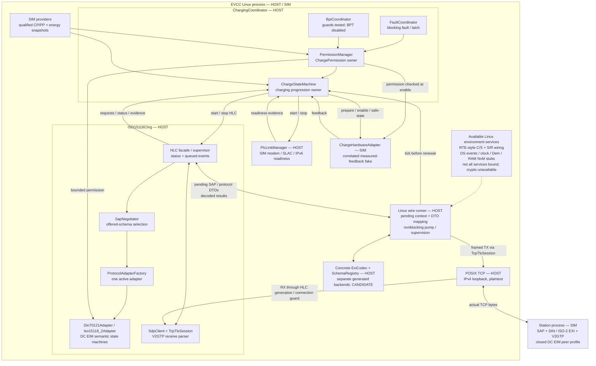
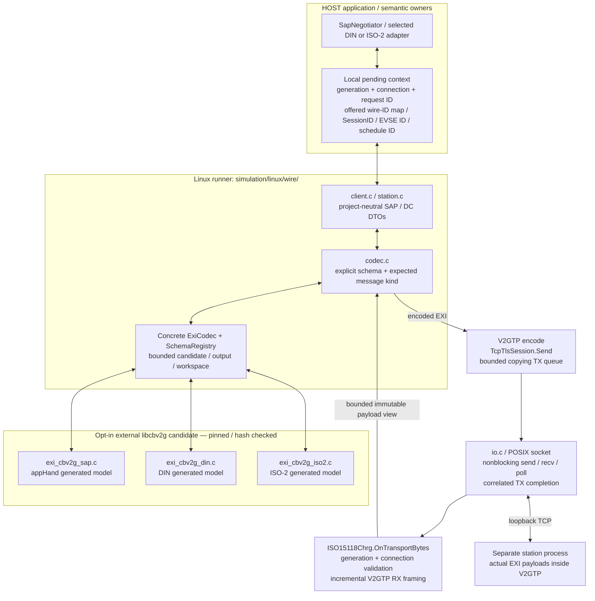
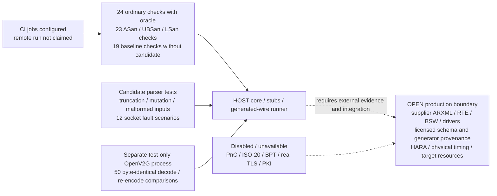

# Current implementation architecture

Revision: Draft 0.1 — 26/10/2026. Source baseline: commit `70ced6a`.
Scope: current C11/Linux host implementation, including the opt-in generated
EXI candidate. No target AUTOSAR configuration or formal freeze is implied.

Legend: **HOST** = implemented project logic verified on host; **SIM** = host
surrounding model or service stub; **CANDIDATE** = pinned external generated
code, opt-in; **OPEN** = production integration/evidence unavailable.
Solid edges describe the current host paths. Dotted edges describe dependencies,
configuration or future integration, not implemented production wiring.

## 1. System and composition view



HLC supplies requests/evidence and consumes permission. It has no direct actuator
control path. The coordinator remains the owner of energy progression and stop.
The supporting PLC manager owns SLAC/link readiness; SDP belongs to HLC.

The diagram represents logical responsibilities. The current C implementation
combines facade/supervisor behavior in `iso15118_chrg.c`; it does not assert
separate generated SWCs, runnables or AUTOSAR partitions.

## 2. Actual generated-code and network path



Generated types stay private to their schema-specific adapters. The runner binds
an actual codec/registry alongside the core facade; the facade's internal
`exi_codec` / `schema_registry` fields still represent lifecycle placeholders.
The concrete backend is not a supplier-generated AUTOSAR service.

Generation, connection and request IDs are local metadata, not custom additions
to standardized payloads. One request is outstanding; decoded kind and SessionID
are checked before forwarding to the owner. SAP wire SchemaID is explicitly
mapped to an offered project schema, never cast to `OpenV2g_SchemaId`.

## 3. Runtime progression and stopping

```mermaid
sequenceDiagram
    participant Env as SIM CP/PP / energy / link
    participant CC as ChargingCoordinator
    participant HLC as HLC / selected protocol owner
    participant IO as Wire runner + EXI/V2GTP + TCP
    participant EVSE as SIM station process
    participant HW as SIM hardware adapter

    Env->>CC: qualified connect + current-generation evidence
    CC->>HLC: start after simulated PLC readiness
    Note over HLC,IO: SDP endpoint / network readiness injected; no real UDP SDP or PLC
    HLC->>IO: pending SAP offer snapshot
    IO->>EVSE: SAP request in EXI/V2GTP
    EVSE-->>IO: selected wire SchemaID
    IO->>HLC: validated offered-schema result
    HLC->>IO: setup / service / EIM auth / parameters
    IO->>EVSE: generated DIN or ISO-2 messages
    EVSE-->>IO: generated responses
    IO->>HLC: checked kind / session / pending context
    HLC-->>CC: status and semantic evidence
    HLC->>IO: cable check / precharge
    CC->>CC: evaluate bounded permission
    CC->>HW: prepare with host measured feedback
    HLC->>IO: PowerDelivery START
    IO->>EVSE: generated request
    EVSE-->>IO: generated response
    CC->>HW: permission-gated enable
    loop Three host current-demand exchanges
        HLC->>IO: pending CurrentDemand request
        IO->>EVSE: EXI/V2GTP request
        Note over CC,IO: Nonblocking wait: coordinator tick before permission renewal; refresh mock evidence
        EVSE-->>IO: EXI/V2GTP response
        IO->>HLC: validated response and local correlation
    end
    CC->>CC: BeginProtocolStop — publish DENY
    CC->>HW: request safe state; check host safe / zero-current feedback
    HLC->>IO: PowerDelivery STOP / WeldingDetection / SessionStop
    IO->>EVSE: bounded generated protocol-stop exchanges
    CC->>HLC: final teardown; cancel protocol / transport
    CC->>Env: stop PLC link
    Note over CC,HW: Fault / timeout / stale evidence invokes full coordinated stop directly
```

This is a host control sequence, not an approved physical electrical stop
sequence. Poll periods, freshness limits and timeout values are provisional host
settings. A late owner turn cannot renew an already expired permission.

## 4. Available verification and production gaps



The oracle is a separate test executable, not an application dependency. Its
comparisons provide differential evidence, not independently authored normative
golden vectors or physical interoperability proof.

## Source mapping

| Diagram element | Current implementation |
|---|---|
| Coordinator owners | `src/charging_coordinator/` |
| HLC facade/supervisor and semantic protocol owners | `src/iso15118_chrg/` |
| CP/PP, energy, PLC and host hardware boundaries | `src/support/` |
| Composition fixture / typed port wiring | `simulation/src/host_simulation.c` |
| Linux service stubs and custom-frame smoke example | `simulation/linux/src/` |
| Generated-wire host application and TCP pump | `simulation/linux/wire/` |
| Concrete schema-specific generated-code adapters | `integration/protocol/adapters/cbv2g/` |
| Candidate source pin / selected-source checksums | `integration/protocol/generated/libcbv2g/` |
| Independent differential oracle and fixed references | `tests/oracle/` |
| Target AUTOSAR / supplier boundary | `integration/autosar/` — blocked for target |

[Current evidence and closure inventory](EXI_WIRE_IMPLEMENTATION_STATUS.md) ·
[Wire build/run guide](../../simulation/linux/wire/README.md)
