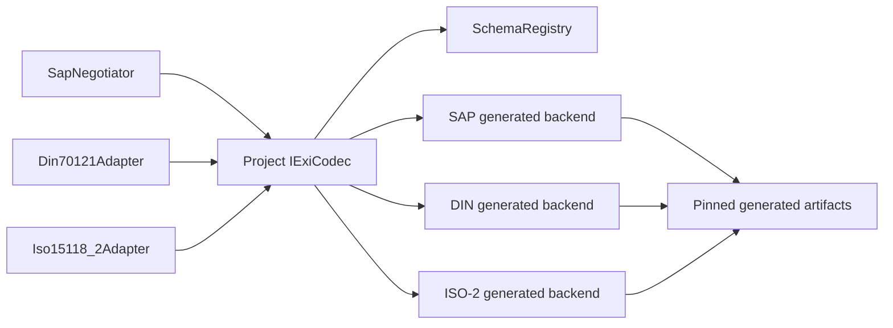

# Đề xuất triển khai EXI cho EVCC

**Revision:** Draft 0.3 — 26/10/2026
**Status:** `PROPOSED_WITH_VERIFIED_SAP_HOST_CANDIDATE` — chưa phải lựa chọn supplier, schema license hoặc bằng chứng conformance

## 1. Quyết định tạm

Chọn `cbExiGen`/`libcbv2g` làm ứng viên đầu tiên cho PoC EXI của DIN SPEC 70121 và ISO 15118-2 DC EIM. Generated codec được tích hợp qua project adapter; generated structures không đi qua RTE port và không trở thành project public ABI.

Giữ một commercial EVCC/EXI product làm phương án giảm rủi ro production. `EXIP` chỉ là phương án dự phòng nếu generated V2G codec không đạt target constraints. Java EXI implementation chỉ được dùng làm host oracle/golden-vector generator.

ISO 15118-2 PnC, ISO 15118-20 và BPT tiếp tục fail-disabled. Draft này không phê duyệt edition chuẩn, schema package hoặc quyền phân phối generated artifacts.

## 2. Ranh giới đã hiện thực

Host/SIL hiện có:

- `SchemaRegistry` lưu descriptor bất biến theo từng explicit `SchemaId`;
- mỗi descriptor ghi protocol/mode, payload/workspace/object/collection limits, implementation ID, schema revision và generated checksum;
- schema chưa bind hoặc bị integrity error không được công bố là available;
- `ExiCodec` bind một backend riêng theo schema và không suy schema từ payload;
- SAP/protocol client gọi encode/decode/reset qua provisional C/S port; `SchemaRegistry` cung cấp C/S descriptor/limits/compatibility và `ExiCodec` dùng required descriptor plus S/R status ports ở runtime;
- registry status và EXI diagnostic được công bố dưới dạng retained S/R snapshot có sequence counter;
- encode/decode kiểm tra session generation, pointer, capacity và message type;
- decoder ghi vào caller-owned candidate object, chỉ copy sang output sau khi decode đầy đủ và đúng expected message type;
- failure reset/zero transient workspace và candidate object; stale generation bị từ chối;
- không cấp phát heap và không có generator/runtime Java trong target-facing implementation.

Các contract nằm tại:

- `include/openv2g/iso15118_chrg/schema_registry.h`;
- `include/openv2g/iso15118_chrg/exi_codec.h`;
- `src/iso15118_chrg/schema_registry.c`;
- `src/iso15118_chrg/exi_codec.c`.

`openv2g_test_exi_codec` dùng fake backend, không phải EXI encoder. Test này xác minh project boundary, fail-closed registry, round-trip callback wiring, bounds, stale generation và no-partial-delivery.

Chi tiết quy ước port xem `PROVISIONAL_ASR_INTERFACE_STYLE.md`. Port names và C types hiện tại không phải cam kết ARXML; semantics ownership và failure là phần cần giữ khi chuyển sang generated RTE.

## 3. Kiến trúc tích hợp generated code



Mỗi backend adapter chịu trách nhiệm chuyển `messageTypeId` và project-neutral object thành đúng generated union/structure của schema đó. Không dùng một generated union chung cho DIN, ISO-2 và ISO-20.

## 4. Artifact layout đề xuất

```text
integration/protocol/
  generated/
    <provider>/
      <generator-pin>/
        manifest.md
        sap/
        din70121/
        iso15118_2/
  adapters/
    cbv2g/
      exi_cbv2g_sap.c
      exi_cbv2g_din.c
      exi_cbv2g_iso2.c
```

`manifest.md` phải ghi:

- generator name, release và commit;
- exact standard/schema edition và corrigenda;
- schema file checksum và nguồn/license record;
- feature configuration dùng khi generate;
- checksum của toàn bộ generated output;
- compiler options, target compiler/version và deviation record;
- measured ROM/RAM/stack/workspace/WCET evidence reference.

Không chạy generator trong ECU build. Generation là controlled host step; production build chỉ dùng reviewed, pinned generated snapshot.

## 5. Trình tự triển khai

1. Thu nhận schema package hợp lệ và legal xác nhận quyền dùng/phân phối.
2. Pin `cbExiGen`/`libcbv2g` release hoặc commit; lưu manifest và checksum.
3. Bind `EXI_SCHEMA_SAP`; xác minh SupportedAppProtocol request/response bằng golden vectors.
4. Bind DIN và ISO-2 DC EIM thành hai backend riêng.
5. Thực hiện message slice đầu: SessionSetup, ServiceDiscovery, PaymentServiceSelection và ChargeParameterDiscovery.
6. Nối decoded project-neutral message sang protocol adapter; không cho EXI gọi coordinator/hardware.
7. Chạy negative corpus và fuzz cho truncated input, oversized count, invalid choice, wrong schema và message-type mismatch.
8. Chạy target compiler, static analysis/MISRA và đo tài nguyên trước khi thay trạng thái `PROPOSED`.

## 6. Điều kiện qua PoC

- Golden encode/decode vectors chạy độc lập cho SAP, DIN và ISO-2.
- Differential result khớp reference codec cho selected profile.
- Không assertion, abort, heap allocation sau init hoặc partial decoded object với malformed peer input.
- Bounds của mọi collection/string/byte array được chứng minh từ generated types tới project DTO.
- Wrong/unoffered schema và message type luôn fail closed.
- Resource report có ROM, RAM, maximum stack, workspace và encode/decode WCET trên target compiler.
- Generated/source checksum và schema license evidence có thể truy vết.

Chỉ khi các điều kiện này đạt mới có thể thay lifecycle placeholder trong `ISO15118Chrg` bằng generated backend và gọi kết quả là target PoC. Protocol conformance, interoperability và production qualification vẫn là các cổng riêng.

## 7. Rủi ro còn mở

| Rủi ro | Xử lý |
|---|---|
| Chưa có licensed schema trong repository | Giữ backend production unavailable; không nhúng schema hoặc tự dựng normative layout. |
| Generated code không đạt compiler/MISRA/resource limits | Giới hạn feature generation, tạo deviation có review hoặc chuyển sang supplier product. |
| ISO-2 test coverage của upstream chưa đủ | Project-owned golden/negative/conformance corpus là acceptance gate bắt buộc. |
| ISO-20/signature chưa đủ ổn định | Giữ feature disabled và đánh giá lại bằng spike riêng. |
| Generated types làm rò ABI vào RTE | Chỉ adapter được include generated headers; public/RTE interfaces dùng project/imported types đã xác định. |

## 8. Nguồn ứng viên

- [EVerest cbExiGen](https://github.com/EVerest/cbexigen)
- [EVerest libcbv2g](https://github.com/EVerest/libcbv2g)
- [W3C Efficient XML Interchange](https://www.w3.org/TR/exi/)
- [W3C EXI Profile](https://www.w3.org/TR/exi-profile/)
- [EXIP portable C implementation](https://github.com/ekrich/exip)
- [EXIficient Java](https://exificient.github.io/java/)

Các nguồn này chứng minh có candidate/reference implementation; chúng không chứng minh selected supplier baseline, license approval hoặc target suitability.


## 9. SAP host candidate implemented — 26/10/2026

Revision note (Draft 0.3): started the generated integration with an opt-in,
externally pinned libcbv2g SAP backend, following the SAP-first order in §5.
The earlier fake boundary tests remain; the new backend executes actual generated
EXI encoding/decoding. No target or production acceptance is implied.

- Adapter: `integration/protocol/adapters/cbv2g/exi_cbv2g_sap.c`.
- Public objects: bounded project-neutral SAP request/response DTOs; generated
  structures stay private. Wire SchemaID remains distinct from project SchemaId.
- Pin: `03350be048b35b179905129005a97144a4bdcf93`, with selected source hashes and
  manifest under `integration/protocol/generated/libcbv2g/`.
- Build is opt-in (`OPENV2G_ENABLE_CBV2G_SAP_POC`), offline after an explicit
  external checkout. No generator is run and no schema/generated C is vendored.
- Bounds follow the actual generated decoder: five offers, 99 namespace bytes;
  one-extra-byte bitstream access is contained by guarded staging storage and
  consumed-length checks. See adapter README for exact limitations.
- Host evidence: 20/20 tests; fixed upstream request/response vectors, truncation,
  bounds, mismatch and malformed corpus; SAP ASan/UBSan/LSan pass.

Step 1 remains OPEN for schema provenance/legal/production rights. Step 2 pins
the host generated-code snapshot but does not recover the full original
schema/generator input chain. Step 3 now has host regression-vector evidence;
independent golden/differential evidence remains OPEN. DIN/ISO-2 backends,
message slices, session-wire mapping and target gates are still pending.
The ISO15118Chrg lifecycle placeholder and Linux semantic socket smoke flow are
not silently replaced by this candidate.

Build/run instructions and evidence:
[cbv2g SAP candidate](../../integration/protocol/adapters/cbv2g/README.md).
