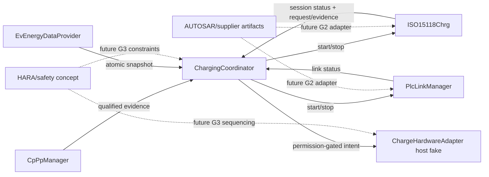

# G1 host/SIL skeleton architecture

**Revision:** Draft 0.14 — 15/10/2026

**Status:** `PROPOSED_IMPLEMENTATION` — host/SIL only, not AUTOSAR production evidence

## 1. Scope

Bộ khung hiện thực hóa phần việc được phép tại G1 trong `PROVISIONAL_BASELINE_PROPOSAL_VI.md`. Nó cung cấp logical C11 contracts, deterministic state owners, host fakes và tests cho:

- `ChargingCoordinator` với `ChargeStateMachine`, `PermissionManager`, `FaultCoordinator`, `BptCoordinator`;
- `ISO15118Chrg` với session lifecycle và catalog các submodule SDP, TCP/TLS, V2GTP, EXI, schema, SAP, protocol adapter, PKI/certificate;
- `CpPpManager`, `EvEnergyDataProvider`, `PlcLinkManager`, `ChargeHardwareAdapter`;
- seams cho clock, diagnostics, crypto và AUTOSAR/supplier integration.

Active feature scope là DIN 70121 DC EIM và ISO 15118-2 DC EIM. PnC, ISO-20 và BPT fail-disabled.

## 2. Repository layout

```text
include/openv2g/
  common/                 logical types, results, validation
  charging_coordinator/   vehicle lifecycle and permission ownership
  iso15118_chrg/          HLC lifecycle and protocol subsystem seams
  support/                CP/PP, energy, PLC and hardware boundaries
  platform/               BSW/platform-facing ports
src/
  common/
  charging_coordinator/
  iso15118_chrg/
  support/
integration/
  autosar/                future RTE/BSW/supplier bindings
  protocol/               future licensed/generated protocol artifacts
simulation/               host-only surrounding-component composition fixture
scripts/                  reproducible host build helpers
tests/
  unit/
  integration/
examples/host_demo/
examples/flow_simulator/
```

## 3. Ownership and communication



`ISO15118Chrg` không biết `OpenV2g_HardwareControlPort`. Chỉ `ChargingCoordinator` có hardware control port. Đây là structural guard chống direct HLC-to-actuator path.

## 4. Implemented host behavior

- Coordinator tạo nonzero `session_generation` khi nhận qualified connect.
- Evidence từ generation khác bị từ chối.
- `PermissionManager` bắt đầu và fallback về `DENY`.
- Permission chỉ `ALLOW` khi CP/PP, energy, link, HLC và hardware evidence current/valid, đồng thời không có blocking fault hoặc BPT path ngoài active scope.
- Hardware host fake cần permission ID, generation, action, mode, direction và expiry hợp lệ trước khi enable.
- Permission expiry kích hoạt stop path.
- Stop idempotent theo coordinator state và gọi theo thứ tự responsibility: revoke permission, hardware safe state, HLC stop, PLC stop.
- SDP/HLC/PLC state owners từ chối stale-generation callback.
- `ISO15118Chrg` nhận caller-owned V2GTP storage và chuyển bounded transport bytes vào parser thật; malformed/oversized frame đưa HLC về error.
- Typed `SchemaRegistry`/`ExiCodec` boundary nhận schema-specific backend, metadata/checksum và caller-owned buffers; stale generation, bounds, wrong message type và partial decode failure được kiểm tra độc lập.
- EXI operations và schema queries đi qua provisional C/S ports; registry status và EXI diagnostic đi qua S/R read ports để giữ semantics RTE-like trước khi có ARXML.
- Coordinator/HLC/PLC/hardware control paths, SDP/TCP/V2GTP operations và lower callbacks có provisional C/S ports; CP/PP, energy, link, HLC, transport, hardware, permission, fault, BPT và state status có S/R copy ports.
- HLC supervisor gọi SDP/TCP/V2GTP qua required ports; nominal integration đọc producer snapshots qua S/R ports, không dereference producer state.
- SDP result được copy thành immutable typed endpoint; TCP/TLS host lifecycle kiểm tra generation, connection ID và state, loại callback/RX cũ sau cancel/reconnect và cấm implicit downgrade khi TLS lỗi.
- HLC event queue có compile-time capacity; overflow revoke permission và buộc coordinator resync bằng authoritative status mới hơn overflow.
- Khởi động schema/EXI/SAP dependency được kiểm tra; lỗi khởi động không còn bị bỏ qua.
- SAP giữ exact ordered offer snapshot theo generation/request ID, lọc DIN khỏi TLS, từ chối unoffered schema/no-match/timeout và chỉ chuyển selection đã xác thực sang static adapter factory.
- Factory cấp đúng một typed DIN hoặc ISO-2 adapter; mỗi adapter sở hữu state riêng, kiểm tra generation/exact pending correlation/sequence/timer và xuất semantic HLC event qua façade.
- DIN và ISO-2 chủ động phát từng semantic EV request qua required C/S message channel; request copy toàn bộ energy/permission snapshot cần thiết để mapper không giữ pointer vào mutable producer state.
- Các bước liên quan năng lượng đọc `EvEnergyDataProvider` và `ChargePermission` qua S/R ports. Missing, sai generation/quality/mode/direction/action hoặc permission hết hạn đều fail-closed trước khi phát request tiếp theo.
- HLC façade cung cấp one-slot bounded protocol-TX mailbox và retained protocol diagnostic. Nó dùng thời gian của owner runnable cho freshness/permission thay vì tin timestamp từ decoded response.
- `ProtocolDataFlow` là rule source dùng chung cho DIN/ISO-2: kiểm tra mode/message applicability, required availability bits, target/permission limit intersection, semantic action/power và correlated metering evidence.
- `EvEnergySnapshot` host type đã khớp catalogue Rev.3 với target voltage/current và project semantic availability bits; đây vẫn không phải supplier/generated ABI.
- ISO-20/PnC/BPT không được quảng bá là active feature.
- `openv2g_host_sim` ghép CP/PP, energy, PLC, HLC, coordinator và hardware fake qua chính C/S/S/R contracts; test có thể inject custom evidence, link loss, peer response và measured hardware feedback mà không thêm đường điều khiển HLC→actuator.

## 5. Deliberately provisional or stubbed

- Logical types không phải `ApplicationDataType`/`ImplementationDataType` generated từ ARXML.
- HLC supervisor vẫn dùng lifecycle placeholder cho EXI/schema và chưa bind generated message mapper; SAP/factory/DIN/ISO-2 đã có typed host component nhưng chưa phải implementation chuẩn trên wire. Typed TCP/TLS host state vẫn không phải SoAd/TcpIp/Csm implementation.
- Host hardware adapter là fake synchronous model, không phải actuator driver.
- Freshness values trong tests là fixture values, không phải HARA/timing baseline.
- Không có normative protocol timers, response mapping, schema body hoặc certificate processing.
- Không có OS task/runnable/event/queue/SchM mapping.

## 6. Replacement seams for G2/G3

| Current seam | Replacement input | Required evidence |
|---|---|---|
| Logical `OpenV2g_*` imported-boundary types | Supplier ARXML/generated header adapter | Signature/type/enum diff and checksum |
| Typed EXI/schema/SAP/protocol message seams | Licensed schemas, selected generator and edition-specific mapper | Golden vectors, response/timer matrix, workspace/WCET, generated checksum |
| PLC lifecycle host model | Modem/raw MME/TcpIp/SoAd integration | Capability matrix and target PoC |
| Hardware host fake | Vehicle hardware/safety adapter | HARA, safe-state sequence, feedback and reaction tests |
| Platform ports | OS/RTE/Dem/Csm/KeyM/NvM configuration | Generated build and integration evidence |

## 7. Verification mapping

| Test target | Covered intent |
|---|---|
| `openv2g_test_permission` | Fail-closed permission, complete/current evidence and stale generation |
| `openv2g_test_bpt_coordinator` | Measured-zero/new-permission guard cho cả hai chiều reversal; stale generation |
| `openv2g_test_hlc_generation` | HLC late callback rejection, transport→V2GTP connection, dependency-start failure, explicit schema/protocol gate và idempotent stop |
| `openv2g_test_hlc_event_queue` | Bounded queue, drop-newest overflow flag/count, generation reset và stale event rejection |
| `openv2g_test_hlc_event_bridge` | HLC event consumer wiring; overflow revokes permission và requires fresh authoritative status resync |
| `openv2g_test_sdp_client` | SDP cancel race, late response rejection and immutable endpoint validation |
| `openv2g_test_tcp_tls_session` | Typed endpoint/connection lifecycle, cancel during handshake, same-generation reconnect, stale connection callbacks, bounded TX queue/backpressure, request/result/deadline correlation, idempotent close and TLS no-downgrade behavior |
| `openv2g_test_hlc_tls` | HLC waits for TLS result; failure stays error and success alone starts message stack |
| `openv2g_test_hardware_gate` | No enable with DENY/expired permission; command/feedback correlation, stale feedback rejection, measured contactor mismatch fault and safe-state recovery |
| `openv2g_test_v2gtp_codec` | Bounded streaming decode, fragmented/coalesced frames, stale generation and malformed/oversized input |
| `openv2g_test_exi_codec` | Explicit immutable schema registry, backend binding, bounded encode/decode, stale generation, reset and no-partial-delivery |
| `openv2g_test_sap_negotiator` | Ordered/bounded offers, DIN-over-TLS filtering, request correlation, unoffered selection, cancel and timeout |
| `openv2g_test_protocol_adapters` | One-active static factory; outbound DIN/ISO-2 DC EIM request sequences, exact pending correlation, current-demand/metering loops, state-by-state permission-expiry gates, timer/peer failures and retained diagnostics |
| `openv2g_test_protocol_data_flow` | DIN/ISO-2 mode/message applicability, required field masks, target/permission limit intersection, target-power projection, metering evidence and stop semantics |
| `openv2g_test_asr_style_ports` | C/S and S/R port bindings across coordinator internals, CP/PP, energy, PLC, hardware, SDP, TCP/TLS, V2GTP and HLC façade |
| `openv2g_test_public_headers` | Public C header self-containment and compile surface |
| `openv2g_test_nominal_flow` | CpPp/Energy provider→coordinator→link→HLC→permission→hardware và revoke-before-teardown order |
| `openv2g_test_host_simulation` | Reusable surrounding-component fixture, custom data injection, stale-generation rejection, measured hardware mismatch và ordered coordinated stop |

Passing host tests is `VERIFIED_HOST` evidence only. It is not target, safety, interoperability or conformance evidence.

## 8. Next implementation order

1. Obtain and checksum selected supplier ARXML/generated headers, then reconcile every C/S caller/server row before producing RTE ports.
2. Bind typed transport/V2GTP intake to generated SoAd/TcpIp/PduR callbacks with connection/request correlation and bounded backpressure.
3. Bind the typed SAP/DIN/ISO-2 semantic seams to licensed generated EXI objects only after schema edition, generator version, response/timer matrix and golden vectors are available.
4. Replace PLC and hardware fakes only when modem capability evidence and the vehicle safety concept satisfy G2/G3 gates.

## 9. Revision notes

| Revision | Date | Changes |
|---|---|---|
| Draft 0.1 | 09/09/2026 | Initial two-composition host/SIL skeleton and verification map. |
| Draft 0.2 | 10/09/2026 | Connected provider outputs, fault/BPT permission evidence and HLC transport intake to the bounded V2GTP parser; added dependency-failure and BPT reversal tests. |
| Draft 0.3 | 10/09/2026 | Added bounded HLC event/resync path, immutable SDP endpoint, typed TCP/TLS lifecycle with no downgrade, cancellation tests and 218-row interface traceability. |
| Draft 0.4 | 10/09/2026 | Added typed schema registry and pluggable EXI codec boundary with bounded buffers, generation checks, integrity handling and no-partial decode publication. |
| Draft 0.5 | 11/09/2026 | Added provisional AUTOSAR-style C/S ports for EXI/schema operations and S/R ports for registry status/EXI diagnostics; documented later RTE/ARXML mapping. |
| Draft 0.6 | 11/09/2026 | Extended provisional C/S and S/R port bindings across support, coordinator, HLC façade and transport libraries; moved internal HLC transport calls and nominal snapshot flow onto ports. |
| Draft 0.7 | 14/09/2026 | Replaced SAP/factory/DIN/ISO-2 lifecycle stubs with typed host components, correlated offer selection, static one-active factory, semantic protocol FSMs and negative-path tests. |
| Draft 0.8 | 15/09/2026 | Added semantic EV request generation, exact request/response correlation, energy and permission S/R gates, HLC protocol-TX mailbox, retained diagnostics and complete DIN/ISO-2 DC EIM host sequences. |
| Draft 0.9 | 15/09/2026 | Added a shared protocol data-flow rule/validation layer, target voltage/current availability, dispatched-request event provenance, correlated metering evidence and main-flow documentation/tests. |
| Draft 0.10 | 20/09/2026 | Added connection-ID correlation to TCP/TLS callbacks and HLC RX intake; covered cancel during handshake, same-generation reconnect and late callbacks from the closed connection. |
| Draft 0.11 | 20/09/2026 | Added bounded transport TX descriptors, fixed-capacity outstanding-request tracking, lower send seam, request/result/deadline correlation, backpressure and cancel cleanup; real SoAd/TcpIp/PduR binding remains G2. |
| Draft 0.12 | 20/09/2026 | Added DIN/ISO-2 DC expiry-matrix regression for precharge, power start, first energy loop and ongoing energy-loop renewal; each dependent request re-reads current permission and fails closed. |
| Draft 0.13 | 20/09/2026 | Added provisional hardware command IDs/results and independently applied measured feedback; correlated lock/contactor mismatch enters hardware fault and clears accepted permission, while stale command feedback cannot affect the active command. |
| Draft 0.14 | 15/10/2026 | Added a reusable host-only surrounding-component simulator, injectable CP/PP/energy/link/EVSE/hardware inputs, ordered trace, flow example, Windows GCC build helper and an 18th integration test. |

## Linux surrounding environment supplement — 26/10/2026

Added `simulation/linux/` as a generic C11/POSIX host boundary around existing project ports. It provides OS events/alarms, loopback TCP with correlated transport TX completion, a semantic SessionSetup station smoke exchange, bounded diagnostics, RAM NvM and fail-closed crypto seams. See [Linux build/run and coverage](../../simulation/linux/README.md). GCC portability fixes add explicit `<stddef.h>` includes in the state-machine and subsystem lifecycle sources. Linux GCC 13.3 Debug strict-warning build and 19/19 host test executables passed. No supplier ABI, full wire protocol, sustained charging loop or target evidence is implied.
