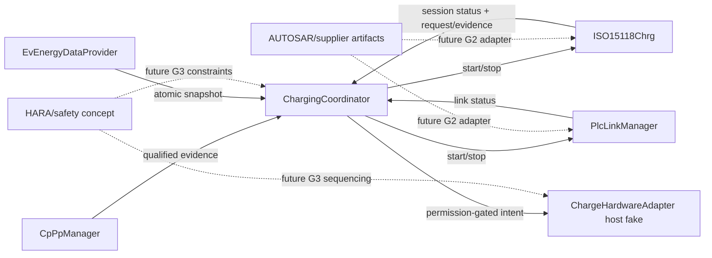

# G1 host/SIL skeleton architecture

**Revision:** Draft 0.1 — 09/09/2026

**Status:** `PROPOSED_IMPLEMENTATION` — host/SIL only, not AUTOSAR production evidence

## 1. Scope

Bộ khung hiện thực hóa phần việc được phép tại G1 trong `PROVISIONAL_BASELINE_PROPOSAL_VI.md`. Nó cung cấp logical C11 contracts, deterministic state owners, host fakes và tests cho:

- `ChargingCoordinator` với `ChargeStateMachine`, `PermissionManager`, `FaultCoordinator`, `BptCoordinator`;
- `ISO15118Chrg` với session lifecycle và catalog các submodule SDP, TCP/TLS, V2GTP, EXI, schema, SAP, protocol adapter, PKI/certificate;
- `CpPpManager`, `EvEnergyDataProvider`, `PlcLinkManager`, `ChargeHardwareAdapter`;
- seams cho clock, diagnostics, crypto và AUTOSAR/supplier integration.

Active feature scope là DIN 70121 DC EIM và ISO 15118-2 DC EIM. PnC, ISO-20 và BPT fail-disabled.

## 2. Repository layout

```text
include/openv2g/
  common/                 logical types, results, validation
  charging_coordinator/   vehicle lifecycle and permission ownership
  iso15118_chrg/          HLC lifecycle and protocol subsystem seams
  support/                CP/PP, energy, PLC and hardware boundaries
  platform/               BSW/platform-facing ports
src/
  common/
  charging_coordinator/
  iso15118_chrg/
  support/
integration/
  autosar/                future RTE/BSW/supplier bindings
  protocol/               future licensed/generated protocol artifacts
tests/
  unit/
  integration/
examples/host_demo/
```

## 3. Ownership and communication



`ISO15118Chrg` không biết `OpenV2g_HardwareControlPort`. Chỉ `ChargingCoordinator` có hardware control port. Đây là structural guard chống direct HLC-to-actuator path.

## 4. Implemented host behavior

- Coordinator tạo nonzero `session_generation` khi nhận qualified connect.
- Evidence từ generation khác bị từ chối.
- `PermissionManager` bắt đầu và fallback về `DENY`.
- Permission chỉ `ALLOW` khi CP/PP, energy, link, HLC và hardware evidence current/valid.
- Hardware host fake cần permission ID, generation, action, mode, direction và expiry hợp lệ trước khi enable.
- Permission expiry kích hoạt stop path.
- Stop idempotent theo coordinator state và gọi theo thứ tự responsibility: revoke permission, hardware safe state, HLC stop, PLC stop.
- SDP/HLC/PLC state owners từ chối stale-generation callback.
- ISO-20/PnC/BPT không được quảng bá là active feature.

## 5. Deliberately provisional or stubbed

- Logical types không phải `ApplicationDataType`/`ImplementationDataType` generated từ ARXML.
- `OpenV2g_Subsystem` chỉ là lifecycle placeholder, không phải EXI/TCP/TLS/protocol implementation.
- Host hardware adapter là fake synchronous model, không phải actuator driver.
- Freshness values trong tests là fixture values, không phải HARA/timing baseline.
- Không có normative protocol timers, response mapping, schema body hoặc certificate processing.
- Không có OS task/runnable/event/queue/SchM mapping.

## 6. Replacement seams for G2/G3

| Current seam | Replacement input | Required evidence |
|---|---|---|
| Logical `OpenV2g_*` imported-boundary types | Supplier ARXML/generated header adapter | Signature/type/enum diff and checksum |
| `OpenV2g_Subsystem` EXI/schema placeholders | Licensed schemas and selected generator | Golden vectors, workspace/WCET, generated checksum |
| PLC lifecycle host model | Modem/raw MME/TcpIp/SoAd integration | Capability matrix and target PoC |
| Hardware host fake | Vehicle hardware/safety adapter | HARA, safe-state sequence, feedback and reaction tests |
| Platform ports | OS/RTE/Dem/Csm/KeyM/NvM configuration | Generated build and integration evidence |

## 7. Verification mapping

| Test target | Covered intent |
|---|---|
| `openv2g_test_permission` | Fail-closed permission, complete/current evidence and stale generation |
| `openv2g_test_hlc_generation` | HLC late callback rejection, explicit schema/protocol gate, idempotent stop |
| `openv2g_test_hardware_gate` | No enable with DENY or expired permission |
| `openv2g_test_v2gtp_codec` | Bounded streaming decode, fragmented/coalesced frames, stale generation and malformed/oversized input |
| `openv2g_test_public_headers` | Public C header self-containment and compile surface |
| `openv2g_test_nominal_flow` | Connect→link→HLC→permission→energy and revoke-before-teardown order |

Passing host tests is `VERIFIED_HOST` evidence only. It is not target, safety, interoperability or conformance evidence.

## 8. Next implementation order

1. Add requirement/interface/state/test traceability IDs without inventing normative requirements.
2. Bind the bounded V2GTP codec to the future transport adapter with caller-owned buffers; then replace the next generic HLC subsystem boundary.
3. Add event queues and cancellation tests with compile-time capacities.
4. Reconcile every C/S caller/server row before producing RTE ports.
5. Replace fakes only when the G2/G3 evidence gate for that dependency is satisfied.
