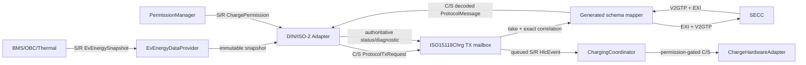
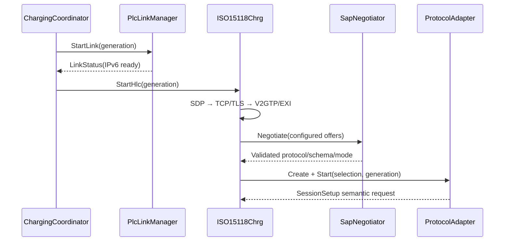

# Luồng dữ liệu DIN SPEC 70121 và ISO 15118-2

**Revision:** Draft 0.1 — 15/09/2026
**Status:** `VERIFIED_HOST_DATA_FLOW` — semantic host/SIL mapping, không phải wire/EXI conformance

## 1. Baseline và giới hạn

Luồng này ánh xạ state/message classes trong Atomic Specification Rev.3 §§18–20 và Charging Architecture Rev.4 §§11.1–11.2 vào provisional AUTOSAR-style C/S, S/R đã triển khai. Candidate standards được dùng để đặt message order là DIN SPEC 70121:2014-12 và ISO 15118-2:2014. Exact corrigenda, response code, optional-field rule, timer và generated datatype vẫn thuộc `OP-006`/`OP-007` cho tới khi có licensed baseline.

Nguồn công khai xác nhận phạm vi: [ISO 15118-2:2014](https://www.iso.org/standard/55366.html) định nghĩa EVCC–SECC application messages, XML/EXI, V2GTP, TLS, TCP và IPv6; [DIN SPEC 70121:2014-12](https://www.dinmedia.de/de/technische-regel/din-spec-70121/224350045) là legacy DC charging communication cho CCS. DIN edition này hiện được DIN Media đánh dấu withdrawn nhưng vẫn là rollout baseline của dự án. [ISO 15118-4:2018](https://www.iso.org/obp/ui?_escaped_fragment_=iso%3Astd%3Aiso%3A15118%3A-4%3Aed-1%3Av1%3Aen) là nguồn conformance-test tương ứng; host rules trong tài liệu này không thay thế ATS đó.

## 2. Ownership và đường dữ liệu chung

Quy tắc ownership:

- adapter sở hữu protocol FSM và pending correlation;
- HLC façade sở hữu one-slot TX mailbox và lưu bản request đã dispatch cho tới response;
- mapper sở hữu generated objects và metering object được tham chiếu bằng bounded evidence token;
- `EvEnergyDataProvider` và `PermissionManager` là semantic producers; adapter chỉ đọc/copy;
- `ChargingCoordinator`, không phải HLC, quyết định hardware action;
- event action/power được lấy từ request đã dispatch, không lấy từ decoded peer payload.

## 3. Các data object qua interface

| Object | Producer → consumer | Nội dung/guard |
|---|---|---|
| `OpenV2g_EvEnergySnapshot` | Energy provider → protocol adapter | Generation, quality, timestamp, snapshot ID, SOC, measured DC values, isolation/interlock, vehicle limits, target voltage/current và availability mask. |
| `OpenV2g_ChargePermission` | Permission manager → protocol adapter | ALLOW/DENY, permission ID, action, mode, direction, bounded limits và expiry. |
| `OpenV2g_ProtocolTxRequest` | Adapter → HLC/mapper | Protocol/schema/mode, flow case, exact correlation, relevant energy-field mask, copied snapshot/permission, semantic action/power và optional metering token. |
| `OpenV2g_ProtocolMessage` | Mapper → adapter | Exact generation/correlation/kind, accepted/ongoing, normalized peer request evidence và optional correlated metering token. |
| `OpenV2g_HlcEvent` | HLC → coordinator | Event category, protocol step, evidence ID, requested action/power copied from the dispatched EV request. |
| `OpenV2g_ProtocolDiagnostic` | Adapter → HLC/diagnostic consumer | State, message, correlation và stable failure reason. |

`availability_mask` dùng project semantic bits, không dùng wire bit positions. Mapper chỉ map field có bit available; các bit bắt buộc của từng flow phải đủ trước khi phát request.

## 4. Common establishment flow

SAP chỉ chọn offer đã cấu hình. DIN chỉ hợp lệ với DC/non-TLS; ISO-2 EIM có DC baseline và AC extension path. Chỉ một adapter active trong một generation.

## 5. DIN 70121 DC EIM — normal flow

| Bước semantic | Mapper message class | Data EV đưa xuống mapper | Response/evidence đưa lên | Next state |
|---|---|---|---|---|
| Session | `SessionSetup` | generation/session context | accepted session identity | Service discovery |
| Service | `ServiceDiscovery` | configured DC/external-payment intent | offered charging/payment service | Service selection |
| Service | `ServicePaymentSelection` | selected DC/external-payment intent | accepted selection | Authorization |
| Authorization | `ContractAuthentication` | EIM/external-payment context | ongoing hoặc accepted | Charge parameter |
| Charge parameter | `ChargeParameterDiscovery` | vehicle limits; optional SOC/temperature/targets by availability | negotiated EVSE limits/evidence | Cable check |
| DC safety | `CableCheck` | interlock evidence; permission included when already valid, otherwise mapper reports not-ready | ongoing hoặc finished; no direct hardware command | Precharge |
| DC precharge | `PreCharge` | target voltage/current, optional measured voltage + PREPARE permission | ongoing hoặc voltage-ready evidence | Power delivery START |
| Power start | `PowerDelivery(START)` | vehicle limits + ENERGIZE/IMPORT permission | accepted start evidence | Current demand |
| Energy loop | `CurrentDemand` | target voltage/current, limits, optional SOC/measured values + permission | ongoing loop or stop condition | self hoặc Power delivery STOP |
| Power stop | `PowerDelivery(STOP)` | `RAMP_TO_ZERO` semantic intent, no new energize permission | accepted stop evidence | Welding detection |
| Post-charge | `WeldingDetection` | target voltage and optional measured DC voltage | finished post-charge evidence | Session stop |
| Session stop | `SessionStop` | session context | accepted close | Terminated |

DIN does not enter `ChargingStatus` or `MeteringReceipt` in this baseline. Authorization, charge-parameter, cable-check, precharge, current-demand and welding responses may remain `ongoing`; each retry receives a new correlation ID.

## 6. ISO 15118-2 DC EIM — normal flow

The DC EIM path uses the same data projections as DIN but keeps separate protocol state and schema ownership:

`SessionSetup → ServiceDiscovery → PaymentServiceSelection → Authorization(EIM) → ChargeParameterDiscovery → CableCheck → PreCharge → PowerDelivery(START) → CurrentDemand* → [MeteringReceipt] → PowerDelivery(STOP) → WeldingDetection → SessionStop`.

Differences represented by the current semantic boundary:

- ISO-2 may request a metering receipt during `CurrentDemand`;
- metering response must carry a nonzero evidence ID bound to the same generation and source correlation;
- the subsequent `MeteringReceipt` TX carries that evidence token back to the generated mapper;
- a signature-required token is rejected while the active EIM build has no PnC security service;
- service-detail, schedules and exact payment/response fields remain mapper/generated-type extensions until G2.

## 7. ISO 15118-2 AC EIM extension flow

The implemented semantic branch is:

`SessionSetup → ServiceDiscovery → PaymentServiceSelection → Authorization(EIM) → ChargeParameterDiscovery → PowerDelivery(START) → ChargingStatus* → [MeteringReceipt] → PowerDelivery(STOP) → SessionStop`.

AC does not allow `CableCheck`, `PreCharge`, `CurrentDemand` or `WeldingDetection` rules. The default product feature remains disabled, so this path is host code readiness rather than active product scope.

## 8. Per-message data-flow rules

| Flow case | Relevant energy bits | Required bits | Permission/action | Event category |
|---|---|---|---|---|
| Session/service/auth | none | none | none | state/service/auth |
| Charge parameter | SOC, temperature, limits, targets | limits | none | parameters accepted |
| DC safety | SOC, isolation, interlock | interlock | permission optional; readiness only with PREPARE or stronger | peer request |
| DC precharge | SOC, measured voltage, targets | target voltage/current | PREPARE or stronger | peer request |
| Power start | limits, targets | limits | ENERGIZE or IMPORT | peer request |
| DC energy loop | SOC, measured V/I, limits, targets | limits + target voltage/current | IMPORT or ENERGIZE | peer request |
| AC energy loop | SOC, limits | limits | IMPORT or ENERGIZE | peer request |
| Metering | mapper-owned evidence token | correlated token | signature policy gate | peer request |
| Power stop | none | none | RAMP_TO_ZERO evidence | peer request |
| Welding detection | measured/target voltage | target voltage | no energize permission | peer request |
| Session stop | none | none | none | session complete |

Target voltage/current must fit both vehicle limits and the active permission limits. Derived target power uses SI projection `mV × mA / 1,000,000 = W` and must fit both maximum-import-power limits.

## 9. Failure and controlled-stop flow

| Trigger | Adapter/HLC result | Coordinator responsibility |
|---|---|---|
| Missing required availability bit or invalid energy envelope | `STALE_DATA`, adapter FAILED | deny/revoke permission and initiate controlled stop |
| Permission missing, DENY, expired, wrong generation/mode/direction/action | `PERMISSION_EXPIRED`, adapter FAILED | revoke before safe-state/teardown |
| Target outside energy/permission limits | `PRECONDITION`, adapter FAILED | do not forward request; controlled stop |
| Wrong generation/correlation/message kind | `SEQUENCE`, adapter FAILED | ignore stale callback; close active session safely |
| Negative peer response | `PEER_REJECT`, adapter FAILED | controlled stop |
| Timer expiry | `TIMEOUT`, adapter FAILED | controlled close; exact deadline remains configured by edition |
| TX mailbox/backpressure failure | `RESOURCE`, adapter FAILED | no silent retry outside owner FSM |
| Link loss | HLC/transport error | physical safe-state may take priority; graceful protocol close is best effort |

Exact contactor, precharge, discharge and isolation reaction sequence is intentionally not defined here; it requires the vehicle safety concept.

## 10. Verification mapping

- `openv2g_test_protocol_data_flow`: mode/message applicability, field masks, limit intersection, target-power projection, metering token and stop action.
- `openv2g_test_protocol_adapters`: complete DIN/ISO-2 DC loops, exact correlation, ongoing loops, metering, permission expiry, peer rejection, timer and diagnostics.
- `openv2g_test_nominal_flow`: provider/coordinator/HLC port connection and HLC dispatch-time ownership.

Passing these tests proves project semantic flow only. Wire encoding, standardized optionality, response codes, timers and interoperability require licensed schemas, generated objects and ISO 15118-4/bench evidence.
