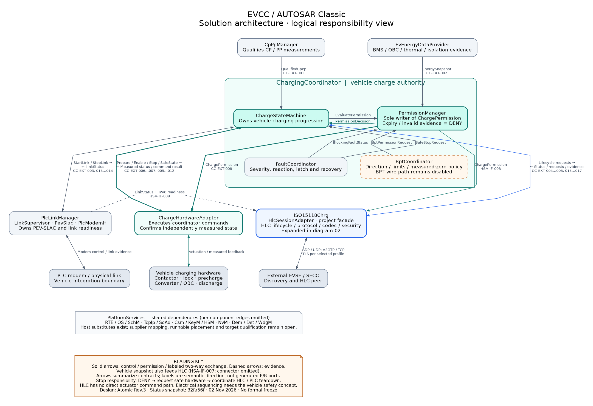
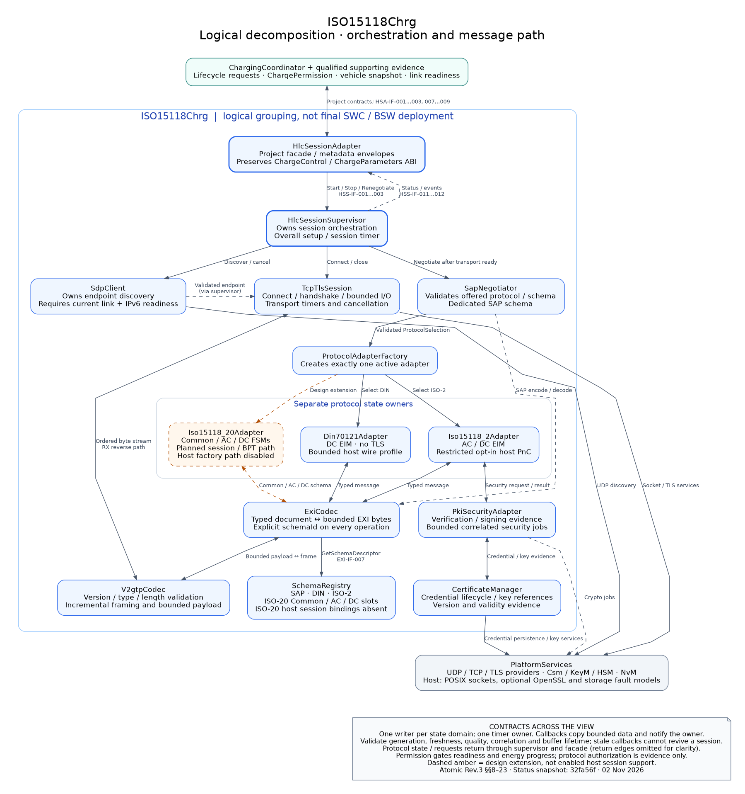

# EVCC solution architecture

Revision 0.1 · 02 November 2026 · documentation design view.

The vehicle-side EVCC separates vehicle charging authority from communication. `ChargingCoordinator` owns progression and permission; `ISO15118Chrg` owns HLC lifecycle and protocol behavior. Only the coordinator requests charging hardware actions. `PlcLinkManager` owns PEV-SLAC; `SdpClient` owns endpoint discovery after qualified link and IPv6 readiness.

These diagrams describe the documented design in Atomic Specification Rev.3. Implementation annotations refer to repository commit `32fa56f1c8425b6b87543ce34816660f559fcfde` and the current host inventory. They do not establish frozen supplier ports, deployment partitions, electrical sequencing, standards conformance or target verification.

## 1. Solution overview



[Open scalable SVG](diagrams/solution-architecture/01-solution-overview.svg) · [Editable DOT](diagrams/solution-architecture/01-solution-overview.dot)

`PermissionManager` is the sole writer of `ChargePermission`. `ChargeStateMachine` owns the vehicle lifecycle, `FaultCoordinator` owns fault severity/latching, and `BptCoordinator` owns direction policy. The manager evaluates the required qualified evidence; arrows terminating on a composition member indicate semantic use, not final RTE wiring. BPT reversal requires measured zero and a new permission, in addition to a supported vehicle topology.

Hardware command acceptance is distinct from measured completion. Missing, expired or invalid required evidence forces DENY. Stopping revokes permission before requesting safe hardware and coordinating HLC/PLC teardown. Normal host stopping may retain communication for a bounded protocol tail; the vehicle safety concept must define physical ordering and deadlines.

The EVSE arrow is a logical peer exchange through platform networking and the PLC bearer; it is not a separate physical link that bypasses PLC. Shared platform dependencies and diagnostic fan-in to `FaultCoordinator` are summarized rather than drawing every connector. Energy, CP, link, HLC and hardware evidence are evaluated together; no single readiness indication grants permission.

## 2. HLC decomposition



[Open scalable SVG](diagrams/solution-architecture/02-hlc-design.svg) · [Editable DOT](diagrams/solution-architecture/02-hlc-design.dot)

Startup proceeds through current link/IPv6 readiness, SDP, TCP and configured TLS, SAP, then one selected protocol adapter. This order is orchestration, not a claim that SDP directly opens TCP. Protocol transmit processing is typed message → explicit-schema EXI → V2GTP → transport; receive processing reverses it with bounded validation before dispatch. SAP uses its own schema before protocol selection. DIN remains non-TLS under the documented baseline.

The facade preserves imported `ChargeControl` and `ChargeParameters` ABI. Generation, timestamp, quality and correlation metadata stay in project envelopes. Its logical inclusion in this view does not finalize ASW/BSW runnable placement. Protocol-generated types stay within the codec/adapter boundary. Security evidence does not grant energy permission.

## 3. Design versus current implementation

| Area | Current host scope at the snapshot | Remaining boundary |
|---|---|---|
| Coordinator and support | C11 coordinator, permission, fault, BPT semantic model and support adapters | Supplier RTE/ARXML, real acquisition, vehicle safety allocation and target scheduling |
| DIN / ISO-2 | Separate adapters and explicit SAP/DIN/ISO-2 generated backends; bounded DC EIM and ISO-2 AC host profiles | Exact-edition qualification, richer profiles/notifications and physical interoperability |
| Security / PnC | Optional OpenSSL transport and crypto; restricted opt-in ISO-2 PnC authorization and signed receipts; host certificate transactions | Certificate installation/update wire, encrypted-key import and selected OEM PKI/HSM policy |
| PLC / network | Typed PEV-SLAC peer fixture; POSIX SDP/TCP with scoped-network support | Raw MME/PHY, modem integration and physical link-local/multicast evidence |
| ISO-20 / BPT | Schema slots, BPT semantic policy and isolated generated-model qualification | ISO-20 session bindings/adapters, scheduled/dynamic AC/DC and BPT wire integration remain disabled/unimplemented |
| Hardware | Deterministic host hardware feedback and correlated stop/assessment contracts | Actual contactor/OBC/converter feedback, topology-specific sequences and measured deadlines |

Sources: [current inventory](INCOMPLETE_ITEMS.md), [PnC host scope](PNC_HOST.md), [typed SLAC scope](../../simulation/linux/SLAC_HOST.md), [ISO-20 qualification](../../integration/protocol/adapters/cbv2g/iso20/README.md), [protocol factory](../../src/iso15118_chrg/protocol_adapter_factory.c), [schema registry](../../src/iso15118_chrg/schema_registry.c). The inventory contains historical sections; the latest named increments take precedence over older incomplete-item rows.

The [30 October diagrams](STRUCTURE_AND_BEHAVIOR.md) remain a historical snapshot. They explicitly record a design/host state-entry difference around `READY_FOR_ENERGY`; these new structural views do not redefine that transition. [DECISIONS.md](../../DECISIONS.md) HF-001 also records C/S P/R ambiguity. Arrows here use semantic caller/producer direction; resolving the exact supplier signatures remains OP-001/OP-002.

## 4. Selected atomic trace

Diagram arrows may summarize multiple contracts. Each row below is one existing atomic item; this selected trace is not a replacement interface catalogue.

| Existing ID | Item | Semantic producer/caller → consumer/server |
|---|---|---|
| CC-EXT-001 | QualifiedCpPp | CpPpManager → ChargingCoordinator |
| CC-EXT-002 | EnergySnapshot | EvEnergyDataProvider → ChargingCoordinator |
| CC-EXT-003 | LinkStatus | PlcLinkManager → ChargingCoordinator |
| CC-EXT-004 | HlcSessionStatus | HlcSessionAdapter → ChargingCoordinator |
| CC-EXT-005 | HlcEvent | HlcSessionAdapter → ChargingCoordinator |
| CC-EXT-006 | HardwareStatus | ChargeHardwareAdapter → ChargingCoordinator |
| CC-EXT-007 | HardwareCommandResult | ChargeHardwareAdapter → ChargingCoordinator |
| CC-EXT-008 | ChargePermission | PermissionManager within ChargingCoordinator → HLC/HW boundary |
| CC-EXT-009 | PrepareHardware | ChargingCoordinator → ChargeHardwareAdapter |
| CC-EXT-010 | EnableEnergyPath | ChargingCoordinator → ChargeHardwareAdapter |
| CC-EXT-011 | StopEnergyPath | ChargingCoordinator → ChargeHardwareAdapter |
| CC-EXT-012 | RequestSafeState | ChargingCoordinator → ChargeHardwareAdapter |
| CC-EXT-013 | StartLink | ChargingCoordinator → PlcLinkManager |
| CC-EXT-014 | StopLink | ChargingCoordinator → PlcLinkManager |
| HSA-IF-001 | StartHlc | ChargingCoordinator → HlcSessionAdapter |
| HSA-IF-002 | StopHlc | ChargingCoordinator → HlcSessionAdapter |
| HSA-IF-003 | RenegotiateHlc | ChargingCoordinator → HlcSessionAdapter |
| HSA-IF-007 | EvChargeSnapshot | EvEnergyDataProvider → HlcSessionAdapter |
| HSA-IF-008 | ChargePermission | ChargingCoordinator → HlcSessionAdapter |
| HSA-IF-009 | LinkStatus | PlcLinkManager → HlcSessionAdapter |
| HSS-IF-004 | DiscoverEndpoint | HlcSessionSupervisor → SdpClient |
| HSS-IF-006 | Connect | HlcSessionSupervisor → TcpTlsSession |
| HSS-IF-008 | Negotiate | HlcSessionSupervisor → SapNegotiator |
| EXI-IF-007 | GetSchemaDescriptor | ExiCodec → SchemaRegistry |

## 5. Sources and maintenance

- [Atomic Specification Rev.3](../EVCC_AUTOSAR_Two_Main_Compositions_Atomic_Interface_Spec_VI.md), §§1–26 and 28–29: authoritative composition/interface ownership and open boundaries.
- [Detailed Compositions Rev.1](../EVCC_AUTOSAR_Two_Main_Compositions_Detailed_Description_VI.md), §§3–5: behavior and interactions, subordinate to Atomic Rev.3 where they differ.
- [Architecture Rev.4](../EVCC_AUTOSAR_Charging_Architecture.md), §§9 and 12: supporting modules and PLC ownership.
- [TASK-5–7 closure review](reviews/TASK_5_7_CLOSURE_REVIEW_2026-11-02.md): existing host review evidence at the selected commit; no new runtime test result is asserted here.

Notation: UML-like component architecture maps, not formal UML or deployable AUTOSAR models. DOT source with Graphviz layered layout follows the repository's existing diagram workflow. Polyline routing and separate overview/detail views limit connector density. Mermaid component-style flowcharts are a fallback when an inline Markdown renderer is preferred; they would preserve the same logical contracts.

Regenerate both SVG and PNG assets with:

```sh
python3 docs/architecture/diagrams/solution-architecture/render.py
```

Use the SVG at its intrinsic scale for inspection; PNG previews and the prose/trace table provide portable and textual alternatives. Meaning is carried by labels and line styles as well as color. Review the diagrams when composition ownership, interface semantics or enabled protocol profiles change. Record a new revision and status snapshot rather than silently updating historical claims.

Revision 0.1 adds the two architecture views, editable sources, render script, implementation distinctions and atomic trace. Validation covers Graphviz rendering, SVG XML, local links, source IDs and visual inspection. No production source or source specification is modified by this documentation increment.
