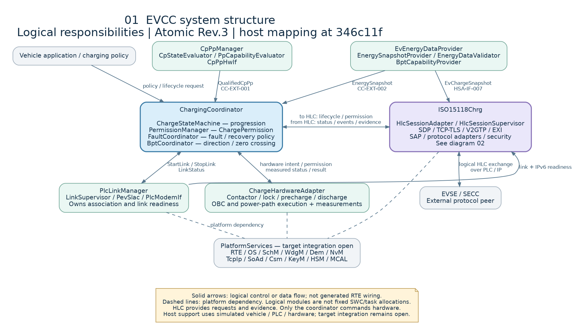
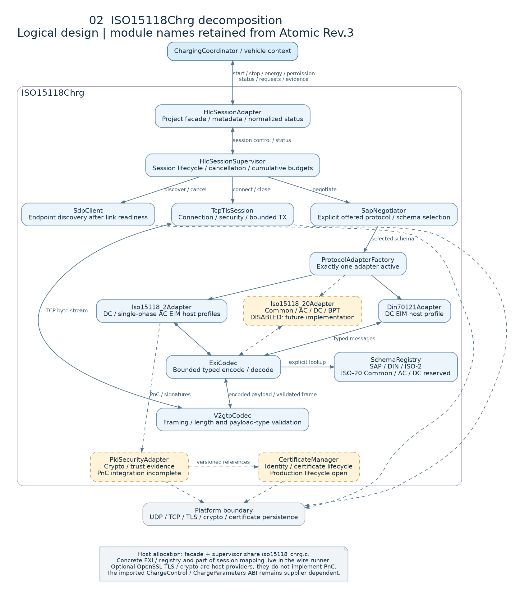
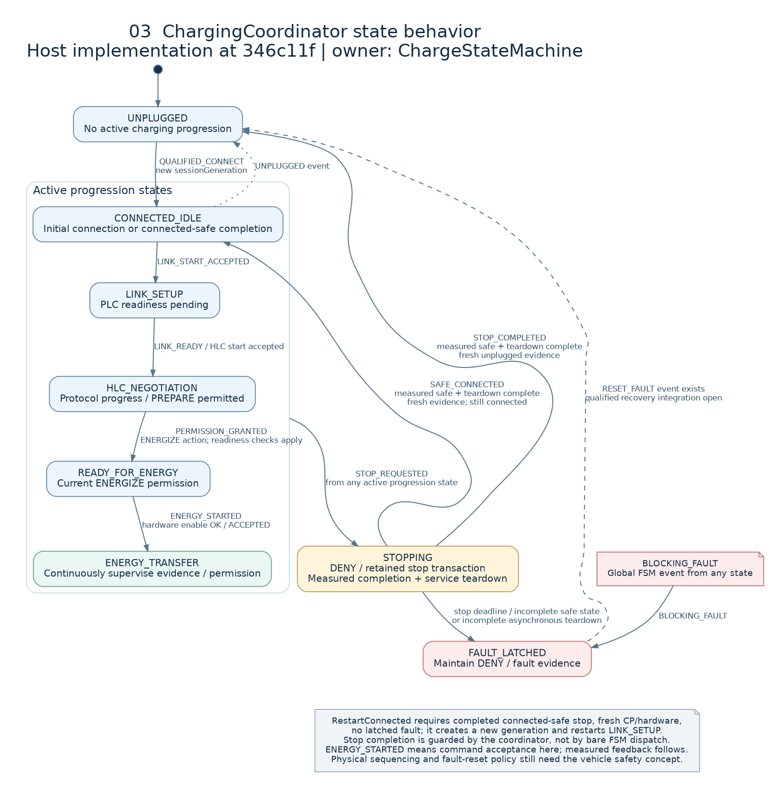
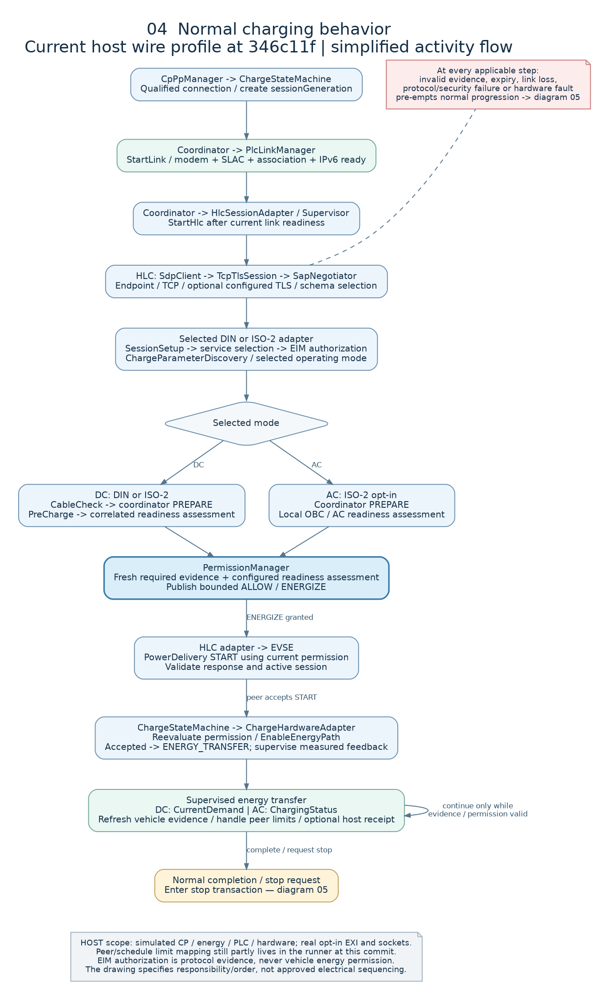
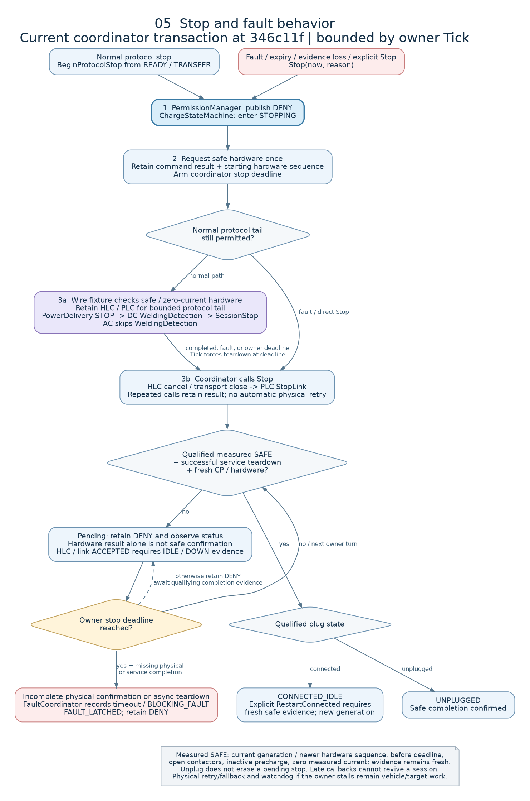

# EVCC structure and behavior diagrams

**Revision:** Draft 0.1 — 30 October 2026.  
**Logical design:** Atomic Interface Specification Rev.3; supporting domains from Architecture Rev.4.  
**Implementation snapshot:** `346c11fda28f91a2fe65316f5a7ab4263ec8081a` — coordinator control-boundary hardening.  
**Status:** architecture communication artifact; not frozen AUTOSAR wiring, a safety allocation or protocol-conformance evidence.

This package answers two questions: **which component owns each responsibility**, and **how the components progress, transfer energy and stop**. Structural diagrams show logical design; behavioral diagrams show the selected host implementation with the qualifications below. They do not imply that every logical subcomponent is a separately deployed SWC or runnable.

Implementation edits were occurring concurrently during preparation. The diagrams deliberately use the commit above, not a mixture of subsequent working-tree changes. The source manifest records the exact reviewed blobs. The earlier [architecture review](reviews/ARCHITECTURE_REVIEW_2026-10-28.md) describes `1bf5613`; several of its findings have since received the [control-boundary increment](CONTROL_BOUNDARY_HARDENING.md).

## Diagram guide

| View | Purpose | Scalable drawing | Editable source |
|---|---|---|---|
| 01 — System structure | Two main compositions, supporting domains and authority boundary | [SVG](diagrams/structure-behavior/01-system-structure.svg) | [DOT](diagrams/structure-behavior/01-system-structure.dot) |
| 02 — HLC decomposition | Facade, supervisor, transport, codec, protocol and security responsibilities | [SVG](diagrams/structure-behavior/02-hlc-decomposition.svg) | [DOT](diagrams/structure-behavior/02-hlc-decomposition.dot) |
| 03 — Coordinator states | Progression, stop completion, connected recovery and fault state | [SVG](diagrams/structure-behavior/03-coordinator-states.svg) | [DOT](diagrams/structure-behavior/03-coordinator-states.dot) |
| 04 — Normal charging flow | Startup, DC/AC readiness, permission, START and energy loop | [SVG](diagrams/structure-behavior/04-normal-charging-flow.svg) | [DOT](diagrams/structure-behavior/04-normal-charging-flow.dot) |
| 05 — Stop and fault flow | DENY first, measured safe state, teardown, timeout and recovery | [SVG](diagrams/structure-behavior/05-stop-fault-flow.svg) | [DOT](diagrams/structure-behavior/05-stop-fault-flow.dot) |

PNG previews below work in Markdown viewers without a diagram renderer. Open SVGs for zooming or reuse in design reviews. Diagrams intentionally group related flows for readability; they do not replace the atomic interface catalogue.

## 01 — System structure



`ChargeStateMachine` owns progression; `PermissionManager` owns `ChargePermission`. HLC may supply a request or evidence, but cannot command a contactor, lock, precharge, converter or discharge action. `PlcLinkManager` owns PEV-SLAC and link readiness; `SdpClient` owns discovery after link/IPv6 readiness.

Blue/purple boxes distinguish the main compositions; green boxes are supporting domains; grey boxes are the environment/platform. Solid arrows describe logical flows, and dashed lines describe platform dependencies. Colours do not constitute safety classifications or verification results.

The current host implements coordinator and HLC logic, but uses simulated vehicle, PLC and hardware surroundings. The intended target dependencies remain AUTOSAR RTE/BSW/MCAL services, with supplier signatures and deployment still open.

## 02 — HLC decomposition



The facade keeps project metadata outside imported `ChargeControl` / `ChargeParameters` types. The supervisor controls lifecycle; exactly one protocol adapter owns protocol state. `SchemaRegistry` selects explicit SAP/DIN/ISO-2 or future ISO-20 Common/AC/DC schemas. V2GTP validates framing before EXI decoding.

The amber dashed modules are future or incomplete integration scope. Optional OpenSSL TLS and software crypto now exist as host providers; they do not complete PnC, signed receipts, transactional certificate provisioning or production HSM integration. At this snapshot, facade and supervisor share `iso15118_chrg.c`; the real codec/registry and part of wire session mapping remain allocated in the Linux runner. Thus the structural drawing is a logical decomposition, not a source-file or deployment map.

SAP also uses the EXI service with the SAP schema. The drawing emphasizes the selected protocol data path; it does not draw every internal call or return. Supervisor-to-factory activation and status propagation are similarly summarized rather than exhaustive call wiring.

## 03 — Coordinator state behavior



The eight state names are retained from Atomic Rev.3. Edge labels below follow the selected implementation, with coordinator-level guards in addition to bare state-machine dispatch.

| From | Event / owner condition | To | Meaning |
|---|---|---|---|
| `UNPLUGGED` | `QUALIFIED_CONNECT` | `CONNECTED_IDLE` | Coordinator creates a new `sessionGeneration`. |
| `CONNECTED_IDLE` | `LINK_START_ACCEPTED` | `LINK_SETUP` | Link owner accepts setup. |
| `LINK_SETUP` | `LINK_READY` after accepted HLC start | `HLC_NEGOTIATION` | Start protocol negotiation. |
| `HLC_NEGOTIATION` | `PERMISSION_GRANTED` with ENERGIZE action | `READY_FOR_ENERGY` | Host readiness/permission evaluation succeeded. |
| `READY_FOR_ENERGY` | `ENERGY_STARTED` | `ENERGY_TRANSFER` | Hardware enable returned OK/ACCEPTED; measured state still requires supervision. |
| Any active progression state | `STOP_REQUESTED` | `STOPPING` | Revoke permission and begin/retain stop transaction. |
| `STOPPING` | `SAFE_CONNECTED` | `CONNECTED_IDLE` | Measured-safe hardware and completed teardown, with fresh connected evidence. |
| `STOPPING` | `STOP_COMPLETED` | `UNPLUGGED` | Same completion guards, with fresh unplugged evidence. |
| `CONNECTED_IDLE` | `UNPLUGGED` FSM event | `UNPLUGGED` | Local FSM edge; ingress/transaction guards still apply. |
| Any state | `BLOCKING_FAULT` FSM event | `FAULT_LATCHED` | Blocking-fault transition; caller owns prior safe-stop actions. |
| `FAULT_LATCHED` | `RESET_FAULT` FSM event | `UNPLUGGED` | Bare edge exists; qualified public recovery policy remains integration work. |

`RestartConnected(now)` is an explicit coordinator operation after connected-safe completion. It requires fresh CP/hardware evidence and no latched fault, creates a new generation, and initiates link setup. It does not resume an old ISO-2 session. Unplug during stopping cannot discard the pending measured-stop transaction.

**Design/implementation distinction:** Atomic §4.3 describes accepted parameters leading to `READY_FOR_ENERGY`, followed by readiness coordination. This implementation keeps preparation in `HLC_NEGOTIATION` and enters `READY_FOR_ENERGY` on an energizing permission. The diagram shows the implementation event, without silently rewriting the source baseline. Likewise, acceptance of an enable command is not a claim that energy physically flows.

## 04 — Normal charging behavior



The diagram follows the host wire path: qualified connection → link → SDP/TCP/optional configured TLS → SAP → selected protocol → service/authentication/parameter negotiation → readiness → permission → START → energy loop.

DC and AC have different readiness paths. DC runs CableCheck and PreCharge; AC uses the explicitly enabled local OBC/readiness fixture. Both must obtain the action-specific permission before energy progression. The wire configuration enables physical assessment; legacy semantic test configurations may disable it. During transfer, the start assessment is historical evidence, while fresh measured ENERGIZED hardware supervises continuation.

These steps name responsibilities, not an approved physical electrical sequence. The wire profile has finite demonstration loops; a real charging session needs vehicle completion policy and continuously acquired evidence. Optional unsigned metering remains a development fixture; authenticated receipts/PnC are not implied.

At every applicable step, rejection/failure takes the error path instead of advancing. Current-source invalidation revokes permission; in ready/transfer states it initiates coordinated stopping. Old-generation and obsolete updates are discarded without reviving or invalidating a newer session. Staleness/expiry is enforced through owner evaluation/ticks; target scheduling and watchdog guarantees are still required.

## 05 — Stop and fault behavior



The order is **revoke permission → request safe hardware → coordinate HLC/PLC termination**. Normal stopping may retain communication for a bounded protocol tail. Fault stopping need not finish that tail. The exact actuator ordering, emergency fallback and physical deadlines require the vehicle safety concept.

`BeginProtocolStop` and `Stop` retain one stop transaction. Repeated calls preserve its result and do not blindly repeat physical commands. A rejected safe-state command remains failed; if measured safety is absent by the owner deadline, a fault is latched. Hardware command acceptance alone cannot complete stopping.

Measured confirmation requires current-generation feedback after the command, a newer hardware sequence, receipt timestamp within the stop interval, SAFE state, open contactors, inactive precharge and zero measured current in this host profile. Completion also requires fresh CP/hardware and HLC/link teardown. An OK HLC/link result means synchronous completion in the project port contract; ACCEPTED requires current IDLE/DOWN status.

If only freshness/result qualification remains unresolved, the diagram's retained-DENY path reflects that completion is not granted. This is not a claim that every recovery case or watchdog failure has a finalized target policy. A stopped owner runnable cannot enforce its own deadline; independent supervision remains external work.

## Trace to the atomic interfaces

Each row below is one existing interface item. Arrows in diagrams 01/04/05 summarize these items; ambiguous source P/R labels are not used to generate ports.

| Existing ID | Element / operation | Semantic producer or caller → consumer or server | Diagram |
|---|---|---|---|
| `CC-EXT-001` | `QualifiedCpPp` | `CpPpManager` → `ChargingCoordinator` | 01, 04 |
| `CC-EXT-002` | `EnergySnapshot` | `EvEnergyDataProvider` → `ChargingCoordinator` | 01, 04 |
| `CC-EXT-003` | `LinkStatus` | `PlcLinkManager` → `ChargingCoordinator` | 01, 04 |
| `CC-EXT-004` | `HlcSessionStatus` | `HlcSessionAdapter` → `ChargingCoordinator` | 01, 05 |
| `CC-EXT-005` | `HlcEvent` | `HlcSessionAdapter` → `ChargingCoordinator` | 01 |
| `CC-EXT-006` | `HardwareStatus` | `ChargeHardwareAdapter` → `ChargingCoordinator` | 01, 05 |
| `CC-EXT-007` | `HardwareCommandResult` | `ChargeHardwareAdapter` → `ChargingCoordinator` | 01, 05 |
| `CC-EXT-008` | `ChargePermission` | `PermissionManager` within coordinator → HLC/hardware | 01, 04, 05 |
| `CC-EXT-009` | `PrepareHardware` | `ChargingCoordinator` → `ChargeHardwareAdapter` | 04 |
| `CC-EXT-010` | `EnableEnergyPath` | `ChargingCoordinator` → `ChargeHardwareAdapter` | 04 |
| `CC-EXT-012` | `RequestSafeState` | `ChargingCoordinator` → `ChargeHardwareAdapter` | 05 |
| `CC-EXT-013` | `StartLink` | `ChargingCoordinator` → `PlcLinkManager` | 01, 04 |
| `CC-EXT-014` | `StopLink` | `ChargingCoordinator` → `PlcLinkManager` | 01, 05 |
| `HSA-IF-001` | `StartHlc` | `ChargingCoordinator` → `HlcSessionAdapter` | 01, 04 |
| `HSA-IF-002` | `StopHlc` | `ChargingCoordinator` → `HlcSessionAdapter` | 01, 05 |
| `HSA-IF-007` | `EvChargeSnapshot` | `EvEnergyDataProvider` → `HlcSessionAdapter` | 01, 02 |
| `HSA-IF-009` | `LinkStatus` | `PlcLinkManager` → `HlcSessionAdapter` | 01, 04 |

This is a diagram trace, not a new ICD or evidence that every source signature is implemented. Exact parameter directions/types, freshness, queue depths and generated RTE mapping remain defined by the atomic specification plus the eventual supplier contract. `CC-EXT-011 StopEnergyPath` remains a source contract; the depicted host transaction uses `RequestSafeState`.

## What remains open at the selected snapshot

| Area | Current host behavior | Remaining design / integration work |
|---|---|---|
| Permission evidence | Current-source invalidation, ordering, required INTERLOCK/LIMITS and configured assessment gate | Explicit protocol authorization/selected-service evidence in the complete permission decision |
| Limits | Manager consumes energy limits; wire runner intersects peer/schedule restrictions | Independent vehicle/cable/charger/schedule ownership and freshness, authoritative intersection |
| Portable HLC allocation | Protocol owners and bounded facade; real EXI through runner mapping | Consolidate reusable SessionID/service/schedule/mapper ownership inside the logical composition |
| Stop | Retained result, measured confirmation, owner deadline and connected restart | Vehicle fallback/retry policy, real command/result correlation, fault recovery and independent watchdog |
| Network and security | Loopback IPv6 SDP/TCP, optional verified OpenSSL host TLS/crypto | Real PEV-SLAC/modem, link-local/multicast integration, supplier TLS/HSM and OEM PKI policy |
| Future scope | Disabled PnC/ISO-20/BPT; guarded BPT semantic model | Full protocol/vehicle implementation; BPT measured zero plus new permission on reversal |
| Deployment | Serialized host owner operations and function ports | Runnables/tasks, ingress queues, WCET/stack, exclusive areas, supplier ARXML/generated ABI |

These are snapshot statements, not claims about concurrent or later changes. No numeric host budget in the source is promoted to a normative timer or vehicle safety deadline.

## Sources, rendering and validation

- [Atomic Interface Specification Rev.3](../EVCC_AUTOSAR_Two_Main_Compositions_Atomic_Interface_Spec_VI.md): §§1–16, 18–26, 28.
- [Detailed Compositions Rev.1](../EVCC_AUTOSAR_Two_Main_Compositions_Detailed_Description_VI.md): §§3–5; subordinate to the atomic revision where definitions differ.
- [Charging Architecture Rev.4](../EVCC_AUTOSAR_Charging_Architecture.md): supporting modules, especially §§9 and 12.
- [Control-boundary hardening](CONTROL_BOUNDARY_HARDENING.md) and [host TLS/crypto](../../simulation/linux/TLS_CRYPTO.md).
- [Coordinator FSM](../../src/charging_coordinator/charge_state_machine.c), [coordinator owner](../../src/charging_coordinator/charging_coordinator.c), [permission manager](../../src/charging_coordinator/permission_manager.c), [wire runner](../../simulation/linux/wire/client.c), each read against the selected commit. File links may display later workspace contents; use the [source manifest](diagrams/structure-behavior/source-manifest.json) for the recorded baseline.

Editable `.dot` files are the drawing sources. Regenerate SVG/PNG with locally installed Graphviz:

```sh
python3 docs/architecture/diagrams/structure-behavior/render.py
```

Validation for this documentation change: all five DOT files rendered to SVG and PNG; rendered images were visually inspected; local document/asset links and SVG XML were checked. Behavioral labels were compared with the pinned source. No implementation tests were rerun, and no new runtime, target or conformance results are claimed.

Revision 0.1 adds these five diagrams and the diagram-to-source explanation. Historical source specifications, the earlier review and prior diagram snapshots are retained unchanged.
