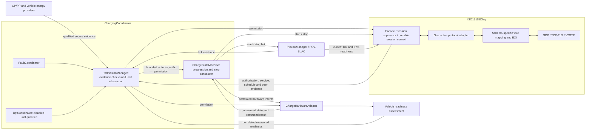

# EVCC architecture review — 28 October 2026

Revision: 0.1. Review baseline: `1bf5613` (`Add gated ISO-2 AC EIM and unsigned host metering`).
Status: review findings and proposed actions; no approval, safety allocation or freeze.

## Assessment

**Keep the two-composition architecture. Its responsibility split is appropriate, but the current host implementation does not yet enforce all of the documented architecture contracts. It is not ready to be frozen as a target AUTOSAR architecture.**

The highest priorities are the integrity of permission evidence, complete readiness/limit ownership, and reliable stop supervision. Adding more protocol features before closing these boundaries would spread responsibility further into integration code.

This review compares Atomic Specification Rev.3 with the detailed composition description, Architecture Rev.4, the current implementation documents and selected C11 execution paths. It examines logical ownership, interfaces, lifecycle, execution and target integration. It is not an exhaustive code audit, a standards-conformance review or a vehicle safety assessment. No source snapshot or implementation file was changed by this review. Review artifacts are added in this directory only.

At the final workspace check, concurrent changes had appeared in `simulation/linux/CMakeLists.txt`, with new `simulation/linux/include/openv2g/linux/tls.h` and `simulation/linux/src/tls.c`. These were not made or assessed by this review. TLS capability statements here describe the reviewed baseline, not those concurrent changes.

The historical handoff statement that implementation/test evidence was unavailable is superseded in scope by the later host supplements. Those supplements provide host evidence; the supplier/vehicle/target gates in `DECISIONS.md` remain open.

## What should be retained

| Architectural choice | Assessment |
|---|---|
| `ChargingCoordinator` and `ISO15118Chrg` | Retain. Separate vehicle charging authority from communication/protocol state. There is no reason to merge them or add a third main composition. |
| `ChargeStateMachine`, `PermissionManager`, `FaultCoordinator`, `BptCoordinator` | Retain their distinct logical ownership. Do not infer that each must become a separately scheduled SWC. |
| HLC produces requests/evidence; coordinator commands hardware | Correct boundary. No direct HLC-to-actuator path was found in the inspected paths. Implementation gaps below concern the completeness of the coordinator gate. |
| `PlcLinkManager` owns PEV-SLAC; HLC owns SDP | Correct separation. The host network path and simulated PLC do not establish real modem/SLAC integration. |
| One active protocol adapter; explicit schema selection | Retain. SAP, DIN, ISO-2 and later ISO-20 Common/AC/DC must retain distinct schema identities and generated bindings. |
| Project facade around imported AUTOSAR interfaces | Retain. Project generations, timestamps and correlation IDs belong in envelopes; exact imported ABI remains supplier dependent. |
| Bounded resources, generations, authoritative status and idempotent cancellation | Strong design intent with meaningful host coverage. Enforcement is uneven across input and lifecycle paths. |
| Disabled PnC/ISO-20/BPT and explicit AC/security opt-ins | Appropriate representation of current capability. A simulated TLS result or unsigned receipt is not cryptographic assurance. |

## Findings, in priority order

P1 means close before treating the reusable control core as a dependable integration baseline. P2 means close before architecture/target freeze. These priorities are review judgments, not ASIL or normative classifications. Finding numbers are local to this review and are not requirement IDs.

### 1. P1 — Invalid and reordered input updates do not reliably invalidate permission evidence

**Observed implementation gap; host reproduced.** `ChargingCoordinator_OnEnergySnapshot` rejects a current-generation `INVALID` sample but leaves `has_energy` and the previous valid snapshot intact. A subsequent permission evaluation can renew `ALLOW` using that snapshot until its age expires. The provider similarly rejects invalid publications without invalidating its retained sample. The coordinator's energy input also accepts an older timestamp/sequence within the same generation.

The probe confirmed both cases: an invalid current energy update followed by evaluation still allowed energy, and an older higher-current limit replaced a newer lower limit. Returning `REJECTED` is insufficient unless every caller is explicitly responsible for revocation; this responsibility is neither encapsulated nor consistent with the retained-state contract.

Evidence: [coordinator input handlers](../../../src/charging_coordinator/charging_coordinator.c), lines 152–164, 167–244 and 285–309; [energy provider](../../../src/support/energy_data_provider.c), lines 14–30. Baseline: Atomic §§1.1, 5.3, 25, 34; `CC-EXT-002`.

**Proposed correction:** distinguish obsolete/unrelated callbacks from authoritative current-source invalidation. Discard obsolete generations without corrupting the active session; consume current-source invalidation as evidence loss and revoke before further progression. Define per-producer monotonic sequence rules, duplicate handling, wrap/reset semantics and timestamp checks. Use receiver/owner time for age and reaction decisions. Apply this policy across CP/PP, energy, link, HLC and hardware inputs.

**Closure:** regression cases for valid→invalid, valid→stale, newer lower limit→older higher limit, duplicate updates and old-generation invalidation. No current-source invalidation may renew permission using the superseded sample.

### 2. P1 — `ChargePermission` does not contain the full readiness decision

**Observed implementation gap; host reproduced.** The manager checks coarse HLC state, hardware state, interlock and selected limits. It does not check required energy availability, correlated physical assessment, or explicit authorization/negotiated-service readiness. `OpenV2g_HlcSessionStatus` alone cannot establish these facts. `ALLOW/ENERGIZE` is selected when hardware is `READY` or `ENERGIZED`.

Physical assessment is checked separately in `RequestEnergyTransfer`, and can be disabled by configuration. Even with it enabled, the probe obtained `ALLOW/ENERGIZE` with no assessment and an empty energy availability mask. The local energy-enable operation correctly rejected the request, but the published permission remained `ALLOW`. HLC and hardware consumers therefore do not receive one complete authorization decision. This does not demonstrate physical vehicle energization; it demonstrates an incomplete shared contract.

Evidence: [permission manager](../../../src/charging_coordinator/permission_manager.c), lines 74–102 and 148–162; [permission evidence type](../../../include/openv2g/charging_coordinator/permission_manager.h); [assessment and enable](../../../src/charging_coordinator/charging_coordinator.c), lines 376–425. The existing [permission test](../../../tests/unit/test_permission_manager.c) also allows energy with zero-initialized availability/physical fields. Baseline: Atomic §§5.3, 24, 27; `PM-IF-006`, `HSA-IF-008`.

**Proposed correction:** make permission action-specific. Define the required evidence set for preparation, energy start and continued transfer in DC and AC. Feed qualified vehicle readiness, protocol authorization/service evidence and assessment correlation into the manager before publishing an energizing permission. Keep the final hardware gate as an additional check. Do not require final precharge readiness to grant the preparation action needed to establish it.

Vehicle-derived thresholds remain open under `OP-005`; the evidence types, availability semantics and fail-deny behavior can be implemented now without inventing those thresholds.

**Closure:** every missing/invalid required evidence item denies the affected action; a failed assessment cannot coexist with an energizing permission; HLC START and hardware enable consume the same decision.

### 3. P1 — Limit calculation is partly owned by the Linux wire runner

**Observed allocation gap.** Atomic §5.3 assigns the intersection of vehicle, battery, thermal, cable, charger and topology limits to `PermissionManager`. The implementation copies `energy.limits`. In the wire path, `client.c` calculates charger/schedule intersections, stores them as `peer_limits`, then replaces the simulated vehicle energy limits during refresh. It also owns schedule expiry and subsequent peer-limit reductions.

This works within the closed fixture but mixes vehicle capability with peer restrictions, losing independent provenance and freshness. A target integration using only the core interfaces does not inherit these checks. Reusing a stored intersection in place of a new vehicle limit could also hide later vehicle derating unless the new integration explicitly recomputes it.

Evidence: [permission manager](../../../src/charging_coordinator/permission_manager.c), line 161; [wire client](../../../simulation/linux/wire/client.c), lines 25–48, 61–63, 243–254 and 286–304; [current project types](../../../include/openv2g/common/types.h), lines 223–263. The CP/PP host type has no cable-current capability field. Baseline: `PM-IF-005/006`, `HSA-IF-010/011`, Atomic §5.3.

**Proposed correction:** retain separate immutable vehicle/cable capability and negotiated peer/schedule evidence, each with generation, source identity and validity. Have `PermissionManager` calculate the permitted envelope. Let protocol data-flow code project requested targets into that envelope. Keep socket code responsible for transport and mapping, without owning vehicle policy.

**Closure:** independent vehicle derating, charger derating, cable limit and schedule-expiry tests all reduce/revoke permission without rewriting the source vehicle capability snapshot.

### 4. P1 — Stop acceptance is not tracked through failure and measured completion

**Observed implementation gap; failed request host reproduced.** `Stop` sets `teardown_started` before requesting the hardware safe state. If that request fails, the function returns failure, but later calls return `OK` without retrying or retaining the failure result. The probe rejected the safe-state request after simulated energization: only one safe-state attempt occurred, the second `Stop` returned `OK`, and the host hardware remained energized. Permission was correctly revoked first.

There is also no coordinator dispatch of `STOP_COMPLETED` from measured hardware feedback. The state-machine branch maps completion to `UNPLUGGED` regardless of connected state, whereas Atomic §4.3 allows connected/unplugged recovery after safe confirmation. A full stopped-while-plugged restart path is therefore not represented by the current coordinator implementation.

Evidence: [coordinator stop](../../../src/charging_coordinator/charging_coordinator.c), lines 463–537; [hardware status handler](../../../src/charging_coordinator/charging_coordinator.c), lines 285–309; [state machine](../../../src/charging_coordinator/charge_state_machine.c), lines 72–83. Baseline: `CC-EXT-007/011/012`, Atomic §§4.3, 25.

**Proposed correction:** retain a stop transaction with command ID, acceptance/result, measured completion, deadline and terminal outcome. Repeated stop calls should observe that transaction and preserve/escalate failure. Determine retry versus emergency fallback from the vehicle contract; do not blindly repeat physical actions. Define connected-safe recovery separately from unplugged recovery, including fault-clear guards.

**Closure:** rejected/BUSY safe-state command, missing feedback, hardware mismatch, repeated stop, unplug during stop and connected-safe completion. Completion must depend on qualified measured state, not a command return value.

### 5. P1 — Expiry and bounded stopping depend on caller ordering and runner budgets

**Observed implementation gap; host reproduced.** The wire supervisor explicitly calls coordinator `Tick` before renewal. The public `EvaluatePermission` path does not enforce that ordering: the probe renewed an already expired permission while source evidence remained within its age limits. Moving to another scheduler could silently lose the intended expiry reaction.

`BeginProtocolStop` revokes permission and retains HLC/PLC for the protocol tail. Its API delegates later teardown to the caller. Coordinator `Tick` only checks an allowed permission's expiry; after revocation it does not impose a protocol-stop deadline. The probe advanced time substantially and left HLC active in `STOPPING`. The wire runner does impose per-exchange timeout and a finite session loop guard, so the tested runner is bounded; that guarantee is not owned by the core. Per-state cumulative Ongoing budgets are already listed as incomplete.

Evidence: [coordinator](../../../src/charging_coordinator/charging_coordinator.c), lines 312–373, 441–460 and 520–537; [wire supervision](../../../simulation/linux/wire/client.c), lines 51–71 and 330–341; [wire exchange timeout](../../../simulation/linux/wire/io.c), lines 103–115; [incomplete items](../INCOMPLETE_ITEMS.md). Baseline: Atomic §§4.3, 10 and 25; `OP-004/006`.

**Proposed correction:** make expiry detection part of the authoritative evaluation/transition path so a missed deadline cannot be erased by renewal. Assign explicit owners and arm/cancel rules for link setup, HLC setup, message response, cumulative protocol processing and physical/protocol stop. Keep physical stop supervision independent of network progress. Specify hardware/watchdog behavior if the coordinator runnable itself stops executing.

**Closure:** late owner execution, renewal at/after expiry, repeated Ongoing responses, stalled protocol tail and blocked communication work. Use provisional configurable test budgets; normative values and vehicle reaction deadlines remain external decisions.

### 6. P2 — Essential HLC session logic still lives outside the reusable composition

**Observed implementation allocation; already partly documented.** The wire runner retains SessionID/EVSE identity, selected service/schedule, pending correlation, codec bindings and response checks. HLC's `exi_codec` and `schema_registry` members are lifecycle placeholders rather than the concrete codec instances used on the wire. The architecture document acknowledges this split.

Consequently, replacing POSIX with SoAd/TcpIp is more than a transport adapter task: the target must also preserve session-validation and mapper state that currently lives under `simulation/`. Leaving two representations called ExiCodec/SchemaRegistry obscures which instance owns configuration, cancellation and diagnostics.

Evidence: [wire client](../../../simulation/linux/wire/client.c), lines 186–328; [HLC structure](../../../include/openv2g/iso15118_chrg/iso15118_chrg.h), lines 54–82; [current architecture](../CURRENT_IMPLEMENTATION_ARCHITECTURE.md), §2.

**Proposed correction:** allocate a portable session context and schema-specific wire mapping within the logical `ISO15118Chrg` boundary, with injected codec/transport services. Move reusable identity, service, schedule and response-validation behavior out of the Linux executable. Keep simulated CP/energy/hardware and POSIX pump in the harness. This is an allocation refinement within the existing composition.

**Closure:** run the same session owner/mapping logic with a deterministic fake transport and the socket transport; both reject wrong session, unexpected response, schema mismatch and late completion without fixture-only policy.

### 7. P2 — Execution/deployment architecture is still a proposal, not an enforceable binding

**Known open decision with concrete implementation impact.** Core `On*` functions can directly transition state and invoke other components: `OnLinkStatus` starts HLC; `OnProtocolMessage` invokes the active adapter. These are usable as serialized owner operations in the host runner. They are not suitable for direct concurrent BSW/ISR callback wiring without an ingress layer. This review did not execute concurrent race tests and does not claim a demonstrated race in the current single-threaded runner.

The target runnable/task/queue/exclusive-area mapping, execution budgets, resource partitioning, watchdog reaction and exact supplier ABI remain unavailable. Function ports provide a useful seam, but `Rte_Call` replacement alone cannot establish timing, isolation or single-writer behavior. Decide explicitly whether the custom HLC internals are the target implementation or a host reference to be replaced by a supplier service; either choice needs a concrete allocation/mapping.

Evidence: [coordinator](../../../src/charging_coordinator/charging_coordinator.c), lines 167–211; [HLC dispatch](../../../src/iso15118_chrg/iso15118_chrg.c), lines 809–898; [provisional interface style](../PROVISIONAL_ASR_INTERFACE_STYLE.md), §§2, 6; [AUTOSAR boundary](../../../integration/autosar/README.md). Related `OP-001/002/004/007/008`, `HF-001`.

**Proposed correction:** define a deployment table per owner: runnable, activation source, serialization mechanism, ingress queue/capacity, overflow reaction, buffer lifetime, task priority/period, WCET/stack budget and watchdog action. Keep BSW callbacks bounded to copy/notify; owner operations consume them. Review parser/crypto resource isolation from vehicle control using the eventual safety/cybersecurity allocation. Resolve C/S server/client ownership operation by operation before ARXML generation, including `CC-EXT-009…017`.

**Closure:** reviewed execution contract, queue/cancel stress tests, target measurements and generated interface mapping. Host scheduling rules can be specified now; target numeric budgets and safety allocations must wait for actual platform evidence.

### 8. P2 — The architecture views need a consistent current baseline

**Observed documentation drift; source history should be preserved.** `CURRENT_IMPLEMENTATION_ARCHITECTURE.md` is explicitly based on `70ced6a`, describes DC and injected SDP, and shows older check totals. Current HEAD includes single-phase AC, unsigned metering and unicast IPv6 SDP/TCP. `INCOMPLETE_ITEMS.md` records those increments. These are individually scoped documents, but a reader following the “current architecture” link can mistake the older diagram for HEAD behavior.

The source atomic catalogue also retains the known P/R ambiguity (`HF-001`). Historical source documents must not be silently edited to pretend it has been resolved against generated ARXML.

Evidence: [current architecture](../CURRENT_IMPLEMENTATION_ARCHITECTURE.md), revision header and §§1, 3, 4; [current incomplete items](../INCOMPLETE_ITEMS.md), updated-increment and network rows; [decision log](../../../DECISIONS.md).

**Proposed correction:** publish a revisioned current implementation view referencing one commit, with separate logical, execution, deployment and feature/evidence views. Keep source snapshots and link their differences explicitly. Track supported, disabled, simulated and externally blocked behavior separately.

**Closure:** each diagram and verification count names its scope/commit; one index entry identifies the authoritative current implementation view. No formal freeze should be inferred from this documentation update.

## Recommended allocation after these corrections — proposed

The view below describes intended logical ownership. It is not an AUTOSAR SWC/runnable allocation or a claim that all edges exist today.



## Verification performed in this review

A clean GCC 13.3.0 C11 build with strict warnings passed **18/18 portable host tests**. Linux socket stubs and the opt-in generated EXI candidate were disabled for this review build. This is not a rerun of the previously documented 28-test candidate/oracle suite or sanitizer runs.

Six additional review probes reproduced the observations in findings 1, 2, 4 and 5. Their assertions deliberately confirm existing gaps; they are not acceptance tests for desired behavior. Preserve them as evidence and invert the relevant expectations when implementing fixes. Source: [architecture probe](evidence/architecture_probe_20261028.c).

```sh
cmake -S . -B /tmp/openv2g-architecture-review-20261028 \
  -DOPENV2G_BUILD_LINUX_STUBS=OFF \
  -DOPENV2G_ENABLE_CBV2G_SAP_POC=OFF
cmake --build /tmp/openv2g-architecture-review-20261028 -j 4
ctest --test-dir /tmp/openv2g-architecture-review-20261028 --output-on-failure
cc -std=c11 -Wall -Wextra -Werror -Iinclude -Isimulation/include \
  docs/architecture/reviews/evidence/architecture_probe_20261028.c \
  /tmp/openv2g-architecture-review-20261028/simulation/libopenv2g_host_sim.a \
  /tmp/openv2g-architecture-review-20261028/libopenv2g_core.a \
  -o /tmp/openv2g-architecture-review-20261028/architecture_probe
/tmp/openv2g-architecture-review-20261028/architecture_probe
```

Observed probe output:

```text
invalid-current-energy: rejected update; cached evidence still renews ALLOW
reordered-current-energy: older same-generation sample replaces lower current limit
incomplete-readiness: ENERGIZE permission with no assessment/availability; local enable correctly rejected
expired-permission: direct evaluation renews expired ALLOW unless caller ticks first
protocol-stop: later coordinator tick leaves HLC active; no core stop deadline
rejected-safe-state: second Stop reports OK; no retry/escalation; host hardware remains energized
```

No target AUTOSAR build, actual EVSE session, PLC modem, electrical hardware, real TLS/PKI, WCET, safety approval or standards conformance was verified in this review.

## Recommended next work

1. Close findings 1, 2, 4 and 5 with explicit contract changes and regression tests. These are actionable host/core issues, not wholly blocked by external decisions.
2. Refactor limit evidence and portable HLC session/mapping ownership (findings 3 and 6), preserving the two-composition model and public imported ABI boundary.
3. Publish the execution/deployment proposal and refreshed architecture views (findings 7 and 8); obtain the actual supplier/vehicle inputs needed to close the existing `OP-*` gates.
4. Resume wider protocol feature completion against that stronger baseline. Keep PnC, ISO-20 and BPT qualification distinct from DIN/ISO-2 EIM host progress.

Architecture freeze should require both closure of the actionable control-boundary findings and versioned external evidence for the selected release. This review does not assign owners, dates, normative deadlines or formal approval.
